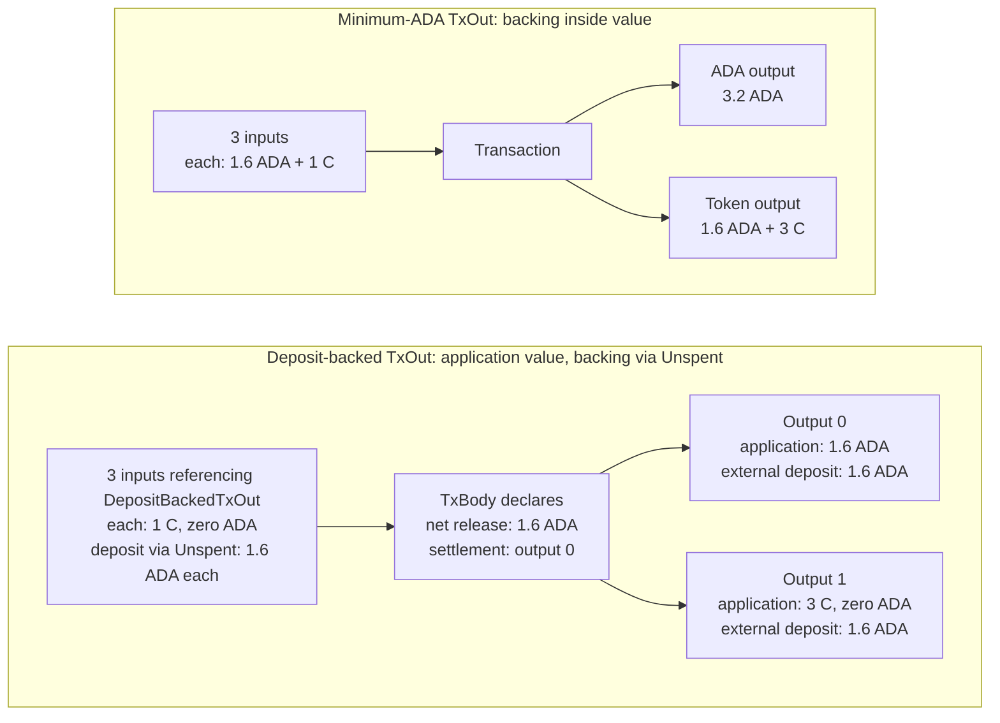
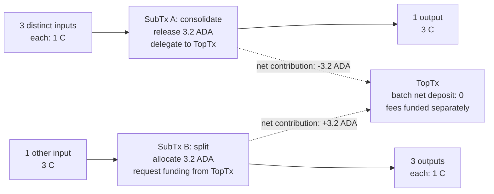
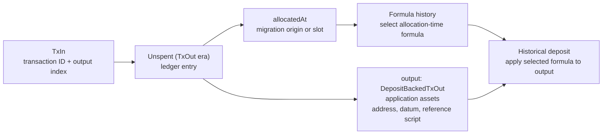
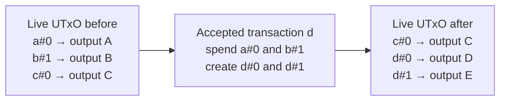

**Table of contents**

- [1. Abstract](#1-abstract)
- [2. Motivation: Why is this CIP necessary?](#2-motivation-why-is-this-cip-necessary)
  - [2.1 Application value independent of resource funding](#21-application-value-independent-of-resource-funding)
  - [2.2 Transaction-level netting](#22-transaction-level-netting)
  - [2.3 ADA-free SubTxs](#23-ada-free-subtxs)
  - [2.4 Asset-free TxOuts](#24-asset-free-txouts)
  - [2.5 A predictable deposit calculation](#25-a-predictable-deposit-calculation)
  - [2.6 Pricing evolution and compatibility](#26-pricing-evolution-and-compatibility)
- [3. Specification](#3-specification)
  - [3.1 Moving minUTxO accounting from TxOuts to transactions](#31-moving-minutxo-accounting-from-txouts-to-transactions)
    - [3.1.1 Builder experience: consolidating token outputs](#311-builder-experience-consolidating-token-outputs)
    - [3.1.2 TxBody deposit declarations](#312-txbody-deposit-declarations)
    - [3.1.3 Netting and the transaction balance](#313-netting-and-the-transaction-balance)
    - [3.1.4 Release authority and settlement](#314-release-authority-and-settlement)
    - [3.1.5 An ADA-free SubTx under formula V1](#315-an-ada-free-subtx-under-formula-v1)
    - [3.1.6 Script outcomes and collateral](#316-script-outcomes-and-collateral)
    - [3.1.7 Scope and terminology](#317-scope-and-terminology)
  - [3.2 Deposit model](#32-deposit-model)
    - [3.2.1 The live UTxO resource](#321-the-live-utxo-resource)
    - [3.2.2 Output representation](#322-output-representation)
    - [3.2.3 Dependency on UTxO Storage Cost Formula](#323-dependency-on-utxo-storage-cost-formula)
    - [3.2.4 Allocation history and the Store invariant](#324-allocation-history-and-the-store-invariant)
  - [3.3 Lifecycle and compatibility](#33-lifecycle-and-compatibility)
    - [3.3.1 Parameter changes and migration](#331-parameter-changes-and-migration)
    - [3.3.2 Stake, voting and monetary conservation](#332-stake-voting-and-monetary-conservation)
    - [3.3.3 Encoding validation and versioning](#333-encoding-validation-and-versioning)
- [4. Rationale: How does this CIP achieve its goals?](#4-rationale-how-does-this-cip-achieve-its-goals)
  - [4.1 Application value and funding](#41-application-value-and-funding)
  - [4.2 Evaluation against the CPS use cases](#42-evaluation-against-the-cps-use-cases)
  - [4.3 Responses to the CPS questions](#43-responses-to-the-cps-questions)
  - [4.4 Alternatives considered](#44-alternatives-considered)
  - [4.5 Resource protection and implementation costs](#45-resource-protection-and-implementation-costs)
  - [4.6 Author TODOs](#46-author-todos)
    - [4.6.1 Plutus compatibility](#461-plutus-compatibility)
    - [4.6.2 Local release guarantees](#462-local-release-guarantees)
    - [4.6.3 Pricing and activation](#463-pricing-and-activation)
    - [4.6.4 Declarations](#464-declarations)
    - [4.6.5 Stake and voting](#465-stake-and-voting)
    - [4.6.6 Integration and validation](#466-integration-and-validation)
- [5. Path to Active](#5-path-to-active)
  - [5.1 Acceptance Criteria](#51-acceptance-criteria)
  - [5.2 Implementation Plan](#52-implementation-plan)
- [6. References](#6-references)
- [7. Copyright](#7-copyright)

## 1. Abstract

This CIP continues the community work on minUTxO described in
[CPS-0037](../CPS-0037/README.md#acknowledgements), including discussions at
BuidlerFest in Argentina. We thank
[@Crypto2099](https://github.com/Crypto2099),
[@lehins](https://github.com/lehins),
[@ch1bo](https://github.com/ch1bo),
[@matteocoppola](https://github.com/matteocoppola), and
[@padierfind](https://github.com/padierfind) for sharing ideas and contributing to
the discussions that made this proposal possible. The design presented here
builds on that collective effort and carries it forward into a concrete ledger
proposal.

*And to everyone who has ever sighed at yet another minUTxO top-up: this one's for
you. We're working to make your life a little easier from here on.*

This proposal introduces deposit-backed TxOuts alongside minimum-ADA TxOuts, with
explicit UTxO capacity deposits and transaction-level netting. A deposit-backed
TxOut carries application assets, including zero ADA, with its full deposit
accounted for separately by the ledger. Spending releases its original deposit
through the output's spending authority. Both output forms can be created and
spent after activation.

Transactions fund the difference between new deposits and released deposits.
Sub-transactions can delegate deposit funding or release accounting to the
enclosing transaction, enabling native-asset transfers with zero application ADA
while the enclosing transaction funds fees and any additional deposit requirement.

This CIP depends on the separate [UTxO Storage Cost Formula](../CIP-????-utxo-cost-formula/README.md)
proposal for the calculation shared by both output forms. That proposal removes
the fixed-point problem and the need for byte-perfect output sizing. This CIP
introduces the accounting mechanism that starts at the hard fork with that
formula and preserves each deposit's original amount across future formula
versions and parameter changes.

## 2. Motivation: Why is this CIP necessary?

Cardano nodes retain and maintain every live UTxO. Requiring ADA to remain committed
while an output occupies that resource provides an economic deterrent against
excessive use. [CPS-0037](../CPS-0037/README.md) distinguishes this necessary resource
cost from the application friction caused by requiring the ADA inside each output.

This CIP preserves that deterrence principle while changing how applications
express and fund their use of UTxO capacity. The objective is to make resource
funding a transaction-level concern, allowing application outputs to describe the
assets and state they are intended to carry.

### 2.1 Application value independent of resource funding

Under the current rule, the ADA in an output serves both the application and the
minimum-ADA requirement. A token payment must therefore include ADA controlled by
the recipient, and an application must manage backing ADA alongside its state.
These obligations affect what the application can express:

| Application intent | Current output requirement | With the proposed output form |
| --- | --- | --- |
| Transfer native tokens | Include ADA even when no ADA payment is intended. | Express the token payment with zero application ADA. |
| Transfer ADA below the current minimum | Increase the payment to the output's minimum. | Preserve the intended payment amount. |
| Maintain a datum or reference script | Carry backing ADA in the application's output value. | Keep the backing separate from application value. |

In each case, the creating transaction funds a full deposit outside the output's
application value. This separation gives applications control over the values they
transfer; it does not remove the cost of keeping an output live. An ADA-bearing
output using the new form commits its application ADA **plus** its deposit, whereas
ADA in a min-ADA output can serve both roles.

### 2.2 Transaction-level netting

A transaction consumes and creates outputs together. ADA from consumed outputs
can already fund new outputs under the current rules. This CIP makes the resource
funding explicit at that same boundary: deposits released by spent outputs offset
deposits required by new outputs, and the transaction settles the difference.

The builder accounts for a single net deposit change in the transaction balance.
This applies to standalone transactions as well as batches containing SubTxs.

### 2.3 ADA-free SubTxs

A SubTx can ask the enclosing transaction to fund its deposit requirement,
allowing a user to author a token operation with zero application ADA in its inputs
and outputs. It can also delegate a deposit release for use elsewhere in the batch.
For example, one user's consolidation can release backing needed by another user's
split into several outputs.

Users can therefore separate the token operation they author from its ADA funding.
The enclosing transaction combines the deposit contributions; funding for fees and
any remaining shortfall must be arranged when assembling the complete transaction.

### 2.4 Asset-free TxOuts

Some outputs exist to publish a datum or make a reference script available. A
`DepositBackedTxOut` can serve this purpose with **zero application ADA and no native tokens**.
Applications can therefore represent data or code without adding ADA to the output
solely to satisfy minUTxO.

These outputs still occupy UTxO capacity. Their full calculated deposit enters the
creating transaction's deposit balance, including the base requirement and any
datum or script payload charges. Spending the output releases its historical
deposit under the same spending and settlement rules as other `DepositBackedTxOut` outputs.

### 2.5 A predictable deposit calculation

Separating the deposit also needs a calculation that is straightforward for wallets
and transaction builders. The current minimum depends on the output's serialized
size, including the ADA amount being chosen. Adding ADA can change that size and
raise the minimum again. Independently, reproducing the exact size couples deposit
calculation to the output's serialization details.

The separate [UTxO Storage Cost Formula](../CIP-????-utxo-cost-formula/README.md) CIP
addresses both problems. This proposal depends on its calculation and applies the
result to explicit deposits, alongside its use for minimum-ADA TxOuts. The formula
can improve minimum-ADA calculation independently of adopting deposit-backed
outputs. Payload measurements, transaction-fee calculation and final balancing
still apply.

### 2.6 Pricing evolution and compatibility

The cost assigned to UTxO capacity must be able to evolve without changing the
amount recoverable from an existing deposit. This CIP introduces a new accounting
mechanism at the hard fork, starting with V1 defined by the required formula CIP.
It retains the information needed to release each deposit at its original amount, while allowing
future formula versions and parameter changes to price new allocations.

An application replacing an output can use its released deposit toward the new
requirement. Any shortfall needs funding; any excess is handled by the transaction's
release rules. Min-ADA outputs remain supported, and migration does not attempt to
reconstruct their pre-fork creation prices.

The [specification](#3-specification) begins with concrete transaction-construction
examples, then defines the body fields, output representation and accounting rules.
The [rationale](#4-rationale-how-does-this-cip-achieve-its-goals) evaluates the benefits
and trade-offs against all seven CPS use cases.

## 3. Specification

### 3.1 Moving minUTxO accounting from TxOuts to transactions

The proposal changes the transaction-construction interface: a builder describes
application outputs and declares the **net UTxO deposit change in `TxBody`**. The
balance of the complete transaction funds that change. The resource being
protected remains the live UTxO set stored and maintained by nodes. ADA stays
committed while outputs occupy that resource, preserving the economic deterrence
principle described in CPS-0037.

A transaction creates and consumes outputs together. This is the boundary at which
released backing and new requirements can be netted. The following example makes
the change in the builder's experience concrete; the body-field specification and
validation rules follow it. The new output representation and ledger-state
adaptations are specified in §3.2.

The examples distinguish the transaction output from its ledger entry.
`DepositBackedTxOut` contains application assets with no embedded minimum ADA. The ledger
wraps it in `Unspent (TxOut era)`, whose allocation origin, together with formula
history, determines the deposit associated with that live output. An input is a
reference to this entry. The deposit is accounted outside the `DepositBackedTxOut` value;
the wrapper's actual fields and this lookup are shown in §3.2.1.

#### 3.1.1 Builder experience: consolidating token outputs

Consider three inputs, each carrying one unit of token C, consolidated into one
output carrying three units. For this illustration, assume **each depicted output
requires 1.6 ADA of backing**, both historically and when created. This constant
requirement is an accounting example, not the V1 formula or a real parameter
setting. Fees and their funding inputs/change are omitted from both diagrams;
assume that funding uses valid min-ADA outputs and adds no external-deposit change.



The existing builder puts enough ADA inside the token output to satisfy its minimum.
Its remaining 3.2 ADA can go to the ADA output, whose value also satisfies its own
minimum. With the proposed form, the token output expresses exactly `3 C`. The
builder accounts for both new outputs' deposits in the transaction balance:

```text
Historical deposits released by the 3 inputs   = 3 × 1.6 = 4.8 ADA
New token output's external deposit           =           1.6 ADA
New ADA settlement output's external deposit  =           1.6 ADA
Net deposit change                           = 3.2 − 4.8 = −1.6 ADA
Application ADA available for output 0        =           1.6 ADA
```

The additional field in the enclosing transaction body is, in CBOR diagnostic
notation (other body fields omitted):

```text
28: [1, 1600000, [1, 0]]
     │      │       └─ settle into this body's output at index 0
     │      └───────── amount in lovelace
     └──────────────── net release
```

Output 0 already contains the 1.6 ADA release in its application value. The
body declaration records and constrains that settlement; it creates no second
payment. The new ADA settlement output needs its own external deposit: its
serialized ADA value is 1.6, compared with 3.2 in the min-ADA output, and the
other 1.6 is held separately as backing. Funding is separated from the application
value, and every new output remains backed.

**Composition can reuse a release directly.** A SubTx that consolidates three
`DepositBackedTxOut` token outputs into one releases 3.2 ADA when it creates no separate
ADA settlement output. It can delegate that release to TopTx. Another SubTx can
consume a distinct three-token input and request 3.2 ADA to split it into three
outputs. Under the same illustrative pricing, their net changes cancel:



All depicted SubTx inputs and outputs have zero application ADA. The corresponding
body-field fragments are:

```text
SubTx A   28: [1, 3200000, [1]]   -- release, delegated to TopTx
SubTx B   28: [2, 3200000]        -- request deposit funding from TopTx
TopTx     28: [2]                -- explicit zero for the complete batch
```

There is no deposit-release output in this batch. The released backing funds the
new allocations through the complete transaction's balance. Fees still require
funding. This is the construction flow enabled by the proposal: express the token
operations, declare their deposit contributions and funding choices, then balance
the enclosing transaction.

#### 3.1.2 TxBody deposit declarations

TopTx is the enclosing transaction; SubTx is a body composed into it. A standalone
transaction is a TopTx with no SubTxs. Each body carries a deposit declaration
specific to its level. Amounts use lovelace.

**Haskell interface.** The implementation adds the following fields to its body
constructors. This excerpt shows only those fields; the existing input, output,
fee and other fields are omitted.

```haskell
data DijkstraTxBodyRaw l era where
  DijkstraTxBodyRaw ::
    { dtbrNetUTxODepositChange :: !TopTxUTxODepositDeclaration
    } ->
    DijkstraTxBodyRaw TopTx era
  DijkstraSubTxBodyRaw ::
    { dstbrNetUTxODepositChange :: !SubTxUTxODepositDeclaration
    } ->
    DijkstraTxBodyRaw SubTx era
```

The declaration payloads describe zero, allocation or release, together with the
funding or settlement choice. These are the implementation's types, with
deriving clauses omitted:

```haskell
-- TopTx: net change for the complete transaction batch.
data NetUTxODepositChange
  = NoUTxODepositChange
  | AllocateUTxODeposit !StrictlyPositiveCoin
  | ReleaseUTxODeposit !StrictlyPositiveCoin !TopTxReleaseSettlement

data TopTxReleaseSettlement
  = NoTopTxSettlement
  | TopTxSettlementOutput !TxIx

-- SubTx: its own contribution and funding or settlement choice.
data SubTxNetUTxODepositChange
  = SubTxNoUTxODepositChange
  | SubTxAllocateUTxODeposit !StrictlyPositiveCoin
  | SubTxRequestUTxODepositFromTopTx !StrictlyPositiveCoin
  | SubTxReleaseUTxODeposit !StrictlyPositiveCoin !SubTxReleaseTarget

data SubTxReleaseTarget
  = SubTxSettlementOutput !TxIx
  | DelegateToTopTx
```

`TopTxUTxODepositDeclaration` and `SubTxUTxODepositDeclaration` wrap their respective
payloads in `StrictMaybe`. This preserves the distinction between an absent field
and an explicit zero: `NoUTxODepositChange` and `SubTxNoUTxODepositChange` are
present zero declarations. The public `NoUTxODepositDeclaration` pattern in each
module represents absence. The wrappers' constructors are private; builders use
the exported patterns, as in the examples below. `StrictlyPositiveCoin` is a
checked positive lovelace amount, and `TxIx` is a zero-based output index.

[TopTx declaration types](https://github.com/nhenin/cardano-ledger-specs/blob/2298a008589d5a0a5ea70bd1ec87d8477e989422/eras/dijkstra/impl/src/Cardano/Ledger/Dijkstra/UTxOs/Deposit/TopTx.hs) · [SubTx declaration types](https://github.com/nhenin/cardano-ledger-specs/blob/2298a008589d5a0a5ea70bd1ec87d8477e989422/eras/dijkstra/impl/src/Cardano/Ledger/Dijkstra/UTxOs/Deposit/SubTx.hs)

The declarations from §3.1.1 can be constructed through that public interface:

```haskell
import Cardano.Ledger.BaseTypes (TxIx (..))
import Cardano.Ledger.Coin (Coin (..))
import Cardano.Ledger.StrictlyPositiveCoin (mkStrictlyPositiveCoin)
import qualified Cardano.Ledger.Dijkstra.UTxOs.Deposit.TopTx as TopTx
import qualified Cardano.Ledger.Dijkstra.UTxOs.Deposit.SubTx as SubTx

-- Standalone example: release 1.6 ADA into own output 0.
-- The result is Maybe TopTxUTxODepositDeclaration.
localRelease = do
  amount <- mkStrictlyPositiveCoin (Coin 1600000)
  pure $ TopTx.DeclaresNetUTxODepositRelease amount
    (TopTx.TopTxSettlementOutput (TxIx 0))

-- Composed example: SubTx A releases 3.2 ADA; SubTx B requests it.
-- The result is Maybe (SubTx A declaration, SubTx B declaration, TopTx declaration).
nettedBatch = do
  amount <- mkStrictlyPositiveCoin (Coin 3200000)
  pure
    ( SubTx.DeclaresNetUTxODepositRelease amount SubTx.DelegateToTopTx
    , SubTx.RequestsUTxODepositFromTopTx amount
    , TopTx.DeclaresZeroNetUTxODeposit
    )
```

**CBOR encoding (CDDL).** CDDL, the Concise Data Definition Language, describes
the serialized data shape. `?` marks an optional map entry, `/` separates
alternatives, and `[ ... ]` describes an array. Both body maps gain optional key
`28`; the commented entries below are inserted into their existing map schemas.
The Haskell constructors above encode to these tagged arrays.

```cddl
; Added to the transaction_body map
; ? 28 : net_utxo_deposit_change

; Added to the sub_transaction_body map
; ? 28 : sub_tx_net_utxo_deposit_change

positive_coin = 1 .. 18446744073709551615
output_index = uint .size 2

net_utxo_deposit_change =
    [0, amount : positive_coin]
  / [1, amount : positive_coin, settlement : top_tx_release_settlement]
  / [2]

top_tx_release_settlement =
    [0]
  / [1, output_index]

sub_tx_net_utxo_deposit_change =
    [0, amount : positive_coin]
  / [1, amount : positive_coin, target : sub_tx_release_target]
  / [2, amount : positive_coin]
  / [3]

sub_tx_release_target =
    [0, output_index]
  / [1]
```

[Dijkstra CDDL](https://github.com/nhenin/cardano-ledger-specs/blob/2298a008589d5a0a5ea70bd1ec87d8477e989422/eras/dijkstra/impl/cddl/data/dijkstra.cddl) · [Body fields and codecs](https://github.com/nhenin/cardano-ledger-specs/blob/2298a008589d5a0a5ea70bd1ec87d8477e989422/eras/dijkstra/impl/src/Cardano/Ledger/Dijkstra/TxBody.hs)

TopTx declares the exact `Δbatch`. Each explicit SubTx declaration gives its exact
own `Δb` and, for a nonzero contribution, its local or delegated accounting choice.
The ledger calculates the expected amounts independently from the actual inputs,
outputs and history before comparing them with the declarations.

| Form | TopTx meaning | SubTx meaning |
| --- | --- | --- |
| Absent | No declaration | No declaration or delegation request |
| Explicit zero | Batch net change equals zero | Own net change equals zero |
| Allocation | Positive batch change | Positive own change accounted locally |
| Request funding | Unavailable | Positive own change delegated to TopTx |
| Release | Negative batch change, with a TopTx settlement choice | Negative own change, with an own settlement output or delegation to TopTx |

A declaration is required when the body's ordinary spending inputs reference a
`DepositBackedTxOut` or its ordinary outputs create one. This requirement applies even at a zero
rate, and even when allocation and release cancel exactly. Any explicit SubTx
declaration, including zero, requires an explicit TopTx declaration. A body with no
such operations may omit its declaration or explicitly declare zero, subject to
this parent requirement. Reference-only access creates no declaration requirement.

Amount-bearing forms contain a strictly positive integer in `1..2^64−1`.
Explicit zero has its own representation. The allocation or release form must
agree with the sign of the calculated change.

Decoders reject unknown tags, incorrect field counts and out-of-range amounts or
indices. Settlement indices refer to this body's own outputs. The ledger
independently validates the declared amount against the actual inputs and outputs;
signing a declaration does not make an incorrect amount acceptable.

#### 3.1.3 Netting and the transaction balance

For each body `b`, define deposits allocated for its new `DepositBackedTxOut` outputs and
deposits released by spending its input entries that contain `DepositBackedTxOut`.

```math
\begin{aligned}
A_b &= \sum_{o\in\mathrm{newOutputs}(b)} F_{\mathrm{active}}(o) \\
R_b &= \sum_{i\in\mathrm{spentInputs}(b)} E_H(U[i]) \\
\Delta_b &= A_b-R_b \\
\Delta_{\mathrm{batch}} &= \sum_{b\in\mathrm{batch}}\Delta_b.
\end{aligned}
```

The sum for `A_b` includes only `DepositBackedTxOut` outputs. Min-ADA inputs contribute zero
to `R_b`. Reference inputs and collateral belong outside the ordinary calculation.
TopTx's own outputs exclude its children's outputs.

For an ordinary accepted transaction, add `max(0, -Δbatch)` to the existing
consumed ADA calculation and `max(0, Δbatch)` to the existing produced ADA
calculation. All remaining transaction terms, including fees, mint, withdrawals,
certificates, direct deposits and governance effects, follow their applicable
ledger rules. The complete transaction must balance. The batch total is the single
Store term in this equation.

For example, a batch requiring 5 ADA of new deposits and releasing 3 ADA funds a
net increase of 2 ADA. Reversing those amounts gives a net release of 2 ADA. The
number of outputs alone does not determine the sign or amount of this change.

For a SubTx `b`, let `L_b = Δ_b` when its contribution is locally accounted and
`L_b = 0` when it delegates allocation or release to TopTx. TopTx's attributed
responsibility is

```math
T = \Delta_{\mathrm{batch}} - \sum_{b\in\mathrm{SubTxs}}L_b.
```

Delegation changes this responsibility while preserving each body's required
amount and the batch total. Individual SubTxs may contribute ADA to the enclosing
transaction or receive funding from it. Conservation is checked for the complete
transaction under the enclosing protocol's rules.

For the common case whose spent and created outputs all use `DepositBackedTxOut`, with
fees but no minting, withdrawals, certificate effects or other balance terms,
the ADA equation reduces to:

```text
input application ADA + max(0, -netDeposit)
  = output application ADA + fee + max(0, netDeposit)
```

Native assets must also be conserved under the applicable mint/burn rules. Min-ADA
inputs and outputs contribute their full serialized value to the general balance.
The single signed deposit term moves ADA into or out of the Store. It is not an
extra amount inserted into every new output's application value.

The reference implementation calculates the batch declaration from each body's contribution
with the following implementation excerpt:

```haskell
requiredTxTotalNetUTxODeposit store body =
  requiredNetUTxODeposit store body
    <> foldMap (requiredNetUTxODeposit store . (^. bodyTxL)) (body ^. subTransactionsTxBodyL)
```

[Exact accounting implementation](https://github.com/nhenin/cardano-ledger-specs/blob/2298a008589d5a0a5ea70bd1ec87d8477e989422/eras/dijkstra/impl/src/Cardano/Ledger/Dijkstra/Rules/DepositStore/Accounting.hs)

#### 3.1.4 Release authority and settlement

The authority to consume an output also authorises release of its deposit. The
original funder gains no additional credential or independent recovery right.
For example, if Alice funds an output controlled by Bob, Bob's spending authority
controls its subsequent consumption and release.

A local SubTx release of amount `r` must designate one of that SubTx's own ordinary
outputs. That output must contain at least `r` lovelace in its serialized value.
For a `DepositBackedTxOut` this is application ADA. For a min-ADA output this is its
full ADA, including embedded backing. The external deposit of a settlement output
provides no part of this coin bound.

TopTx's settlement choice follows the batch total and its attributed share `T`.

| Condition | TopTx settlement requirement |
| --- | --- |
| `Δbatch < 0` and `T < 0` | Designate an own ordinary output with at least `-T` lovelace. |
| `Δbatch < 0` and `T >= 0` | Use the release form with no TopTx settlement output. |
| `Δbatch >= 0` | Use allocation or explicit zero, whose forms carry no settlement selector. |

The TopTx coverage amount may exceed the whole-batch release. If a locally
accounted child allocates 3 ADA and TopTx's attributed share releases 5 ADA, the
batch releases 2 ADA while TopTx's selected output must contain at least 5 ADA.

Indices are zero-based within the declaring body's ordinary output sequence.
They cannot select a sibling's output, a parent's output, or a collateral return.
The declared outputs already include their settlement value. Checking a destination
adds no second release to the Store or the transaction's available funds.

These checks constrain the settlement destination and amount. They do not by
themselves establish the source of the selected output's coins or impose
independent SubTx balance. Cross-body funding remains possible within the
complete transaction's conservation rules.

#### 3.1.5 An ADA-free SubTx under formula V1

Assume V1 from [UTxO Storage Cost Formula](../CIP-????-utxo-cost-formula/README.md)
at `p = 4310`, and outputs with no datum or reference script. Alice
controls one `DepositBackedTxOut` containing two distinct tokens and zero
application ADA. Its historical deposit was allocated under this same formula.
She sends one token to Bob and one to Carol in two new `DepositBackedTxOut` outputs.

| Deposit operation | Calculation | Lovelace |
| --- | --- | ---: |
| Consume Alice's two-asset output | `4310 × (250 + 74 × 2)` | 1,715,380 released |
| Create Bob's one-asset output | `4310 × (250 + 74)` | 1,396,440 allocated |
| Create Carol's one-asset output | `4310 × (250 + 74)` | 1,396,440 allocated |
| Net SubTx contribution | `2,792,880 − 1,715,380` | 1,077,500 allocated |

Alice's SubTx declares a request for TopTx to fund 1,077,500 lovelace. It carries
zero application ADA in both its input and outputs. Assuming TopTx's other inputs
and outputs use the min-ADA form and introduce no external-deposit change, TopTx declares
that same positive batch total and supplies the net deposit plus the fee from its
own available ADA. The complete transaction also conserves both tokens.

A one-for-one replacement with identical measurements and unchanged pricing has a
zero contribution and requires an explicit zero declaration. The fee still needs
funding. If Alice's consumed output is a min-ADA output, the calculation instead
uses its full serialized ADA and zero external release credit.

#### 3.1.6 Script outcomes and collateral

Declaration presence, exactness, output validity and settlement checks apply to
both accepted phase-2 outcomes. Ordinary financial conservation applies to the
ordinary-success path. A transaction rejected during validation applies no ledger
effects.

On ordinary success, the ledger applies the ordinary TopTx and SubTx inputs,
outputs and deposit changes and credits the normal transaction fee. On accepted
phase-2 failure, it applies the collateral inputs and collateral return and their
deposit effects. Ordinary effects remain unapplied on that path.

For collateral, define the following quantities.

| Symbol | Quantity |
| --- | --- |
| `C` | Serialized ADA in collateral inputs, using full ADA for min-ADA inputs and application ADA for inputs referencing `DepositBackedTxOut` |
| `Q` | Serialized ADA in the signed collateral return, or zero if absent |
| `dI` | Historical external deposits of consumed collateral inputs |
| `dQ` | Active-price external deposit for a `DepositBackedTxOut` return, or zero for an absent or min-ADA return |

```math
\begin{aligned}
a &= \max(0,d_Q-d_I) \\
s &= \max(0,d_I-d_Q) \\
f_{\mathrm{coin}} &= C-Q-a \\
f_{\min} &= \left\lceil
\frac{\mathrm{txFee}\cdot\mathrm{collateralPercentage}}{100}
\right\rceil.
\end{aligned}
```

When TopTx or any SubTx has redeemers, collateral funding requires
`fcoin >= fmin`. Input coins fund the signed return, any extra deposit requirement
and the minimum collateral fee. Released-deposit surplus is excluded from this
minimum-fee funding calculation and does not enlarge the signed return.

When the optional total-collateral field is present and the redeemer-triggered
comparison applies, it must equal `C − Q`. On accepted phase-2 failure the fee pot
receives `fcoin + s`, and the Store changes by `dQ − dI`. Thus

```math
C+d_I = Q+d_Q+(f_{\mathrm{coin}}+s).
```

The collateral return must preserve the exact native-asset identities and
quantities from collateral inputs. Ordinary mint and outputs cannot supply those
assets on the failure path. Existing input resolution, witness, eligibility,
return validity and input-count rules continue to apply. The ledger derives
collateral deposit effects directly from the collateral inputs and return.

#### 3.1.7 Scope and terminology

The proposal extends the Dijkstra transaction model, which provides enclosing
transactions and sub-transactions. This CIP specifies their
UTxO-deposit behaviour. Activation requires an era transition and compatible
transaction builders, node interfaces and script contexts.

| Term | Meaning |
| --- | --- |
| TopTx | The enclosing transaction body. Its deposit declaration covers the complete batch. |
| SubTx | A sub-transaction body. Its declaration covers its own ordinary inputs and outputs. |
| Batch | TopTx and all of its SubTx bodies, each counted once. A standalone transaction is a batch with no SubTxs. |
| `MinAdaTxOut` | A min-ADA output whose full value includes its minimum ADA. This form can also be created after activation. |
| `DepositBackedTxOut` | A deposit-backed output. Its value contains application assets with no embedded minimum ADA; its backing is accounted through the enclosing `Unspent (TxOut era)` ledger entry and formula history. |
| `Unspent (TxOut era)` | The ledger entry wrapping an output with its allocation origin. This metadata determines its historical deposit together with the output and formula history. |
| Allocation | A live output identified by its transaction input reference, together with its allocation origin. |
| DepositStore | Ledger state recording the allocations, deposit formula history and total externally held deposits. |
| Settlement output | An ordinary output designated by a deposit-release declaration. Its value already includes the required settlement amount. |

All deposit amounts and rates below use lovelace. Calculation uses exact integer
arithmetic. A positive net change allocates ADA to the Store and a negative change
releases ADA from it.

### 3.2 Deposit model

#### 3.2.1 The live UTxO resource

The resource is a persistent collection of live outputs indexed by their creating
transaction ID and output index. The reference implementation stores it as a map of wrapped outputs. These are actual type
declarations, with deriving clauses omitted:

```haskell
newtype IndexedUTxOs era = IndexedUTxOs
  { unIndexedUTxOs :: Map TxIn (Unspent (TxOut era))
  }

data Unspent output = Unspent
  { output :: !output
  , allocatedAt :: !AllocatedAt
  }

data AllocatedAt
  = AtStoreMigration
  | AtSlot !SlotNo
```

`TxIn` identifies the creating transaction and output index. `output` contains the
`TxOut`, which can use the `MinAdaTxOut` or `DepositBackedTxOut` variant. `allocatedAt` belongs to
the surrounding ledger entry, outside the serialized `TxOut`. The wrapper does
not store a coin amount: its origin selects a historical formula, which is
applied to the wrapped output to recover its deposit. The Store also maintains
the aggregate external ADA total.



This lookup shows the `DepositBackedTxOut` case; a min-ADA entry contributes zero external
deposit, because its full ADA remains inside its value. Both variants are wrapped
in `Unspent`. The map entries, their output payloads and allocation metadata
occupy node resources.

[Allocation map](https://github.com/nhenin/cardano-ledger-specs/blob/2298a008589d5a0a5ea70bd1ec87d8477e989422/libs/cardano-ledger-core/src/Cardano/Ledger/State/Accounting/UTxOs/IndexedUTxOs.hs) · [Unspent and allocation origin](https://github.com/nhenin/cardano-ledger-specs/blob/2298a008589d5a0a5ea70bd1ec87d8477e989422/libs/cardano-ledger-core/src/Cardano/Ledger/State/Accounting/UTxOs/Unspent.hs)

In ordinary successful execution, a transaction removes its spent entries and
adds its newly created outputs. Unspent entries remain in place:



The reference implementation's ordinary state projection selects those changes directly from
the body (implementation excerpt, signature omitted):

```haskell
projectValidTxBody slot body = project slot (body ^. inputsTxBodyL) (outputsTxBody body)
```

This projection describes state changes after choosing the ordinary path; it is
not a complete admission check. The collateral path selects collateral inputs
and the collateral return instead. Formula activation and migration have their
own lifecycle rules in §3.3.

[Store projection](https://github.com/nhenin/cardano-ledger-specs/blob/2298a008589d5a0a5ea70bd1ec87d8477e989422/libs/cardano-ledger-core/src/Cardano/Ledger/State/Accounting/UTxOs/Store/Internals.hs)

#### 3.2.2 Output representation

Both output forms retain an address and their supported datum and reference-script
fields. The selected form determines how ADA is accounted for.

| Property | `MinAdaTxOut` | `DepositBackedTxOut` |
| --- | --- | --- |
| Serialized value | Full ADA and native assets | Application ADA and native assets |
| Admission in the supporting era | Output ADA must cover the active deposit formula | The transaction must fund the full external deposit |
| External deposit | Zero | Full calculated requirement |
| Value consumed on ordinary spending | Full serialized value | Application value, with the historical deposit released separately |

A `DepositBackedTxOut` may contain native assets with zero application ADA. The
ledger also accepts zero-ADA outputs carrying a datum, a reference script, or
only an address, subject to the remaining output-validity rules. Every occurrence
has its own allocation, including equal outputs at different indices and outputs
whose calculated deposit is zero.

The full deposit is external even when application ADA already exceeds the
calculated requirement. Adding application ADA leaves the external requirement
unchanged. For a newly proposed min-ADA output, the active formula determines its
minimum ADA, including for a collateral return. Earlier-era validation continues
to use the rules of its own era.

The deposit-backed output's implementation makes the separation explicit. Its fields carry
application assets and spending information; the external deposit amount is
accounted by the Store. This is the implementation's type declaration, with deriving
clauses omitted:

```haskell
data DijkstraDepositBackedTxOut = DijkstraDepositBackedTxOut
  { depositBackedAddress :: !Addr
  , depositBackedApplicationAssets :: !(ApplicationAssets DijkstraEra)
  , depositBackedDatum :: !(Datum DijkstraEra)
  , depositBackedReferenceScript :: !(StrictMaybe (Script DijkstraEra))
  }
```

[Output implementation](https://github.com/nhenin/cardano-ledger-specs/blob/2298a008589d5a0a5ea70bd1ec87d8477e989422/eras/dijkstra/impl/src/Cardano/Ledger/Dijkstra/TxOut.hs)

The corresponding output CDDL extends the existing output choices. `address`,
`value`, `datum_option`, `script_ref` and the legacy productions retain their
meanings in the enclosing Dijkstra schema. The implementation names the `DepositBackedTxOut`
production `store_backed_transaction_output`; this is an encoding identifier.

```cddl
transaction_output =
    alonzo_transaction_output
  / babbage_transaction_output
  / store_backed_transaction_output

store_backed_transaction_output =
  { 0 : address
  , 4 : application_assets
  , ? 2 : datum_option
  , ? 3 : script_ref
  }

application_assets = value
```

A map-form output requires key `0` and exactly one value key. Key `1` selects the
legacy value representation and key `4` selects application assets. Legacy Alonzo
list-form outputs also remain accepted. Transaction output bytes contain neither
the external deposit amount nor the allocation origin.

#### 3.2.3 Dependency on UTxO Storage Cost Formula

This CIP requires [UTxO Storage Cost Formula](../CIP-????-utxo-cost-formula/README.md).
That proposal defines V1, its output measurements, coefficients and exact
calculation. It is the normative source for pricing; this CIP defines how the
result is funded, recorded and released. The formula CIP can be adopted for
minimum-ADA TxOuts without introducing deposit-backed TxOuts.

Let `F_active(o)` be the result of the required formula at the version and rate
active when output `o` is allocated. The two coexisting forms use that result as
follows, including for collateral returns:

| Output form | Use of the calculated requirement |
| --- | --- |
| `MinAdaTxOut` | Its serialized ADA must cover `F_active(o)`. It creates no external deposit. |
| `DepositBackedTxOut` | The transaction funds the full `F_active(o)` externally, independently of its application ADA. |

On spending, a deposit-backed entry releases its allocation-time amount, using
the history specified in §3.2.4. A minimum-ADA entry contributes its full serialized
value and zero external release credit. The original datum and script payload
bytes required by the formula must remain available for historical calculation.

The formula's activation must precede or coincide with this CIP's activation.
The numerical examples use V1 and, for history tests only, the experimental V2
documented in the formula CIP. They do not activate V2 or set a network rate.

#### 3.2.4 Allocation history and the Store invariant

This CIP introduces allocation history at the hard fork, with V1 from the required
formula CIP as its initial formula. Subsequent formula versions and rate changes
extend this history while preserving the original amounts of deposits allocated
under earlier rules.
Pre-fork outputs enter through the migration rules in §3.3.1.

The reference implementation represents the resource and its backing together. The CIP's
conceptual `DepositStore` is named `UTxOStore` in the implementation. Its type
combines the allocation map defined in §3.2.1 with pricing history and the total:

```haskell
data UTxOStore era = UTxOStore
  { depositFormulaHistory :: !DepositFormulaHistory
  , totalDepositAmount :: !DepositAmount
  , allocations :: !(IndexedUTxOs era)
  }
```

[Store](https://github.com/nhenin/cardano-ledger-specs/blob/2298a008589d5a0a5ea70bd1ec87d8477e989422/libs/cardano-ledger-core/src/Cardano/Ledger/State/Accounting/UTxOs/Store/Internals.hs) · [Allocation map](https://github.com/nhenin/cardano-ledger-specs/blob/2298a008589d5a0a5ea70bd1ec87d8477e989422/libs/cardano-ledger-core/src/Cardano/Ledger/State/Accounting/UTxOs/IndexedUTxOs.hs) · [Allocation entry](https://github.com/nhenin/cardano-ledger-specs/blob/2298a008589d5a0a5ea70bd1ec87d8477e989422/libs/cardano-ledger-core/src/Cardano/Ledger/State/Accounting/UTxOs/Unspent.hs)

The logical state consists of an allocation map `U`, a formula history `H`, and a
total `S` of externally held ADA. Each entry in `U` contains the accepted output
and one allocation origin.

- `AtStoreMigration` identifies an imported min-ADA output.
- `AtSlot(s)` identifies an output allocated at ledger slot `s`.

History contains an initial formula and dated activations. A formula includes both
its version and rate. Imported entries always resolve to the initial formula.
Dated entries resolve to the most recent activation at or before their allocation
slot, falling back to the initial formula. Activation intervals include their
starting slot and exclude the following activation's slot.

Let `P_H(u)` be the result of applying that historical formula to entry `u`.

```math
E_H(u) =
\begin{cases}
0 & \text{for a min-ADA output} \\
P_H(u) & \text{for a DepositBackedTxOut}
\end{cases}
```

The ledger must maintain the exact invariant

```math
S = \sum_{u\in U} E_H(u).
```

A valid allocation adds its external deposit once. A valid spend removes its
allocation and releases its historical external deposit once. Reference inputs
leave allocations in place. Rejection preserves the preceding state. The
transaction's existing input and output-reference rules determine which
occurrences may be consumed and created.

The reference implementation reconstructs deposit amounts from output measurements, allocation
origins and shared history. An implementation may use a different internal
representation if it preserves these amounts and the same transitions. Snapshot,
rollback and replay must retain enough information to reproduce them exactly.
History survives an empty allocation map.

For wallet and inspection queries, the proposal also defines a min-ADA backing
view. If `C(u)` is the output's ADA, its embedded reserve is
`min(C(u), P_H(u))`, and the corresponding application-ADA view is the remainder.
Its entire serialized ADA still enters spending and conservation. This reserve
view creates zero external release credit. The cap concerns existing entries,
while admission of a newly created min-ADA output requires the full active minimum.

### 3.3 Lifecycle and compatibility

#### 3.3.1 Parameter changes and migration

A rate change becomes part of history at the first slot of the epoch in which it
is effective, including when the first transaction arrives later. New allocations
use the active formula and rate. Existing allocations retain their origins and
historical deposits, and the cached Store total is preserved by activation alone.

Activations append a later interval. They must preserve the prices of all existing
allocations. The ledger rejects formula-version downgrades and permits rates
to increase or decrease within a version. Reapplying the current formula is a
no-op.

At the hard fork, translate existing UTxO references and their semantic address, value,
datum and reference script into min-ADA entries marked `AtStoreMigration`. Initialise
the formula baseline to V1 with the effective translated rate. The external Store
total starts at zero. Existing ADA pots and output values retain their amounts.
The baseline supplies the proposal's view of imported backing, whose amount is
capped by each output's ADA. It does not reconstruct pre-fork creation prices.

A transaction may spend both output forms and create either form after activation.
New outputs, including replacements of min-ADA outputs, satisfy the active rules.
This transition changes state representation and requires downstream interfaces to
handle the new form.

The following experiment uses V1 and the experimental V2 documented in
[UTxO Storage Cost Formula](../CIP-????-utxo-cost-formula/README.md). It uses two otherwise
identical outputs with two distinct assets, no datum or script, and rate 4310.
V2 is a test formula; neither proposal activates it.

| Allocation formula | Deposit at creation | Release after V2 activation |
| --- | ---: | ---: |
| V1 | 1,715,380 lovelace | 1,715,380 lovelace |
| Experimental V2 | 1,810,200 lovelace | 1,810,200 lovelace |

Restoring a snapshot and spending both under V2 releases 3,525,580 lovelace. A
successor created at that time pays the active requirement. This experiment is
covered by the implementation's historical-refund test. [Executable example](https://github.com/nhenin/cardano-ledger-specs/blob/2298a008589d5a0a5ea70bd1ec87d8477e989422/docs/dijkstra-deposit-store-rules.md#ds-state-balance-p08)

#### 3.3.2 Stake, voting and monetary conservation

The ledger applies existing staking eligibility and delegation rules to the
full ADA of min-ADA outputs and to the application ADA of `DepositBackedTxOut` outputs.
External deposits add no stake or voting weight. Store ADA remains part of total
ADA conservation and is counted once, alongside output ADA and the existing fees,
deposits, rewards, treasury, reserves and donation pots.

For example, an eligible min-ADA output containing 10 ADA contributes 10 ADA. An
eligible `DepositBackedTxOut` containing 8 application ADA with a 2 ADA external
deposit contributes 8 ADA. [Distribution rules](https://github.com/nhenin/cardano-ledger-specs/blob/2298a008589d5a0a5ea70bd1ec87d8477e989422/docs/dijkstra-deposit-store-rules.md#derived-distributions)

#### 3.3.3 Encoding validation and versioning

Decoders must preserve absence, explicit zero, operation kind, amount and destination.
They reject unknown constructor tags, incorrect field counts, zero or out-of-range
amounts in amount-bearing forms, and indices outside `0..65535`. Ledger validation
also verifies that each selected index exists in the declaring body's outputs.

These encodings require activation in a supporting era. Snapshot formats must
preserve the semantic state described above, including allocation origins and
formula history. The reference implementation uses MemPack for some Store entries;
its outer snapshot shape alone does not specify those entries' encoding.

## 4. Rationale: How does this CIP achieve its goals?

### 4.1 Application value and funding

The deposit-backed output form allows an application to state the exact assets intended for
a recipient or a continuing script. Deposit netting exposes the aggregate funding
change, and delegation gives the enclosing transaction an explicit way to fund a
SubTx. The ledger maintains one allocation per output reference, so common funding
does not require those outputs to share a spending credential or to be consumed
together.

This representation has a capital cost. For a `DepositBackedTxOut` with `C`
application ADA and requirement `F`, total committed ADA is `C + F`. Under the
existing representation, some or all of `C` can also satisfy the minimum. Choosing
the external form can therefore increase total ADA committed to an ADA-bearing
payment. Keeping the min-ADA form lets builders retain the embedded representation,
while also giving them an additional choice to support.

The required [UTxO Storage Cost Formula](../CIP-????-utxo-cost-formula/README.md) removes the
deposit's dependence on its own funded amount and on the output's outer encoding.
Builders still determine asset identities,
datum and script payloads, resolve input histories, pay transaction fees and
balance the complete transaction. Changing an asset bundle can still change the
required deposit. The claim is a simpler deposit calculation and explicit funding
interface.

### 4.2 Evaluation against the CPS use cases

| CPS use case | Effect of the proposal | Remaining burden or trade-off |
| --- | --- | --- |
| Frozen wallet | Released backing can fund replacement deposits. TopTx can sponsor a SubTx's fee and additional deposit funding. | An equally priced replacement frees no spare ADA for the fee. A sponsor or another ADA source is still needed. |
| Payment below minUTxO | A `DepositBackedTxOut` can contain an exact small ADA payment or tokens with zero application ADA. | The full external deposit and transaction fees require funding. |
| Funding recipient-controlled ADA | Funding may be consolidated or delegated to TopTx. The deposit is held outside the application's value. | Release authority still follows the output. The original funder gains no separate claim. |
| Non-staking application state | Application value is represented independently of backing. | Deposits remain locked and excluded from stake and voting. Moving otherwise eligible backing to an external deposit also removes that eligibility. |
| Construction and change balancing | The required formula CIP avoids an ADA-amount/encoded-size fixed point. This CIP's netting gives one batch Store transfer. | Builders handle input selection, final payload measurements, fees, declarations, formula history and balancing. |
| High fan-out distribution | The batch funds the net sum, with optional sponsorship. | Each new output still incurs its full requirement. More outputs can require more capital. |
| Successor-output top-up | The old historical deposit is available toward the new active-price requirement. | Any shortfall needs funding. A decrease releases value through the spending transaction's settlement rules. |

A quantitative comparison uses representative transactions and wallet workflows.
It must count application ADA, external deposits and fees without double counting
ADA that serves both roles in a min-ADA output. [CPS evaluation requirements](../CPS-0037/README.md#evaluation-requirements)

### 4.3 Responses to the CPS questions

1. **Parameter changes and beneficiaries.** Existing deposits retain their original
   amount. A successor pays the current requirement. The transaction funds an
   increase and disposes of a release under its spending and settlement rules.
   Historical funding creates no independent entitlement.
2. **Existing validators.** **TODO:** Specify the script-context projection for
   each supported Plutus version and its effect on validators that check exact
   ADA amounts; see [the author TODO](#461-plutus-compatibility).
3. **Uneconomic cleanup.** Spending releases the historical backing. The proposal
   adds no expiry or extra cleanup reward. An output can remain indefinitely when
   consumption costs exceed the value its controller can recover.
4. **Deposit organisation.** The ledger maintains an individual allocation per
   output and an exact aggregate total. Transaction-level funding can be shared,
   while output spending authority remains individual. The resource costs are
   described in §4.5.
5. **Exact allocation and encoding boundaries.** The required formula CIP calculates
   the full requirement independently of application ADA and the outer output encoding.
   Its exact amount enters the Store invariant. The proposal allows no
   unallocated Store surplus. Embedded min-ADA is consumed once through value.

### 4.4 Alternatives considered

| Alternative | Reason for evaluating it | Trade-off motivating the proposal |
| --- | --- | --- |
| Adopt UTxO Storage Cost Formula alone | Simplify the minimum calculation while retaining minimum-ADA TxOuts | This is the independent proposal on which this CIP depends. It simplifies calculation; deposit-backed values and explicit netting require this additional CIP. |
| Application/deposit split inside each output | Make the two roles explicit within the transferred output | A size formula over that same encoded split can create a fixed-point allocation problem. Deposit representation and pricing must be evaluated together. |
| External deposit for only the shortfall `max(0, requirement − applicationADA)` | Preserve overlap between intended ADA and backing, as an alternative representation | Application ADA affects the external amount and requires its own lifecycle and compatibility analysis. The proposal uses a full external deposit for the new form. |
| Funder-controlled account obligation | Give the funder a continuing claim while state occupies capacity | Account ownership, authorisation, shared obligations and independently spendable outputs require additional rules. |
| Redistribute backing across outputs | Relax each output's minimum while retaining ADA in output values | Allocation and recovery rights still need definition, and backing continues to participate in the transferred values. |

The full external deposit separates the backing requirement from application ADA.
This gives each new output an exact, individual allocation while
allowing transactions to net their funding. The capital and implementation costs
of this choice are described below.

### 4.5 Resource protection and implementation costs

The Store invariant ensures that the recorded external obligations have exactly
matching ADA backing. Economic protection additionally depends on the rate and
coefficients specified by [UTxO Storage Cost Formula](../CIP-????-utxo-cost-formula/README.md).
Calibration belongs to that proposal. Integrating deposit-backed outputs must also
account for the resources introduced here: allocation metadata, indexes and
historical-price lookup and storage. A passing accounting test does not establish
that the selected pricing covers those costs.

The protocol can represent a zero rate. Zero-priced outputs still require
allocation records and explicit declarations where applicable. Such a rate must
be assessed against the intended economic protection.

Each live output adds an allocation origin, and history retains formula changes.
Implementers must assess state size, lookups, snapshot costs and retention of
obsolete formula intervals. Any history compaction must preserve every live
allocation's exact historical amount.

Conservation includes the Store once. Ordinary and collateral effects must use the
selected execution path, and all consumers of ledger state must agree on the two
output forms. Release authority, price changes and migration are therefore part
of the validation and compatibility contract.

### 4.6 Author TODOs

> **TODO — Editorial:** Resolve the items below, incorporate the resulting rules
> and rationale into the appropriate sections, and remove this author checklist
> before publication.

#### 4.6.1 Plutus compatibility

> **TODO:** Specify the context projection for each supported Plutus version,
> including application value, backing, transaction-level deposit information and
> validators that check exact ADA amounts. Resolve the `DepositBackedTxOut` translation
> paths. Use the V4 integration fixture as supporting evidence, without treating
> it as a contract for other versions.
>
> Sources: [Ledger context work](https://github.com/nhenin/cardano-ledger-specs/blob/2298a008589d5a0a5ea70bd1ec87d8477e989422/docs/dijkstra-deposit-store-rules.md#ds-plutus-compatibility) · [V4 integration fixture](https://github.com/willjgould/cardano-minutxo-integration/commit/d2300267436d4cc6a4cb2dbc7898b9f98787192b)

#### 4.6.2 Local release guarantees

> **TODO:** Decide whether the destination-and-amount checks need an additional
> guarantee about the source or permitted use of released ADA. Define how the
> signed body expresses that guarantee while allowing intentional cross-body
> funding. Cover the case where a SubTx consumes 10 application ADA and releases
> 2 ADA: either 12 ADA goes to its own output, or 10 ADA goes there and 2 ADA is
> intentionally contributed to TopTx fees. Update §3.1.4 with the resulting rule.
>
> Source: [Settlement analysis](https://github.com/nhenin/cardano-ledger-specs/blob/2298a008589d5a0a5ea70bd1ec87d8477e989422/docs/dijkstra-deposit-store-rules.md#ds-tx-settlement-refinement)

#### 4.6.3 Pricing and activation

> **TODO:** Record the assigned number of the required UTxO Storage Cost Formula CIP and
> coordinate the two proposals' activation versions. Confirm that its calibration
> covers the allocation metadata and storage introduced here. Specify how formula
> activations are recorded in deposit history, including when the formula CIP has
> already activated before this proposal.

#### 4.6.4 Declarations

> **TODO:** Confirm the use of explicit numeric net declarations and document the
> reason for retaining them. Any alternative in which the ledger computes the
> amount must still represent the signed funding and settlement choices.

#### 4.6.5 Stake and voting

> **TODO:** Confirm the external-deposit exclusion, document its implications for
> capital efficiency and migration, and record verification of the distributions
> through ordinary execution, collateral and snapshot boundaries.

#### 4.6.6 Integration and validation

> **TODO:** Incorporate evidence for wallet/indexer handling, private-network flows
> and rollback/replay. Check that persisted-history validation enforces the same
> contract as formula activation, including version-downgrade rejection. Cover
> shared-collateral cases and document the interoperable snapshot format.
>
> Source: [Verification record](https://github.com/nhenin/cardano-ledger-specs/blob/2298a008589d5a0a5ea70bd1ec87d8477e989422/docs/dijkstra-deposit-store-verification.md)

## 5. Path to Active

### 5.1 Acceptance Criteria

- [x] Publish the motivating problem statement as CPS-0037 and link it from the CIP.
- [ ] Complete author and domain review of the rules, alternatives, local settlement
      guarantee, Plutus projections, transaction encoding and activation policy.
- [ ] Adopt the required [UTxO Storage Cost Formula](../CIP-????-utxo-cost-formula/README.md)
      before or with this proposal, including its resource-pricing validation.
- [ ] Establish the conservation, exact-backing and historical-release properties
      in the formal specification and assess the additional allocation and history
      costs against the pricing supplied by the formula CIP.
- [ ] Demonstrate interoperable encoding, validation, migration, snapshots and
      rollback/replay against independent expectations.
- [ ] Complete the dedicated stake/voting and collateral verification,
      with results tied to the final implementation revision.
- [ ] Demonstrate native-token transfers, small ADA payments, continuing-script
      transitions and sponsored SubTxs across the wallet, builder and node stack
      on a private network, including accepted script failure and parameter changes.
- [ ] Document the operational impact on node implementations, cardano-api,
      wallets, hardware wallets, indexers and explorers.
- [ ] Deploy the implementation in block-producing nodes representing at least
      80% of stake, and activate it through the agreed protocol transition.

### 5.2 Implementation Plan

The Haskell Ledger implementation in PR #3 provides executable rules for output
forms, declarations, net accounting, authority, settlement, collateral,
historical deposits and state transitions. The code excerpts and implementation
references in this CIP are pinned to revision
`2298a008589d5a0a5ea70bd1ec87d8477e989422`. The excerpts use the approved names
`MinAdaTxOut` and `DepositBackedTxOut`; that pinned revision calls them `LegacyTxOut`
and `NewTxOut`. It likewise uses `DijkstraNewTxOut` and `storeBacked*` for the
payload and fields now named `DijkstraDepositBackedTxOut` and `depositBacked*`.
[Ledger implementation](https://github.com/nhenin/cardano-ledger-specs/pull/3)

Deployment requires support across the Ledger, node, cardano-api, transaction
builders, wallets and indexers. Integrated validation must cover native-token
transfers, small ADA payments, continuing-script transitions and sponsored SubTxs,
including accepted script failure, parameter changes, snapshots and rollback.
Results must identify the implementation revision and protocol parameters used.

Activation follows the acceptance criteria above and the supporting era's
protocol transition, with UTxO Storage Cost Formula active no later than this proposal.
Nodes and downstream tools must agree on the output forms,
deposit declarations, state representation and script-context contract before
activation.

## 6. References

- [CIP-0001 and the CIP process](https://cips.cardano.org/cip/CIP-0001)
- [CPS-0037 and its cited prior work](https://github.com/cardano-foundation/CIPs/tree/master/CPS-0037)
- [UTxO Storage Cost Formula — required companion CIP](../CIP-????-utxo-cost-formula/README.md)
- [DepositStore business specification at the referenced revision](https://github.com/nhenin/cardano-ledger-specs/blob/2298a008589d5a0a5ea70bd1ec87d8477e989422/docs/dijkstra-deposit-store-rules.md)
- [Verification record at the same baseline](https://github.com/nhenin/cardano-ledger-specs/blob/2298a008589d5a0a5ea70bd1ec87d8477e989422/docs/dijkstra-deposit-store-verification.md)
- [Formula implementation](https://github.com/nhenin/cardano-ledger-specs/blob/2298a008589d5a0a5ea70bd1ec87d8477e989422/eras/dijkstra/impl/src/Cardano/Ledger/Dijkstra/UTxOs/Deposit/Formula.hs)
- [Transaction accounting implementation](https://github.com/nhenin/cardano-ledger-specs/blob/2298a008589d5a0a5ea70bd1ec87d8477e989422/eras/dijkstra/impl/src/Cardano/Ledger/Dijkstra/Rules/DepositStore/Accounting.hs)
- [Dijkstra transaction CDDL](https://github.com/nhenin/cardano-ledger-specs/blob/2298a008589d5a0a5ea70bd1ec87d8477e989422/eras/dijkstra/impl/cddl/data/dijkstra.cddl)

## 7. Copyright

This CIP is licensed under
[CC-BY-4.0](https://creativecommons.org/licenses/by/4.0/legalcode).
