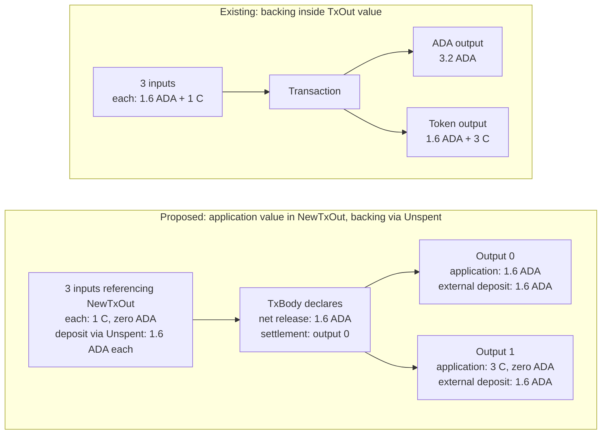
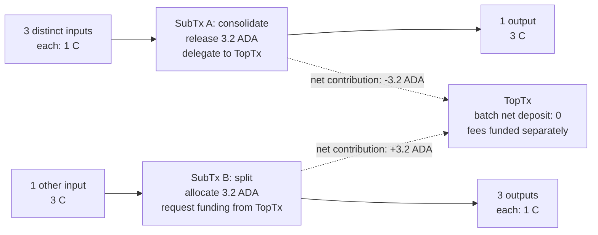
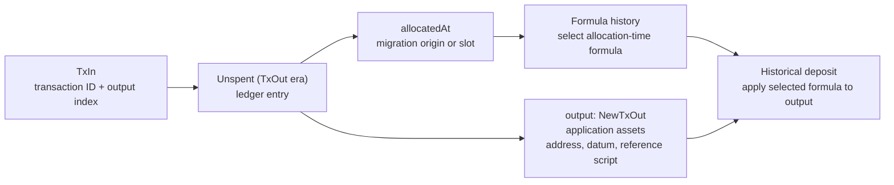
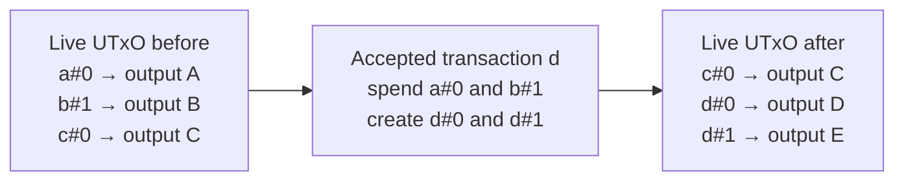

> **Working draft, 9 November 2026.** This revision describes the candidate
> implemented by the Dijkstra Ledger prototype at `2298a008589d5a0a5ea70bd1ec87d8477e989422`.
> The specification and rationale below form a first proposal for review. The
> [open questions](#46-open-questions) identify decisions needed to complete it.
> The CIP number and submission pull request await submission.

**Table of contents**

- [1. Abstract](#1-abstract)
- [2. Motivation: Why is this CIP necessary?](#2-motivation-why-is-this-cip-necessary)
- [3. Specification](#3-specification)
  - [3.1 Moving minUTxO accounting from TxOuts to transactions](#31-moving-minutxo-accounting-from-txouts-to-transactions)
    - [3.1.1 Builder experience: consolidating token outputs](#311-builder-experience-consolidating-token-outputs)
    - [3.1.2 TxBody deposit declarations](#312-txbody-deposit-declarations)
    - [3.1.3 Netting and the transaction balance](#313-netting-and-the-transaction-balance)
    - [3.1.4 Release authority and settlement](#314-release-authority-and-settlement)
    - [3.1.5 An ADA-free SubTx under formula V1](#315-an-ada-free-subtx-under-formula-v1)
    - [3.1.6 Script outcomes and collateral](#316-script-outcomes-and-collateral)
    - [3.1.7 Scope and terminology](#317-scope-and-terminology)
  - [3.2 Deposit model](#32-deposit-model)
    - [3.2.1 The live UTxO resource](#321-the-live-utxo-resource)
    - [3.2.2 Output representation](#322-output-representation)
    - [3.2.3 Deposit calculation](#323-deposit-calculation)
    - [3.2.4 Allocation history and the Store invariant](#324-allocation-history-and-the-store-invariant)
  - [3.3 Lifecycle and compatibility](#33-lifecycle-and-compatibility)
    - [3.3.1 Parameter changes and migration](#331-parameter-changes-and-migration)
    - [3.3.2 Stake, voting and monetary conservation](#332-stake-voting-and-monetary-conservation)
    - [3.3.3 Encoding validation and versioning](#333-encoding-validation-and-versioning)
- [4. Rationale: How does this CIP achieve its goals?](#4-rationale-how-does-this-cip-achieve-its-goals)
  - [4.1 Application value and funding](#41-application-value-and-funding)
  - [4.2 Evaluation against the CPS use cases](#42-evaluation-against-the-cps-use-cases)
  - [4.3 Responses to the CPS questions](#43-responses-to-the-cps-questions)
  - [4.4 Alternatives considered](#44-alternatives-considered)
  - [4.5 Resource protection and implementation costs](#45-resource-protection-and-implementation-costs)
  - [4.6 Open questions](#46-open-questions)
    - [4.6.1 Plutus compatibility](#461-plutus-compatibility)
    - [4.6.2 Local release guarantees](#462-local-release-guarantees)
    - [4.6.3 Pricing and activation](#463-pricing-and-activation)
    - [4.6.4 Declarations](#464-declarations)
    - [4.6.5 Stake and voting](#465-stake-and-voting)
    - [4.6.6 Integration and validation](#466-integration-and-validation)
- [5. Path to Active](#5-path-to-active)
  - [5.1 Acceptance Criteria](#51-acceptance-criteria)
  - [5.2 Implementation Plan](#52-implementation-plan)
- [6. References](#6-references)
- [7. Copyright](#7-copyright)

## 1. Abstract

This proposal introduces explicit UTxO capacity deposits and transaction-level
netting. A new output form carries the application's assets, including zero ADA,
while the ledger accounts separately for the full deposit required to keep that
output in the UTxO set. Spending the output releases its original deposit through
its spending authority.

A transaction funds the difference between deposits required by its new outputs
and deposits released by its consumed outputs. Each sub-transaction declares its
own contribution and can delegate funding or release accounting to the enclosing
transaction. A sub-transaction can therefore transfer native assets with zero
application ADA while the enclosing transaction provides fees and any additional
deposit funding.

The candidate also introduces a component-based deposit formula and retains the
formula history and allocation origin needed to recover each output's original
deposit. Parameter changes price future allocations. Existing implicit-deposit
outputs and the new output form coexist.

The proposal addresses the application and transaction-builder friction described
in CPS-0037. Its remaining review covers script compatibility, local release
settlement, pricing calibration, and integration across the node and wallet stack.

## 2. Motivation: Why is this CIP necessary?

[CPS-0037 — Application and transaction friction in minUTxO implementation](../CPS-0037/README.md)
describes how ordinary output ADA currently serves both application value and
backing for persistent state. A token payment can require the sender to supply ADA
controlled by the recipient. An application-state transition can require a top-up.
Builders must accommodate these requirements while constructing and balancing
outputs. The minimum itself depends on the output's encoded size, including the
ADA amount being chosen. The CPS was published on 27 October 2026. [Published CPS](https://github.com/cardano-foundation/CIPs/tree/master/CPS-0037)

The proposed interface lets a builder express the assets intended for each
recipient, calculate the deposits, and settle their aggregate change. Its two
principal operations are allocating a deposit when a new output enters the UTxO
set and releasing that deposit when an authorised transaction consumes the output.

For sub-transactions, the funding choice becomes explicit. A user can author a
token transfer and ask the enclosing transaction to fund its positive deposit
contribution. The enclosing transaction can combine that request with deposits
released elsewhere in the batch and with its own funds. Such a flow requires a
participant willing to assemble and fund the enclosing transaction.

ADA remains committed for the lifetime of each funded output. The proposal changes
its representation, calculation and transaction accounting. Its effect on all
seven CPS use cases is evaluated in the [rationale](#4-rationale-how-does-this-cip-achieve-its-goals).

## 3. Specification

### 3.1 Moving minUTxO accounting from TxOuts to transactions

The proposal changes the transaction-construction interface: a builder describes
application outputs and declares the **net UTxO deposit change in `TxBody`**. The
balance of the complete transaction funds that change. The resource being
protected remains the live UTxO set stored and maintained by nodes. ADA stays
committed while outputs occupy that resource, preserving the economic deterrence
principle described in CPS-0037.

A transaction creates and consumes outputs together. This is the boundary at which
released backing and new requirements can be netted. The following example makes
the change in the builder's experience concrete; the body-field specification and
validation rules follow it. The new output representation and ledger-state
adaptations are specified in §3.2.

The examples distinguish the transaction output from its ledger entry.
`NewTxOut` contains application assets with no embedded minimum ADA. The ledger
wraps it in `Unspent (TxOut era)`, whose allocation origin, together with formula
history, determines the deposit associated with that live output. An input is a
reference to this entry. The deposit is accounted outside the `NewTxOut` value;
the wrapper's actual fields and this lookup are shown in §3.2.1.

#### 3.1.1 Builder experience: consolidating token outputs

Consider three inputs, each carrying one unit of token C, consolidated into one
output carrying three units. For this illustration, assume **each depicted output
requires 1.6 ADA of backing**, both historically and when created. This constant
requirement is an accounting example, not the V1 formula or a real parameter
setting. Fees and their funding inputs/change are omitted from both diagrams;
assume that funding uses valid legacy outputs and adds no external-deposit change.



The legacy builder puts enough ADA inside the token output to satisfy its minimum.
Its remaining 3.2 ADA can go to the ADA output, whose value also satisfies its own
minimum. With the proposed form, the token output expresses exactly `3 C`. The
builder accounts for both new outputs' deposits in the transaction balance:

```text
Historical deposits released by the 3 inputs   = 3 × 1.6 = 4.8 ADA
New token output's external deposit           =           1.6 ADA
New ADA settlement output's external deposit  =           1.6 ADA
Net deposit change                           = 3.2 − 4.8 = −1.6 ADA
Application ADA available for output 0        =           1.6 ADA
```

The additional field in the enclosing transaction body is, in CBOR diagnostic
notation (other body fields omitted):

```text
28: [1, 1600000, [1, 0]]
     │      │       └─ settle into this body's output at index 0
     │      └───────── amount in lovelace
     └──────────────── net release
```

Output 0 already contains the 1.6 ADA release in its application value. The
body declaration records and constrains that settlement; it creates no second
payment. The new ADA settlement output needs its own external deposit: its
serialized ADA value is 1.6, compared with 3.2 in the legacy ADA output, and the
other 1.6 is held separately as backing. Funding is separated from the application
value, and every new output remains backed.

**Composition can reuse a release directly.** A SubTx that consolidates three
`NewTxOut` token outputs into one releases 3.2 ADA when it creates no separate
ADA settlement output. It can delegate that release to TopTx. Another SubTx can
consume a distinct three-token input and request 3.2 ADA to split it into three
outputs. Under the same illustrative pricing, their net changes cancel:



All depicted SubTx inputs and outputs have zero application ADA. The corresponding
body-field fragments are:

```text
SubTx A   28: [1, 3200000, [1]]   -- release, delegated to TopTx
SubTx B   28: [2, 3200000]        -- request deposit funding from TopTx
TopTx     28: [2]                -- explicit zero for the complete batch
```

There is no deposit-release output in this batch. The released backing funds the
new allocations through the complete transaction's balance. Fees still require
funding. This is the construction flow enabled by the proposal: express the token
operations, declare their deposit contributions and funding choices, then balance
the enclosing transaction.

#### 3.1.2 TxBody deposit declarations

TopTx is the enclosing transaction; SubTx is a body composed into it. A standalone
transaction is a TopTx with no SubTxs. Each body carries a deposit declaration
specific to its level. Amounts use lovelace.

**Haskell interface.** The prototype adds the following fields to its body
constructors. This excerpt shows only those fields; the existing input, output,
fee and other fields are omitted.

```haskell
data DijkstraTxBodyRaw l era where
  DijkstraTxBodyRaw ::
    { dtbrNetUTxODepositChange :: !TopTxUTxODepositDeclaration
    } ->
    DijkstraTxBodyRaw TopTx era
  DijkstraSubTxBodyRaw ::
    { dstbrNetUTxODepositChange :: !SubTxUTxODepositDeclaration
    } ->
    DijkstraTxBodyRaw SubTx era
```

The declaration payloads describe zero, allocation or release, together with the
funding or settlement choice. These are the prototype's actual types, with
deriving clauses omitted:

```haskell
-- TopTx: net change for the complete transaction batch.
data NetUTxODepositChange
  = NoUTxODepositChange
  | AllocateUTxODeposit !StrictlyPositiveCoin
  | ReleaseUTxODeposit !StrictlyPositiveCoin !TopTxReleaseSettlement

data TopTxReleaseSettlement
  = NoTopTxSettlement
  | TopTxSettlementOutput !TxIx

-- SubTx: its own contribution and funding or settlement choice.
data SubTxNetUTxODepositChange
  = SubTxNoUTxODepositChange
  | SubTxAllocateUTxODeposit !StrictlyPositiveCoin
  | SubTxRequestUTxODepositFromTopTx !StrictlyPositiveCoin
  | SubTxReleaseUTxODeposit !StrictlyPositiveCoin !SubTxReleaseTarget

data SubTxReleaseTarget
  = SubTxSettlementOutput !TxIx
  | DelegateToTopTx
```

`TopTxUTxODepositDeclaration` and `SubTxUTxODepositDeclaration` wrap their respective
payloads in `StrictMaybe`. This preserves the distinction between an absent field
and an explicit zero: `NoUTxODepositChange` and `SubTxNoUTxODepositChange` are
present zero declarations. The public `NoUTxODepositDeclaration` pattern in each
module represents absence. The wrappers' constructors are private; builders use
the exported patterns, as in the examples below. `StrictlyPositiveCoin` is a
checked positive lovelace amount, and `TxIx` is a zero-based output index.

[TopTx declaration types](https://github.com/nhenin/cardano-ledger-specs/blob/2298a008589d5a0a5ea70bd1ec87d8477e989422/eras/dijkstra/impl/src/Cardano/Ledger/Dijkstra/UTxOs/Deposit/TopTx.hs) · [SubTx declaration types](https://github.com/nhenin/cardano-ledger-specs/blob/2298a008589d5a0a5ea70bd1ec87d8477e989422/eras/dijkstra/impl/src/Cardano/Ledger/Dijkstra/UTxOs/Deposit/SubTx.hs)

The declarations from §3.1.1 can be constructed through that public interface:

```haskell
import Cardano.Ledger.BaseTypes (TxIx (..))
import Cardano.Ledger.Coin (Coin (..))
import Cardano.Ledger.StrictlyPositiveCoin (mkStrictlyPositiveCoin)
import qualified Cardano.Ledger.Dijkstra.UTxOs.Deposit.TopTx as TopTx
import qualified Cardano.Ledger.Dijkstra.UTxOs.Deposit.SubTx as SubTx

-- Standalone example: release 1.6 ADA into own output 0.
-- The result is Maybe TopTxUTxODepositDeclaration.
localRelease = do
  amount <- mkStrictlyPositiveCoin (Coin 1600000)
  pure $ TopTx.DeclaresNetUTxODepositRelease amount
    (TopTx.TopTxSettlementOutput (TxIx 0))

-- Composed example: SubTx A releases 3.2 ADA; SubTx B requests it.
-- The result is Maybe (SubTx A declaration, SubTx B declaration, TopTx declaration).
nettedBatch = do
  amount <- mkStrictlyPositiveCoin (Coin 3200000)
  pure
    ( SubTx.DeclaresNetUTxODepositRelease amount SubTx.DelegateToTopTx
    , SubTx.RequestsUTxODepositFromTopTx amount
    , TopTx.DeclaresZeroNetUTxODeposit
    )
```

**CBOR encoding (CDDL).** CDDL, the Concise Data Definition Language, describes
the serialized data shape. `?` marks an optional map entry, `/` separates
alternatives, and `[ ... ]` describes an array. Both body maps gain optional key
`28`; the commented entries below are inserted into their existing map schemas.
The Haskell constructors above encode to these tagged arrays.

```cddl
; Added to the transaction_body map
; ? 28 : net_utxo_deposit_change

; Added to the sub_transaction_body map
; ? 28 : sub_tx_net_utxo_deposit_change

positive_coin = 1 .. 18446744073709551615
output_index = uint .size 2

net_utxo_deposit_change =
    [0, amount : positive_coin]
  / [1, amount : positive_coin, settlement : top_tx_release_settlement]
  / [2]

top_tx_release_settlement =
    [0]
  / [1, output_index]

sub_tx_net_utxo_deposit_change =
    [0, amount : positive_coin]
  / [1, amount : positive_coin, target : sub_tx_release_target]
  / [2, amount : positive_coin]
  / [3]

sub_tx_release_target =
    [0, output_index]
  / [1]
```

[Prototype CDDL](https://github.com/nhenin/cardano-ledger-specs/blob/2298a008589d5a0a5ea70bd1ec87d8477e989422/eras/dijkstra/impl/cddl/data/dijkstra.cddl) · [Body fields and codecs](https://github.com/nhenin/cardano-ledger-specs/blob/2298a008589d5a0a5ea70bd1ec87d8477e989422/eras/dijkstra/impl/src/Cardano/Ledger/Dijkstra/TxBody.hs)

TopTx declares the exact `Δbatch`. Each explicit SubTx declaration gives its exact
own `Δb` and, for a nonzero contribution, its local or delegated accounting choice.
The ledger calculates the expected amounts independently from the actual inputs,
outputs and history before comparing them with the declarations.

| Form | TopTx meaning | SubTx meaning |
| --- | --- | --- |
| Absent | No declaration | No declaration or delegation request |
| Explicit zero | Batch net change equals zero | Own net change equals zero |
| Allocation | Positive batch change | Positive own change accounted locally |
| Request funding | Unavailable | Positive own change delegated to TopTx |
| Release | Negative batch change, with a TopTx settlement choice | Negative own change, with an own settlement output or delegation to TopTx |

A declaration is required when the body's ordinary spending inputs reference a
`NewTxOut` or its ordinary outputs create one. This requirement applies even at a zero
rate, and even when allocation and release cancel exactly. Any explicit SubTx
declaration, including zero, requires an explicit TopTx declaration. A body with no
such operations may omit its declaration or explicitly declare zero, subject to
this parent requirement. Reference-only access creates no declaration requirement.

Amount-bearing forms contain a strictly positive integer in `1..2^64−1`.
Explicit zero has its own representation. The allocation or release form must
agree with the sign of the calculated change.

Decoders reject unknown tags, incorrect field counts and out-of-range amounts or
indices. Settlement indices refer to this body's own outputs. The ledger
independently validates the declared amount against the actual inputs and outputs;
signing a declaration does not make an incorrect amount acceptable.

#### 3.1.3 Netting and the transaction balance

For each body `b`, define deposits allocated for its new `NewTxOut` outputs and
deposits released by spending its input entries that contain `NewTxOut`.

```math
\begin{aligned}
A_b &= \sum_{o\in\mathrm{newOutputs}(b)} F_{\mathrm{active}}(o) \\
R_b &= \sum_{i\in\mathrm{spentInputs}(b)} E_H(U[i]) \\
\Delta_b &= A_b-R_b \\
\Delta_{\mathrm{batch}} &= \sum_{b\in\mathrm{batch}}\Delta_b.
\end{aligned}
```

The sum for `A_b` includes only `NewTxOut` outputs. Legacy inputs contribute zero
to `R_b`. Reference inputs and collateral belong outside the ordinary calculation.
TopTx's own outputs exclude its children's outputs.

For an ordinary accepted transaction, add `max(0, -Δbatch)` to the existing
consumed ADA calculation and `max(0, Δbatch)` to the existing produced ADA
calculation. All remaining transaction terms, including fees, mint, withdrawals,
certificates, direct deposits and governance effects, follow their applicable
ledger rules. The complete transaction must balance. The batch total is the single
Store term in this equation.

For example, a batch requiring 5 ADA of new deposits and releasing 3 ADA funds a
net increase of 2 ADA. Reversing those amounts gives a net release of 2 ADA. The
number of outputs alone does not determine the sign or amount of this change.

For a SubTx `b`, let `L_b = Δ_b` when its contribution is locally accounted and
`L_b = 0` when it delegates allocation or release to TopTx. TopTx's attributed
responsibility is

```math
T = \Delta_{\mathrm{batch}} - \sum_{b\in\mathrm{SubTxs}}L_b.
```

Delegation changes this responsibility while preserving each body's required
amount and the batch total. Individual SubTxs may contribute ADA to the enclosing
transaction or receive funding from it. Conservation is checked for the complete
transaction under the enclosing protocol's rules.

For the common case whose spent and created outputs all use `NewTxOut`, with
fees but no minting, withdrawals, certificate effects or other balance terms,
the ADA equation reduces to:

```text
input application ADA + max(0, -netDeposit)
  = output application ADA + fee + max(0, netDeposit)
```

Native assets must also be conserved under the applicable mint/burn rules. Legacy
inputs and outputs contribute their full serialized value to the general balance.
The single signed deposit term moves ADA into or out of the Store. It is not an
extra amount inserted into every new output's application value.

The prototype calculates the batch declaration from each body's contribution
with the following implementation excerpt:

```haskell
requiredTxTotalNetUTxODeposit store body =
  requiredNetUTxODeposit store body
    <> foldMap (requiredNetUTxODeposit store . (^. bodyTxL)) (body ^. subTransactionsTxBodyL)
```

[Exact accounting implementation](https://github.com/nhenin/cardano-ledger-specs/blob/2298a008589d5a0a5ea70bd1ec87d8477e989422/eras/dijkstra/impl/src/Cardano/Ledger/Dijkstra/Rules/DepositStore/Accounting.hs)

#### 3.1.4 Release authority and settlement

The authority to consume an output also authorises release of its deposit. The
original funder gains no additional credential or independent recovery right.
For example, if Alice funds an output controlled by Bob, Bob's spending authority
controls its subsequent consumption and release.

A local SubTx release of amount `r` must designate one of that SubTx's own ordinary
outputs. That output must contain at least `r` lovelace in its serialized value.
For a `NewTxOut` this is application ADA. For a legacy output this is its
full ADA, including embedded backing. The external deposit of a settlement output
provides no part of this coin bound.

TopTx's settlement choice follows the batch total and its attributed share `T`.

| Condition | TopTx settlement requirement |
| --- | --- |
| `Δbatch < 0` and `T < 0` | Designate an own ordinary output with at least `-T` lovelace. |
| `Δbatch < 0` and `T >= 0` | Use the release form with no TopTx settlement output. |
| `Δbatch >= 0` | Use allocation or explicit zero, whose forms carry no settlement selector. |

The TopTx coverage amount may exceed the whole-batch release. If a locally
accounted child allocates 3 ADA and TopTx's attributed share releases 5 ADA, the
batch releases 2 ADA while TopTx's selected output must contain at least 5 ADA.

Indices are zero-based within the declaring body's ordinary output sequence.
They cannot select a sibling's output, a parent's output, or a collateral return.
The declared outputs already include their settlement value. Checking a destination
adds no second release to the Store or the transaction's available funds.

These rules specify the prototype's destination and amount checks. The stronger
economic guarantee for a local release remains an [open question](#46-open-questions).

#### 3.1.5 An ADA-free SubTx under formula V1

Assume V1 at `p = 4310`, and outputs with no datum or reference script. Alice
controls one `NewTxOut` containing two distinct tokens and zero
application ADA. Its historical deposit was allocated under this same formula.
She sends one token to Bob and one to Carol in two new `NewTxOut` outputs.

| Deposit operation | Calculation | Lovelace |
| --- | --- | ---: |
| Consume Alice's two-asset output | `4310 × (250 + 74 × 2)` | 1,715,380 released |
| Create Bob's one-asset output | `4310 × (250 + 74)` | 1,396,440 allocated |
| Create Carol's one-asset output | `4310 × (250 + 74)` | 1,396,440 allocated |
| Net SubTx contribution | `2,792,880 − 1,715,380` | 1,077,500 allocated |

Alice's SubTx declares a request for TopTx to fund 1,077,500 lovelace. It carries
zero application ADA in both its input and outputs. Assuming TopTx's other inputs
and outputs are legacy and introduce no external-deposit change, TopTx declares
that same positive batch total and supplies the net deposit plus the fee from its
own available ADA. The complete transaction also conserves both tokens.

A one-for-one replacement with identical measurements and unchanged pricing has a
zero contribution and requires an explicit zero declaration. The fee still needs
funding. If Alice's consumed output is a legacy output, the calculation instead
uses its full serialized ADA and zero external release credit.

#### 3.1.6 Script outcomes and collateral

Declaration presence, exactness, output validity and settlement checks apply to
both accepted phase-2 outcomes. Ordinary financial conservation applies to the
ordinary-success path. A transaction rejected during validation applies no ledger
effects.

On ordinary success, the ledger applies the ordinary TopTx and SubTx inputs,
outputs and deposit changes and credits the normal transaction fee. On accepted
phase-2 failure, it applies the collateral inputs and collateral return and their
deposit effects. Ordinary effects remain unapplied on that path.

For collateral, define the following quantities.

| Symbol | Quantity |
| --- | --- |
| `C` | Serialized ADA in collateral inputs, using full ADA for legacy inputs and application ADA for inputs referencing `NewTxOut` |
| `Q` | Serialized ADA in the signed collateral return, or zero if absent |
| `dI` | Historical external deposits of consumed collateral inputs |
| `dQ` | Active-price external deposit for a `NewTxOut` return, or zero for an absent or legacy return |

```math
\begin{aligned}
a &= \max(0,d_Q-d_I) \\
s &= \max(0,d_I-d_Q) \\
f_{\mathrm{coin}} &= C-Q-a \\
f_{\min} &= \left\lceil
\frac{\mathrm{txFee}\cdot\mathrm{collateralPercentage}}{100}
\right\rceil.
\end{aligned}
```

When TopTx or any SubTx has redeemers, collateral funding requires
`fcoin >= fmin`. Input coins fund the signed return, any extra deposit requirement
and the minimum collateral fee. Released-deposit surplus is excluded from this
minimum-fee funding calculation and does not enlarge the signed return.

When the optional total-collateral field is present and the redeemer-triggered
comparison applies, it must equal `C − Q`. On accepted phase-2 failure the fee pot
receives `fcoin + s`, and the Store changes by `dQ − dI`. Thus

```math
C+d_I = Q+d_Q+(f_{\mathrm{coin}}+s).
```

The collateral return must preserve the exact native-asset identities and
quantities from collateral inputs. Ordinary mint and outputs cannot supply those
assets on the failure path. Existing input resolution, witness, eligibility,
return validity and input-count rules continue to apply. The ledger derives
collateral deposit effects directly from the collateral inputs and return.

#### 3.1.7 Scope and terminology

The candidate is implemented in the prototype's Dijkstra era, which already
provides enclosing transactions and sub-transactions. This CIP specifies their
UTxO-deposit behaviour. Activation requires an era transition and compatible
transaction builders, node interfaces and script contexts.

| Term | Meaning |
| --- | --- |
| TopTx | The enclosing transaction body. Its deposit declaration covers the complete batch. |
| SubTx | A sub-transaction body. Its declaration covers its own ordinary inputs and outputs. |
| Batch | TopTx and all of its SubTx bodies, each counted once. A standalone transaction is a batch with no SubTxs. |
| Legacy output | An implicit-deposit output whose full value includes its minimum ADA. This form can also be created after activation. |
| `NewTxOut` | The new output variant. Its value contains application assets with no embedded minimum ADA; its backing is accounted through the enclosing `Unspent (TxOut era)` ledger entry and formula history. |
| `Unspent (TxOut era)` | The ledger entry wrapping an output with its allocation origin. This metadata determines its historical deposit together with the output and formula history. |
| Allocation | A live output identified by its transaction input reference, together with its allocation origin. |
| DepositStore | Ledger state recording the allocations, deposit formula history and total externally held deposits. |
| Settlement output | An ordinary output designated by a deposit-release declaration. Its value already includes the required settlement amount. |

All deposit amounts and rates below use lovelace. Calculation uses exact integer
arithmetic. A positive net change allocates ADA to the Store and a negative change
releases ADA from it.

### 3.2 Deposit model

#### 3.2.1 The live UTxO resource

The resource is a persistent collection of live outputs indexed by their creating
transaction ID and output index. The prototype stores it as a map of wrapped outputs. These are actual type
declarations, with deriving clauses omitted:

```haskell
newtype IndexedUTxOs era = IndexedUTxOs
  { unIndexedUTxOs :: Map TxIn (Unspent (TxOut era))
  }

data Unspent output = Unspent
  { output :: !output
  , allocatedAt :: !AllocatedAt
  }

data AllocatedAt
  = AtStoreMigration
  | AtSlot !SlotNo
```

`TxIn` identifies the creating transaction and output index. `output` contains the
`TxOut`, which can use the legacy or `NewTxOut` variant. `allocatedAt` belongs to
the surrounding ledger entry, outside the serialized `TxOut`. The wrapper does
not store a coin amount: its origin selects a historical formula, which is
applied to the wrapped output to recover its deposit. The Store also maintains
the aggregate external ADA total.



This lookup shows the `NewTxOut` case; a legacy entry contributes zero external
deposit, because its full ADA remains inside its value. Both variants are wrapped
in `Unspent`. The map entries, their output payloads and allocation metadata
occupy node resources.

[Allocation map](https://github.com/nhenin/cardano-ledger-specs/blob/2298a008589d5a0a5ea70bd1ec87d8477e989422/libs/cardano-ledger-core/src/Cardano/Ledger/State/Accounting/UTxOs/IndexedUTxOs.hs) · [Unspent and allocation origin](https://github.com/nhenin/cardano-ledger-specs/blob/2298a008589d5a0a5ea70bd1ec87d8477e989422/libs/cardano-ledger-core/src/Cardano/Ledger/State/Accounting/UTxOs/Unspent.hs)

In ordinary successful execution, a transaction removes its spent entries and
adds its newly created outputs. Unspent entries remain in place:



The prototype's ordinary state projection selects those changes directly from
the body (implementation excerpt, signature omitted):

```haskell
projectValidTxBody slot body = project slot (body ^. inputsTxBodyL) (outputsTxBody body)
```

This projection describes state changes after choosing the ordinary path; it is
not a complete admission check. The collateral path selects collateral inputs
and the collateral return instead. Formula activation and migration have their
own lifecycle rules in §3.3.

[Store projection](https://github.com/nhenin/cardano-ledger-specs/blob/2298a008589d5a0a5ea70bd1ec87d8477e989422/libs/cardano-ledger-core/src/Cardano/Ledger/State/Accounting/UTxOs/Store/Internals.hs)

#### 3.2.2 Output representation

Both output forms retain an address and their supported datum and reference-script
fields. The selected form determines how ADA is accounted for.

| Property | Legacy output | `NewTxOut` |
| --- | --- | --- |
| Serialized value | Full ADA and native assets | Application ADA and native assets |
| Admission under the candidate era | Output ADA must cover the active deposit formula | The transaction must fund the full external deposit |
| External deposit | Zero | Full calculated requirement |
| Value consumed on ordinary spending | Full serialized value | Application value, with the historical deposit released separately |

A `NewTxOut` may contain native assets with zero application ADA. The
prototype also accepts zero-ADA outputs carrying a datum, a reference script, or
only an address, subject to the remaining output-validity rules. Every occurrence
has its own allocation, including equal outputs at different indices and outputs
whose calculated deposit is zero.

The full deposit is external even when application ADA already exceeds the
calculated requirement. Adding application ADA leaves the external requirement
unchanged. For a newly proposed legacy output, the active formula determines its
minimum ADA, including for a collateral return. Earlier-era validation continues
to use the rules of its own era.

The new output's implementation makes the separation explicit. Its fields carry
application assets and spending information; the external deposit amount is
accounted by the Store. This is the prototype's type declaration, with deriving
clauses omitted:

```haskell
data DijkstraNewTxOut = DijkstraNewTxOut
  { storeBackedAddress :: !Addr
  , storeBackedApplicationAssets :: !(ApplicationAssets DijkstraEra)
  , storeBackedDatum :: !(Datum DijkstraEra)
  , storeBackedReferenceScript :: !(StrictMaybe (Script DijkstraEra))
  }
```

[Output implementation](https://github.com/nhenin/cardano-ledger-specs/blob/2298a008589d5a0a5ea70bd1ec87d8477e989422/eras/dijkstra/impl/src/Cardano/Ledger/Dijkstra/TxOut.hs)

The corresponding output CDDL extends the existing output choices. `address`,
`value`, `datum_option`, `script_ref` and the legacy productions retain their
meanings in the enclosing Dijkstra schema. The prototype names the `NewTxOut`
production `store_backed_transaction_output`; this is an encoding identifier.

```cddl
transaction_output =
    alonzo_transaction_output
  / babbage_transaction_output
  / store_backed_transaction_output

store_backed_transaction_output =
  { 0 : address
  , 4 : application_assets
  , ? 2 : datum_option
  , ? 3 : script_ref
  }

application_assets = value
```

A map-form output requires key `0` and exactly one value key. Key `1` selects the
legacy value representation and key `4` selects application assets. Legacy Alonzo
list-form outputs also remain accepted. Transaction output bytes contain neither
the external deposit amount nor the allocation origin.

#### 3.2.3 Deposit calculation

The candidate starts with formula V1. Let `p` be the effective
`coinsPerUTxOByte` parameter and let the output measurements be as follows.

| Symbol | Measurement |
| --- | --- |
| `N(o)` | Number of distinct native-asset identities. Each policy ID and asset-name pair counts once, independently of its quantity. ADA contributes zero. |
| `D(o)` | Datum payload bytes. An absent datum contributes zero, a datum hash contributes its digest length, and an inline datum contributes the length of its accepted CBOR-encoded payload, excluding the outer tag 24 and byte-string envelope. |
| `R(o)` | Original native-script CBOR or serialized Plutus script bytes, excluding the script-language and output wrappers. An absent script contributes zero. |

```math
F_{1,p}(o) = p\left(250 + 74N(o) + D(o) + R(o)\right)
```

The output address, application ADA, and enclosing CBOR fields contribute no
additional term. The original datum and script payload bytes must be available
when a historical deposit is calculated. Re-encoding the whole output is
unnecessary for this formula.

The same measurement and formula apply to ordinary outputs and collateral returns,
and to calculating the candidate era's minimum for newly created legacy outputs.
The V1 coefficients are the current prototype choice. Their resource coverage and
economic calibration remain part of the [pricing review](#46-open-questions).

The prototype includes an experimental V2 to exercise formula evolution.

```math
F_{2,p}(o) = p\left(260 + 80N(o) + D(o) + R(o)\right)
```

V2 supplies the worked evolution example below. Its activation policy requires a
future protocol decision. A new network or era transition initially selects V1
with its effective protocol-parameter rate. The rate used in the examples is an
explicit input to those examples.

#### 3.2.4 Allocation history and the Store invariant

The prototype represents the resource and its backing together. The CIP's
conceptual `DepositStore` is named `UTxOStore` in the implementation. Its type
combines the allocation map defined in §3.2.1 with pricing history and the total:

```haskell
data UTxOStore era = UTxOStore
  { depositFormulaHistory :: !DepositFormulaHistory
  , totalDepositAmount :: !DepositAmount
  , allocations :: !(IndexedUTxOs era)
  }
```

[Store](https://github.com/nhenin/cardano-ledger-specs/blob/2298a008589d5a0a5ea70bd1ec87d8477e989422/libs/cardano-ledger-core/src/Cardano/Ledger/State/Accounting/UTxOs/Store/Internals.hs) · [Allocation map](https://github.com/nhenin/cardano-ledger-specs/blob/2298a008589d5a0a5ea70bd1ec87d8477e989422/libs/cardano-ledger-core/src/Cardano/Ledger/State/Accounting/UTxOs/IndexedUTxOs.hs) · [Allocation entry](https://github.com/nhenin/cardano-ledger-specs/blob/2298a008589d5a0a5ea70bd1ec87d8477e989422/libs/cardano-ledger-core/src/Cardano/Ledger/State/Accounting/UTxOs/Unspent.hs)

The logical state consists of an allocation map `U`, a formula history `H`, and a
total `S` of externally held ADA. Each entry in `U` contains the accepted output
and one allocation origin.

- `AtStoreMigration` identifies an imported legacy output.
- `AtSlot(s)` identifies an output allocated at ledger slot `s`.

History contains an initial formula and dated activations. A formula includes both
its version and rate. Imported entries always resolve to the initial formula.
Dated entries resolve to the most recent activation at or before their allocation
slot, falling back to the initial formula. Activation intervals include their
starting slot and exclude the following activation's slot.

Let `P_H(u)` be the result of applying that historical formula to entry `u`.

```math
E_H(u) =
\begin{cases}
0 & \text{for a legacy output} \\
P_H(u) & \text{for a NewTxOut}
\end{cases}
```

The ledger must maintain the exact invariant

```math
S = \sum_{u\in U} E_H(u).
```

A valid allocation adds its external deposit once. A valid spend removes its
allocation and releases its historical external deposit once. Reference inputs
leave allocations in place. Rejection preserves the preceding state. The
transaction's existing input and output-reference rules determine which
occurrences may be consumed and created.

The prototype reconstructs deposit amounts from output measurements, allocation
origins and shared history. An implementation may use a different internal
representation if it preserves these amounts and the same transitions. Snapshot,
rollback and replay must retain enough information to reproduce them exactly.
History survives an empty allocation map.

For wallet and inspection queries, the candidate also defines a legacy backing
view. If `C(u)` is the output's ADA, its embedded reserve is
`min(C(u), P_H(u))`, and the corresponding application-ADA view is the remainder.
Its entire serialized ADA still enters spending and conservation. This reserve
view creates zero external release credit. The cap concerns existing entries,
while admission of a newly created legacy output requires the full active minimum.

### 3.3 Lifecycle and compatibility

#### 3.3.1 Parameter changes and migration

A rate change becomes part of history at the first slot of the epoch in which it
is effective, including when the first transaction arrives later. New allocations
use the active formula and rate. Existing allocations retain their origins and
historical deposits, and the cached Store total is preserved by activation alone.

Activations append a later interval. They must preserve the prices of all existing
allocations. The candidate rejects formula-version downgrades and permits rates
to increase or decrease within a version. Reapplying the current formula is a
no-op. The protocol mechanism selecting a future formula version requires further
specification.

At migration, translate existing UTxO references and their semantic address, value,
datum and reference script into legacy entries marked `AtStoreMigration`. Initialise
the formula baseline to V1 with the effective translated rate. The external Store
total starts at zero. Existing ADA pots and output values retain their amounts.
The baseline supplies the candidate's view of imported backing, whose amount is
capped by each output's ADA. It does not reconstruct pre-fork creation prices.

A transaction may spend both output forms and create either form after activation.
New outputs, including replacements of legacy outputs, satisfy the active rules.
This transition changes state representation and requires downstream interfaces to
handle the new form.

The following experiment uses two otherwise identical outputs with two distinct
assets, no datum or script, and rate 4310.

| Allocation formula | Deposit at creation | Release after V2 activation |
| --- | ---: | ---: |
| V1 | 1,715,380 lovelace | 1,715,380 lovelace |
| Experimental V2 | 1,810,200 lovelace | 1,810,200 lovelace |

Restoring a snapshot and spending both under V2 releases 3,525,580 lovelace. A
successor created at that time pays the active requirement. This experiment is
covered by the prototype's historical-refund test. [Executable example](https://github.com/nhenin/cardano-ledger-specs/blob/2298a008589d5a0a5ea70bd1ec87d8477e989422/docs/dijkstra-deposit-store-rules.md#ds-state-balance-p08)

#### 3.3.2 Stake, voting and monetary conservation

The candidate applies existing staking eligibility and delegation rules to the
full ADA of legacy outputs and to the application ADA of `NewTxOut` outputs.
External deposits add no stake or voting weight. Store ADA remains part of total
ADA conservation and is counted once, alongside output ADA and the existing fees,
deposits, rewards, treasury, reserves and donation pots.

For example, an eligible legacy output containing 10 ADA contributes 10 ADA. An
eligible `NewTxOut` containing 8 application ADA with a 2 ADA external
deposit contributes 8 ADA. This policy is part of the candidate under review.
Dedicated stake and voting checks remain to be completed in the prototype's
verification scope. [Distribution rules](https://github.com/nhenin/cardano-ledger-specs/blob/2298a008589d5a0a5ea70bd1ec87d8477e989422/docs/dijkstra-deposit-store-rules.md#derived-distributions)

#### 3.3.3 Encoding validation and versioning

Decoders must preserve absence, explicit zero, operation kind, amount and destination.
They reject unknown constructor tags, incorrect field counts, zero or out-of-range
amounts in amount-bearing forms, and indices outside `0..65535`. Ledger validation
also verifies that each selected index exists in the declaring body's outputs.

The candidate encodings require activation in a supporting era. Final protocol
version assignment and future formula-version selection remain open. Implementation
snapshot formats must preserve the semantic state described above. The prototype's
internal Store snapshot uses MemPack for some entries, and its outer shape alone
is insufficient to define an interoperable snapshot format.

## 4. Rationale: How does this CIP achieve its goals?

### 4.1 Application value and funding

The new output form allows an application to state the exact assets intended for
a recipient or a continuing script. Deposit netting exposes the aggregate funding
change, and delegation gives the enclosing transaction an explicit way to fund a
SubTx. The ledger maintains one allocation per output reference, so common funding
does not require those outputs to share a spending credential or to be consumed
together.

This representation has a capital cost. For a `NewTxOut` with `C`
application ADA and requirement `F`, total committed ADA is `C + F`. Under the
existing representation, some or all of `C` can also satisfy the minimum. Choosing
the external form can therefore increase total ADA committed to an ADA-bearing
payment. Keeping the legacy form lets builders retain the embedded representation,
while also giving them an additional choice to support.

The component formula removes the deposit's dependence on its own funded amount
and on the output's outer encoding. Builders still determine asset identities,
datum and script payloads, resolve input histories, pay transaction fees and
balance the complete transaction. Changing an asset bundle can still change the
required deposit. The claim is a simpler deposit calculation and explicit funding
interface.

### 4.2 Evaluation against the CPS use cases

| CPS use case | Candidate effect | Remaining burden or trade-off |
| --- | --- | --- |
| Frozen wallet | Released backing can fund replacement deposits. TopTx can sponsor a SubTx's fee and additional deposit funding. | An equally priced replacement frees no spare ADA for the fee. A sponsor or another ADA source is still needed. |
| Payment below minUTxO | A `NewTxOut` can contain an exact small ADA payment or tokens with zero application ADA. | The full external deposit and transaction fees require funding. |
| Funding recipient-controlled ADA | Funding may be consolidated or delegated to TopTx. The deposit is held outside the application's value. | Release authority still follows the output. The original funder gains no separate claim. |
| Non-staking application state | Application value is represented independently of backing. | Deposits remain locked and excluded from stake and voting. Moving otherwise eligible backing to an external deposit also removes that eligibility. |
| Construction and change balancing | The component formula avoids an ADA-amount/encoded-size fixed point. Netting gives one batch Store transfer. | Builders handle input selection, final payload measurements, fees, declarations, formula history and balancing. |
| High fan-out distribution | The batch funds the net sum, with optional sponsorship. | Each new output still incurs its full requirement. More outputs can require more capital. |
| Successor-output top-up | The old historical deposit is available toward the new active-price requirement. | Any shortfall needs funding. A decrease releases value through the spending transaction's settlement rules. |

These effects need quantitative comparison using representative transactions,
including current wallet workarounds. The comparison must count application ADA,
external deposits and fees without double counting ADA that serves both roles in
a legacy output. [CPS evaluation requirements](../CPS-0037/README.md#evaluation-requirements)

### 4.3 Responses to the CPS questions

1. **Parameter changes and beneficiaries.** Existing deposits retain their original
   amount. A successor pays the current requirement. The transaction funds an
   increase and disposes of a release under its spending and settlement rules.
   Historical funding creates no independent entitlement.
2. **Existing validators.** A complete script-context contract remains to be
   specified for each supported Plutus version. The intended compatibility and
   available integration evidence are described below.
3. **Uneconomic cleanup.** Spending releases the historical backing. The candidate
   adds no expiry or extra cleanup reward. An output can remain indefinitely when
   consumption costs exceed the value its controller can recover.
4. **Deposit organisation.** The ledger maintains an individual allocation per
   output and an exact aggregate total. Transaction-level funding can be shared,
   while output spending authority remains individual. Storage costs and effects
   on transaction construction require measurement.
5. **Exact allocation and encoding boundaries.** The full external deposit is
   calculated independently of application ADA and the outer output encoding.
   Its exact amount enters the Store invariant. The candidate allows no
   unallocated Store surplus. Legacy embedded ADA is consumed once through value.

### 4.4 Alternatives considered

| Alternative | Reason for evaluating it | Trade-off motivating the candidate |
| --- | --- | --- |
| Formula-only change | Simplify the minimum calculation while keeping the existing output interface | It can reduce builder calculations, while token-only outputs still need ADA in their value. |
| Application/deposit split inside each output | Make the two roles explicit within the transferred output | A size formula over that same encoded split can create a fixed-point allocation problem. Deposit representation and pricing must be evaluated together. |
| External deposit for only the shortfall `max(0, requirement − applicationADA)` | Preserve overlap between intended ADA and backing, as explored in an earlier draft | Application ADA affects the external amount and requires its own lifecycle and compatibility analysis. The current prototype uses a full external deposit for the new form. |
| Funder-controlled account obligation | Give the funder a continuing claim while state occupies capacity | Account ownership, authorisation, shared obligations and independently spendable outputs require additional rules. |
| Redistribute backing across outputs | Relax each output's minimum while retaining ADA in output values | Allocation and recovery rights still need definition, and backing continues to participate in the transferred values. |

The comparative assessment is continuing. The prototype supplies concrete rules
and executable examples for the current candidate. Architectural review must weigh
these alternatives against the same CPS use cases and resource-protection goals.

### 4.5 Resource protection and implementation costs

The Store invariant ensures that the recorded external obligations have exactly
matching ADA backing. Economic protection additionally depends on a suitable
positive rate and coefficients that cover the relevant resources. The formula's
base and per-asset allowance require evaluation against address and asset-name
sizes, datum and script representations, allocation metadata, indexes and actual
node storage. A passing accounting test does not establish that calibration.

The protocol can represent a zero rate. Zero-priced outputs still require
allocation records and explicit declarations where applicable. Such a rate must
be assessed against the intended economic protection.

Each live output adds an allocation origin, and history retains formula changes.
Implementers must assess state size, lookups, snapshot costs and retention of
obsolete formula intervals. Any history compaction must preserve every live
allocation's exact historical amount.

Conservation includes the Store once. Ordinary and collateral effects must use the
selected execution path, and all consumers of ledger state must agree on the two
output forms. Release authority, price changes and migration are therefore part
of the validation and compatibility contract.

### 4.6 Open questions

#### 4.6.1 Plutus compatibility

The target is support across the supported Plutus
versions, respecting each version's existing feature restrictions. The reviewed
Ledger source leaves context projection and translations unfinished, including
legacy translation paths with `unexpected NewTxOut` errors. Will's separate V4
integration fixture preserves total value and exposes backing and application
value, providing evidence for the review. The team must agree what each script
version sees, whether transaction-level deposit information is exposed, and how
validators that check exact ADA amounts behave. [Ledger compatibility work](https://github.com/nhenin/cardano-ledger-specs/blob/2298a008589d5a0a5ea70bd1ec87d8477e989422/docs/dijkstra-deposit-store-rules.md#ds-plutus-compatibility) · [V4 integration fixture](https://github.com/willjgould/cardano-minutxo-integration/commit/d2300267436d4cc6a4cb2dbc7898b9f98787192b)

#### 4.6.2 Local release guarantees

Requiring a destination to contain at least the
release amount does not establish the source of its coins or distinguish an
intended contribution to another body from redirected release value. A SubTx
consuming 10 application ADA and releasing 2 ADA may produce 12 ADA locally, or
produce 10 ADA and contribute 2 ADA to TopTx fees when that contribution is
intended. Independent SubTx balance would prevent useful cross-body funding.
The review must define the stronger guarantee and its expression in the signed
transaction. [Settlement discussion](https://github.com/nhenin/cardano-ledger-specs/blob/2298a008589d5a0a5ea70bd1ec87d8477e989422/docs/dijkstra-deposit-store-rules.md#ds-tx-settlement-refinement)

#### 4.6.3 Pricing and activation

Review V1's resource coverage and coefficients, the
future version-selection mechanism, and the final activation conditions. The
experimental V2 establishes a test scenario for historical refunds. A production
version requires its own reviewed formula and activation rule.

#### 4.6.4 Declarations

The prototype explicitly checks numeric net amounts. Review
whether those signed amounts provide sufficient value to retain, and what changes
would be needed if the ledger computed them without numeric declarations. Funding
and settlement choices still require an explicit representation.

#### 4.6.5 Stake and voting

Review the external-deposit exclusion and its effect on
capital efficiency and migration incentives. Complete the dedicated distribution
checks through ordinary execution, collateral and snapshot boundaries.

#### 4.6.6 Integration and validation

Complete downstream output handling, wallet and
indexer queries, private-network flows, and rollback/replay checks. The current
history decoder recognises formula versions and checks interval ordering, while
version-downgrade rejection is implemented at activation. Review persisted-state
validation against the final history contract and verify the remaining shared
collateral cases. [Verification record](https://github.com/nhenin/cardano-ledger-specs/blob/2298a008589d5a0a5ea70bd1ec87d8477e989422/docs/dijkstra-deposit-store-verification.md)

## 5. Path to Active

### 5.1 Acceptance Criteria

- [x] Publish the motivating problem statement as CPS-0037 and link it from the CIP.
- [ ] Complete author and domain review of the rules, alternatives, local settlement
      guarantee, Plutus projections, transaction encoding and activation policy.
- [ ] Establish the conservation, exact-backing and historical-release properties
      in the formal specification and assess the formula against adversarial
      resource growth and measured storage costs.
- [ ] Demonstrate interoperable encoding, validation, migration, snapshots and
      rollback/replay against independent expectations.
- [ ] Complete the dedicated stake/voting and remaining collateral verification,
      with results tied to the final implementation revision.
- [ ] Demonstrate native-token transfers, small ADA payments, continuing-script
      transitions and sponsored SubTxs across the wallet, builder and node stack
      on a private network, including accepted script failure and parameter changes.
- [ ] Document the operational impact on node implementations, cardano-api,
      wallets, hardware wallets, indexers and explorers.
- [ ] Deploy the implementation in block-producing nodes representing at least
      80% of stake, and activate it through the agreed protocol transition.

### 5.2 Implementation Plan

The first implementation is the Haskell Ledger prototype in PR #3. Its executable
business specification covers output forms, declarations, net accounting,
authority, settlement, collateral, historical deposits and state transitions.
This draft is based on revision `2298a008589d5a0a5ea70bd1ec87d8477e989422`.
[Ledger prototype](https://github.com/nhenin/cardano-ledger-specs/pull/3)

The full CI run at `b77257163` passed on 8 November. The later 9 November revision
adds the formula-downgrade guard. The reporting checkpoint records that later run
as still in progress. Verification results apply to their recorded revisions and
scopes. [Passing 8 November run](https://github.com/nhenin/cardano-ledger-specs/actions/runs/42479739616) · [9 November reporting checkpoint](../biweekly-reports/2026-11-02-to-2026-11-13.md)

The next implementation work is to review the Ledger lifecycle against these
rules, resolve the Plutus and settlement decisions, and run the integrated flows
on a private network. Those findings feed back into this draft, its reference
implementation and the formal model. Performance and compatibility results then
support author review and submission. [Ledger review](https://github.com/input-output-hk/arc-cardano-minutxo-alternatives/issues/29) · [Plutus review](https://github.com/input-output-hk/arc-cardano-minutxo-alternatives/issues/23) · [Private-network validation](https://github.com/input-output-hk/arc-cardano-minutxo-alternatives/issues/60)

## 6. References

- [CIP-0001 and the CIP process](https://cips.cardano.org/cip/CIP-0001)
- [CPS-0037 and its cited prior work](https://github.com/cardano-foundation/CIPs/tree/master/CPS-0037)
- [DepositStore business specification at the draft baseline](https://github.com/nhenin/cardano-ledger-specs/blob/2298a008589d5a0a5ea70bd1ec87d8477e989422/docs/dijkstra-deposit-store-rules.md)
- [Verification record at the same baseline](https://github.com/nhenin/cardano-ledger-specs/blob/2298a008589d5a0a5ea70bd1ec87d8477e989422/docs/dijkstra-deposit-store-verification.md)
- [Formula implementation](https://github.com/nhenin/cardano-ledger-specs/blob/2298a008589d5a0a5ea70bd1ec87d8477e989422/eras/dijkstra/impl/src/Cardano/Ledger/Dijkstra/UTxOs/Deposit/Formula.hs)
- [Transaction accounting implementation](https://github.com/nhenin/cardano-ledger-specs/blob/2298a008589d5a0a5ea70bd1ec87d8477e989422/eras/dijkstra/impl/src/Cardano/Ledger/Dijkstra/Rules/DepositStore/Accounting.hs)
- [Dijkstra transaction CDDL](https://github.com/nhenin/cardano-ledger-specs/blob/2298a008589d5a0a5ea70bd1ec87d8477e989422/eras/dijkstra/impl/cddl/data/dijkstra.cddl)

## 7. Copyright

This CIP is licensed under
[CC-BY-4.0](https://creativecommons.org/licenses/by/4.0/legalcode).
