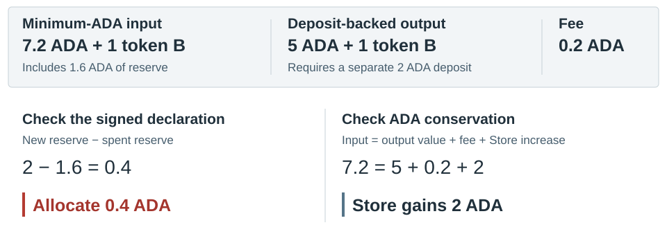

**Table of contents**

- [1. Abstract](#1-abstract)
- [2. Motivation: Why is this CIP necessary?](#2-motivation-why-is-this-cip-necessary)
  - [2.1 Preliminaries — the live UTxO set and its economic deterrent](#21-preliminaries--the-live-utxo-set-and-its-economic-deterrent)
  - [2.2 From straightforward payments to hidden application intent](#22-from-straightforward-payments-to-hidden-application-intent)
    - [2.2.1 An ADA payment already covers the minimum](#221-an-ada-payment-already-covers-the-minimum)
    - [2.2.2 A token-only transfer introduces ADA funding](#222-a-token-only-transfer-introduces-ada-funding)
    - [2.2.3 The recorded value obscures the intended payment](#223-the-recorded-value-obscures-the-intended-payment)
  - [2.3 Composition multiplies the funding work](#23-composition-multiplies-the-funding-work)
  - [2.4 Explicit deposits with a choice of output form](#24-explicit-deposits-with-a-choice-of-output-form)
- [3. Specification](#3-specification)
  - [3.1 Application value and resource backing](#31-application-value-and-resource-backing)
    - [3.1.1 The banknote analogy](#311-the-banknote-analogy)
    - [3.1.2 Minimum-ADA vs deposit-backed outputs](#312-minimum-ada-vs-deposit-backed-outputs)
    - [3.1.3 From individual deposits to transaction netting](#313-from-individual-deposits-to-transaction-netting)
  - [3.2 Transaction-building experience](#32-transaction-building-experience)
    - [3.2.1 Build the application. Review the net.](#321-build-the-application-review-the-net)
    - [3.2.2 Describing the application flow](#322-describing-the-application-flow)
    - [3.2.3 Choosing funding and refund policies](#323-choosing-funding-and-refund-policies)
    - [3.2.4 Computing and reviewing the net](#324-computing-and-reviewing-the-net)
    - [3.2.5 Composing SubTxs and delegating to TopTx](#325-composing-subtxs-and-delegating-to-toptx)
      - [3.2.5.1 Building a token-only SubTx](#3251-building-a-token-only-subtx)
      - [3.2.5.2 Netting across SubTxs](#3252-netting-across-subtxs)
    - [3.2.6 Mixing minimum-ADA and deposit-backed outputs](#326-mixing-minimum-ada-and-deposit-backed-outputs)
      - [3.2.6.1 Choosing the form of each payment](#3261-choosing-the-form-of-each-payment)
      - [3.2.6.2 Spending an input below the minimum](#3262-spending-an-input-below-the-minimum)
  - [3.3 Ledger specification](#33-ledger-specification)
    - [3.3.1 Signed transaction interface](#331-signed-transaction-interface)
      - [3.3.1.1 TxOut forms and encoding](#3311-txout-forms-and-encoding)
      - [3.3.1.2 TxBody deposit declarations and encoding](#3312-txbody-deposit-declarations-and-encoding)
        - [3.3.1.2.1 TopTx deposit declaration](#33121-toptx-deposit-declaration)
        - [3.3.1.2.2 SubTx deposit declaration](#33122-subtx-deposit-declaration)
    - [3.3.2 Validation rules](#332-validation-rules)
      - [3.3.2.1 Declaration presence and exactness](#3321-declaration-presence-and-exactness)
      - [3.3.2.2 Netting and the transaction balance](#3322-netting-and-the-transaction-balance)
      - [3.3.2.3 Release authority and settlement](#3323-release-authority-and-settlement)
      - [3.3.2.4 Script outcomes and collateral](#3324-script-outcomes-and-collateral)
    - [3.3.3 Ledger state and transaction application](#333-ledger-state-and-transaction-application)
      - [3.3.3.1 Unspent entries and allocation origins](#3331-unspent-entries-and-allocation-origins)
      - [3.3.3.2 UTxOStore and deposit accounting](#3332-utxostore-and-deposit-accounting)
      - [3.3.3.3 Applying transactions and maintaining the Store invariant](#3333-applying-transactions-and-maintaining-the-store-invariant)
      - [3.3.3.4 Persistence, rollback and replay](#3334-persistence-rollback-and-replay)
    - [3.3.4 Historical deposits and pricing changes](#334-historical-deposits-and-pricing-changes)
      - [3.3.4.1 Storage cost formula and allocation history](#3341-storage-cost-formula-and-allocation-history)
      - [3.3.4.2 Formula and parameter changes](#3342-formula-and-parameter-changes)
      - [3.3.4.3 Recovering deposits outside the node](#3343-recovering-deposits-outside-the-node)
  - [3.4 Activation and compatibility](#34-activation-and-compatibility)
    - [3.4.1 Activation and the migration baseline](#341-activation-and-the-migration-baseline)
    - [3.4.2 Legacy outputs below the new minimum](#342-legacy-outputs-below-the-new-minimum)
    - [3.4.3 Script contexts and existing contracts](#343-script-contexts-and-existing-contracts)
    - [3.4.4 Stake, voting and monetary conservation](#344-stake-voting-and-monetary-conservation)
- [4. Rationale: How does this CIP achieve its goals?](#4-rationale-how-does-this-cip-achieve-its-goals)
  - [4.1 Application value and funding](#41-application-value-and-funding)
  - [4.2 Evaluation against the CPS use cases](#42-evaluation-against-the-cps-use-cases)
  - [4.3 Responses to the CPS questions](#43-responses-to-the-cps-questions)
  - [4.4 Alternatives considered](#44-alternatives-considered)
  - [4.5 Resource protection and implementation costs](#45-resource-protection-and-implementation-costs)
  - [4.6 Author TODOs](#46-author-todos)
    - [4.6.1 Plutus compatibility](#461-plutus-compatibility)
    - [4.6.2 Local release guarantees](#462-local-release-guarantees)
    - [4.6.3 Pricing and activation](#463-pricing-and-activation)
    - [4.6.4 Declarations](#464-declarations)
    - [4.6.5 Stake and voting](#465-stake-and-voting)
    - [4.6.6 Integration and validation](#466-integration-and-validation)
- [5. Path to Active](#5-path-to-active)
  - [5.1 Acceptance Criteria](#51-acceptance-criteria)
  - [5.2 Implementation Plan](#52-implementation-plan)
  - [5.3 Reference transaction-construction API](#53-reference-transaction-construction-api)
- [6. References](#6-references)
- [7. Copyright](#7-copyright)

## 1. Abstract

This CIP continues the community work on minUTxO, including discussions at
BuidlerFest in Argentina. We thank the community contributors whose ideas and
discussions made this proposal possible.
[CPS-0037 acknowledgements](../CPS-0037/README.md#acknowledgements) · [@Crypto2099](https://github.com/Crypto2099) · [@lehins](https://github.com/lehins) · [@ch1bo](https://github.com/ch1bo) · [@matteocoppola](https://github.com/matteocoppola) · [@padierfind](https://github.com/padierfind)

*And to everyone who has ever sighed at yet another minUTxO top-up, this one's for
you. We're working to make your life a little easier from here on.*

This proposal introduces deposit-backed TxOuts alongside the current minimum-ADA
TxOuts. A deposit-backed output records application assets, including zero ADA,
while the ledger accounts for its full storage deposit separately. Spending the
output releases its original deposit under the output's spending authority.

The proposed declaration counts the storage reserve on both sides of a
transaction. Both minimum-ADA and deposit-backed outputs contribute. The ledger
also tracks how much ADA moves into or out of its external deposit store.
SubTxs can account for their contribution locally or delegate it to TopTx,
enabling token-only operations whose fees and deposit funding are coordinated
by the enclosing transaction.

This CIP depends on UTxO Storage Cost Formula for pricing. It introduces allocation
origins and shared formula history at the hard fork, allowing the ledger and
external tools to recover each original deposit across subsequent formula and
parameter changes. [UTxO Storage Cost Formula](../CIP-????-utxo-cost-formula/README.md)

## 2. Motivation: Why is this CIP necessary?

CPS-0037 collects the community's experience with minimum ADA. This proposal
addresses the **funding and accounting work** that arises when the ADA backing
ledger state becomes part of the **application's transfers**.
[CPS-0037](../CPS-0037/README.md)

### 2.1 Preliminaries — the live UTxO set and its economic deterrent

Each node maintains the **live UTxO set**, a map from input references to unspent
outputs. In ordinary successful execution, a transaction removes the outputs it
spends and adds those it creates. The resource grows through **more entries** or
**more bytes per entry**, including larger **inline datums** and **reference
scripts**. [Inline datums](https://cips.cardano.org/cip/CIP-0032) · [Reference scripts](https://cips.cardano.org/cip/CIP-0033)

The **minimum-ADA requirement** makes every new output carry enough ADA for its
resource footprint. Keeping more or larger outputs live therefore requires more
**ADA to remain committed**. Spending an output makes its ADA available to the
transaction, subject to the requirements of the outputs it creates.
[CPS-0037 — the current rule](../CPS-0037/README.md#the-current-minutxo-rule)


That commitment is the **economic deterrent** this proposal preserves. It is the
**necessary resource friction**. Mixing that funding into application payments
also creates **accidental friction**, as the following examples show.
[CPS-0037 — necessary and accidental friction](../CPS-0037/README.md#necessary-resource-friction-and-accidental-implementation-friction)

<a id="21-resource-costs-and-accidental-friction"></a>
<a id="21-application-value-independent-of-resource-funding"></a>
<a id="22-from-ada-payments-to-application-workflows"></a>
<a id="23-explicit-accounting-and-readable-history"></a>
<a id="21-when-resource-funding-obscures-an-application-payment"></a>

### 2.2 From straightforward payments to hidden application intent

The same rule affects these **3 application flows** differently. The examples use
illustrative minima for outputs with different contents.


#### 2.2.1 An ADA payment already covers the minimum

An application sends **100 ADA** to a script output with a large datum and a
reference script. Its minimum is approximately **52 ADA**. The payment already
covers the requirement, so this output needs **no additional funding**. The
intended payment can be recorded directly in `Value`.

#### 2.2.2 A token-only transfer introduces ADA funding

The intended payment is **1 token and zero ADA**. With a **1.6 ADA minimum**, the
output must also carry that ADA. Sending tokens to **3 recipients** through
3 such outputs requires **4.8 ADA** alongside the tokens. The application now
has **ADA funding** to manage, and each recipient's spending conditions control
that ADA. [CPS-0037 — token transfers and funding control](../CPS-0037/README.md#use-case-fund-for-someone-else)

#### 2.2.3 The recorded value obscures the intended payment

An application sends **1,000 tokens and 20 ADA** to a script output with a
**32 ADA minimum**. A **12 ADA top-up** brings its recorded `Value` to
**1,000 tokens and 32 ADA**.

A **token-only transfer** could produce the same `Value`, with all 32 ADA supplied
for resource backing. `Value` alone cannot recover the intended **0 ADA or 20 ADA
payment**. Applications must preserve that **application context** through a
datum, metadata or their own records, and consult it when interpreting subsequent
transfers and transaction history. [CPS-0037 — application value and resource backing](../CPS-0037/README.md#applicative-value-and-operational-backing)

<a id="22-transaction-level-netting"></a>
<a id="23-ada-free-subtxs"></a>
<a id="24-transaction-level-netting"></a>
<a id="25-ada-free-subtxs"></a>
<a id="22-composition-multiplies-the-funding-work"></a>

### 2.3 Composition multiplies the funding work

Applications must repeat this accounting across **recipient outputs** and
**successive state updates**. If an output holds 32 ADA and its successor needs
40 ADA after a pricing change, that successor has an **8 ADA funding
shortfall**. Consolidating outputs can instead free ADA for other uses.
Each step combines the application's asset movements with **top-ups and refunds**.
[CPS-0037 — successor-output funding](../CPS-0037/README.md#use-case-continuing-output)

**Nested transactions** amplify that work across independently authored
**SubTxs** assembled into a **TopTx**. Token-only operations can require ADA
funding and refund decisions across the batch, while their intended payment
amounts still need separate bookkeeping. Transaction-level accounting provides a
place to coordinate those resource-funding movements.
[Nested transactions](https://cips.cardano.org/cip/CIP-0118)

<a id="24-asset-free-txouts"></a>
<a id="25-a-predictable-deposit-calculation"></a>
<a id="26-asset-free-txouts"></a>
<a id="26-pricing-evolution-and-compatibility"></a>
<a id="27-simple-calculation-and-historical-recovery"></a>
<a id="23-explicit-deposits-with-a-choice-of-output-form"></a>

### 2.4 Explicit deposits with a choice of output form

The goal is to preserve the **economic deterrent** while making **application
amounts explicit** and resource funding easier to coordinate. **Deposit-backed
outputs** account separately for application assets and their full storage
deposit. The current **minimum-ADA form** remains available for workflows in
which the same ADA serves both as payment and as resource backing.

The proposal gives transaction builders 3 capabilities.

1. Express application inputs and outputs with their **intended assets**.
2. Account for deposits through a **net change at transaction level**, with
   reusable funding and refund policies.
3. Let a SubTx handle its change locally or **delegate to TopTx**, which can
   coordinate deposit funding alongside fees.

The **UTxO Storage Cost Formula** proposal supplies the calculation. This CIP
adds the accounting and history needed to recover each **original deposit** when
its output is spent, including after pricing changes.
[UTxO Storage Cost Formula](../CIP-????-utxo-cost-formula/README.md)

<a id="317-scope-and-terminology"></a>

## 3. Specification

The specification introduces the distinction between **application value and
resource backing**, then follows the **transaction-building workflow** from
application inputs and outputs to net deposit accounting and SubTx delegation.

The **Ledger** section defines the signed transaction interface, validation,
state transitions and historical deposit recovery across pricing changes.
**Activation and compatibility** covers migration and the interaction with
existing outputs and contracts.

> **Ledger prototype**
>
> The Cardano ledger prototype implements external deposits, SubTx delegation
> and historical deposit recovery. Its signed net currently counts external
> deposits only. This proposal extends that calculation to the embedded reserves
> of minimum-ADA outputs. [Prototype integration TODO](#464-declarations)
>
> Throughout this document, implementation references and Haskell excerpts connect
> the specification to the prototype's types, transaction-construction API and
> validation rules.
>
> [Implementation PR](https://github.com/nhenin/cardano-ledger-specs/pull/3) · [Referenced source revision](https://github.com/nhenin/cardano-ledger-specs/tree/1c22597b03e950e14d86e1d5ad86284ee5d7c1f3)

### 3.1 Application value and resource backing

Two amounts are involved when an application creates an output. The application
chooses the value it intends to transfer. The storage cost formula determines
the ADA backing required for the output to occupy the live UTxO set. This proposal
introduces a deposit-backed output that accounts for each amount separately.

#### 3.1.1 The banknote analogy

A **20-euro banknote** gives its holder 20 euros of spending power. Producing the
note also requires paper, ink and printing. Its face value expresses what it can
buy. Its production cost expresses the resources needed to create the physical
object used for that payment.

A deposit-backed output gives application value and resource backing similarly
distinct roles. The output records the assets the application transfers. Its
associated ADA deposit backs the resources it occupies in the live UTxO set.


In the example, the application transfers **1,000 tokens and 20 ADA**. An
illustrative **32 ADA deposit** gives **52 ADA committed for this output**,
alongside the tokens. The deposit is held while the output is unspent. Spending
the output releases that deposit through the transaction balance.

<a id="311-choosing-each-output-form"></a>

<a id="312-minimum-ada-and-deposit-backed-outputs"></a>

#### 3.1.2 Minimum-ADA vs deposit-backed outputs

The transaction builder chooses the form of each new output. In a **minimum-ADA
output**, the ADA in `Value` also satisfies the resource requirement. In a
**deposit-backed output**, `Value` records the application assets and the full
storage deposit is accounted for outside the `TxOut`.

Consider the intended transfer of **1,000 tokens and 20 ADA**, with an illustrative
resource requirement of **32 ADA**. A minimum-ADA output must carry 32 ADA,
including a **12 ADA top-up**. Its `Value` would be identical for a **token-only
transfer**, where all 32 ADA were supplied to meet the minimum. Reading `Value`
alone cannot distinguish those application payments.

A deposit-backed output records the **20 ADA payment** alongside the tokens and
accounts for the **32 ADA deposit** separately, giving **52 ADA committed** for
this output.


For the token-only transfer, the deposit-backed output instead records **1,000
tokens and zero ADA** in `Value`, with the same **32 ADA external deposit**. The
intended application ADA amount is explicit in each case.

When the payment already covers the minimum, the minimum-ADA form lets the same
ADA serve both purposes. A **5 ADA payment** with a **2 ADA resource requirement**
commits **5 ADA** in that form. A deposit-backed output records the 5 ADA payment
and a separate 2 ADA deposit, committing **7 ADA**.


**Deposit-backed outputs make the distinction explicit when resource funding
would otherwise obscure the application's intended ADA amount.** This supports
token-only transfers, exact ADA payments below the minimum, and application state
with zero application assets. Minimum-ADA outputs remain available for workflows
that use the same ADA as payment and resource backing. The choice is made for
each output, and both forms can appear in one transaction.

When a minimum-ADA output is spent, its full value enters the transaction balance.
Spending a deposit-backed output contributes its application value and releases
its historical external deposit into that balance.

#### 3.1.3 From individual deposits to transaction netting

The choice of representation also affects how many objects carry the value.
**20 coins of 1 euro** can be exchanged for **1 banknote of 20 euros**. The holder
has 20 euros to spend in either case. Similarly, a transaction builder can group
assets into fewer outputs or distribute them across several outputs. These
choices change the resources occupied in the live UTxO set and the deposits
required.

Each spent output releases its original storage reserve. Each new output needs
a reserve at the current price. The reserve may be embedded in a minimum-ADA
output or held externally for a deposit-backed one. Across both forms,
**input reserves can fund output reserves**. Their difference is the amount of
backing the transaction allocates or releases.

The transaction builder can therefore design the **application flow** and review
its resource-funding effect as **one net amount**. The following section shows how
this works in practice, with a **funding input** for top-ups, a **refund output**
for released ADA, and a calculation that prepares the net declaration for review.

<a id="31-moving-minutxo-accounting-from-txouts-to-transactions"></a>
<a id="31-transaction-builder-experience"></a>
<a id="31-transaction-building-dsl"></a>

<a id="32-transaction-building-dsl"></a>

### 3.2 Transaction-building experience

#### 3.2.1 Build the application. Review the net.

Transaction builders describe the **application flow**, choose **funding and
refund policies**, and review the **net deposit change**. The construction API
uses the selected inputs and outputs, these policy choices and the ledger context
to prepare the deposit declaration. This workflow supports standalone
transactions and TopTx/SubTx batches.


This workflow runs in transaction-construction software. The ledger validates its
**signed result** and records individual deposit allocations when applying it.

<a id="321-describing-the-application-flow"></a>

#### 3.2.2 Describing the application flow

An application wants to consolidate **3 units of token C in a single output**.
The transaction builder selects 3 deposit-backed inputs, each with 1 token and
zero ADA in its `Value`. The inputs retain their recorded form. For each new
output, the builder chooses between the **minimum-ADA** and **deposit-backed**
forms. Here, the builder chooses a deposit-backed output for the application
transfer so that **output 1** carries all 3 tokens and zero ADA.


The builder designates **output 0** for the refund and also chooses the
deposit-backed form for it. Assume each of the 3 spent outputs releases a
**1.6 ADA** deposit and each of the 2 new outputs requires the same amount.
Of the 4.8 ADA released, 3.2 ADA backs the new outputs, including the refund
output itself. The remaining **1.6 ADA** goes into output 0 as spendable value.
The funding candidate `reserve#0` stays unspent. Assume the minimum-ADA input
for fees and the change output have equal embedded reserves. Their contributions
cancel in the net and are omitted from the breakdown below.

> **Viewing individual deposits.** The application view can hide the per-output
> deposits and show just the net release. When the ledger applies this transaction,
> it releases the spent inputs’ deposits and allocates a separate deposit to each
> new deposit-backed output. When a later transaction spends one of those outputs,
> its deposit appears on the input side of that transaction’s breakdown.

<details>
<summary>Show the deposit breakdown for this transaction</summary>

| Entry | Deposit released | Deposit allocated |
| --- | ---: | ---: |
| 3 spent token inputs | 1.6 ADA each | — |
| Output 1 · Token consolidation | — | 1.6 ADA |
| Output 0 · Refund | — | 1.6 ADA |
| **Total** | **4.8 ADA** | **3.2 ADA** |

</details>

<a id="313-funding-and-refund-policies"></a>

<a id="323-funding-and-refund-policies"></a>

<a id="322-choosing-funding-and-refund-policies"></a>

#### 3.2.3 Choosing funding and refund policies

The builder chooses **where a top-up comes from** and **where a refund goes**.
An application can reuse these choices across transfers. In the consolidation
above, the policy offers `reserve#0` for funding and names output 0 for refunds.
The transaction releases **1.6 ADA**, so output 0 receives it and the reserve
stays unspent.


For a **top-up**, the builder can use funds already in the transaction or name
a reserve input to add when the body has an allocation to fund. If selected, the
reserve becomes an ordinary spending input. Any historical deposit it releases
counts towards the final net.

For a **refund**, the builder can select an existing output by index or supply a
new output. A new deposit-backed output needs its own deposit. If that would
consume the entire release, the builder must choose another refund destination.
A minimum-ADA refund output uses the ADA in its own value for backing.

The builder can **preview the declaration** before applying the policy to the
transaction body. For the consolidation above, the pseudocode gives the following results.

```text
policy = { funding: candidate("reserve#0"), refund: existingOutput(0) }

previewDepositChange(draft, policy, ledgerContext)
    → Release(1.6 ADA, output 0)

applyDepositPolicy(draft, policy, ledgerContext)
    → draft with deposit declaration Release(1.6 ADA, output 0)
```

The preview accounts for any input or output the policy would add. Applying the
policy to the same draft and ledger context includes those additions and writes
the same declaration. Here, output 0 is already in the draft and the reserve
stays unspent. The builder sets the refund output’s value and balances assets,
change and fees before signing.

For a Haskell implementation, see the [reference transaction-construction API](#53-reference-transaction-construction-api).

<a id="311-builder-experience-consolidating-token-outputs"></a>
<a id="312-consolidation-and-the-net-declaration"></a>
<a id="312-computing-and-reviewing-the-net"></a>

<a id="322-computing-and-reviewing-the-net"></a>

<a id="323-computing-and-reviewing-the-net"></a>

#### 3.2.4 Computing and reviewing the net

With the inputs, outputs and reserve policy chosen, the builder can see **how
much ADA this transaction needs to commit or can recover**. For a standalone
transaction, price **every new output** under the active rules and recover the
**original reserve of every spent input**. For a minimum-ADA input the reserve
is capped at the ADA it contains. Include any funding input, change output or
refund output selected by the policy.

```math
\text{Net reserve change} = \text{Reserves on new outputs} - \text{Reserves on spent inputs}
```

The sign determines the declaration. **Release** returns the surplus when the
net is negative. **Allocate** identifies the additional backing when the net is positive.
Equal amounts give **No deposit change**, an explicit zero.

Consolidating or splitting outputs can change the net. So can changing the
contents of a single output. Consider 3 drafts that spend **the same inputs**
and create **the same number of outputs**. Each spends a script output with a
historical deposit of **3.2 ADA** and creates one deposit-backed successor with
the same address and application assets. Each also includes the same minimum-ADA
reserve input and a minimum-ADA change output at index 0, which can receive a
refund. Assume the reserve on the change output equals the embedded reserve on
the funding input, so their contributions cancel.

Assume the pricing rules stay fixed at an illustrative **4,000 lovelace per
byte**. The comparison varies the encoded sizes of the successor’s **inline
datum** and **reference script**. A difference of 400 bytes changes the required
deposit by **1.6 ADA**.


The builder can use this preview to compare valid representations of the same
application state, then review the declaration for the chosen draft before signing.

<a id="32-subtx-composition-and-delegation"></a>
<a id="33-subtx-composition-and-delegation"></a>
<a id="321-local-accounting-or-delegation-to-toptx"></a>
<a id="331-local-accounting-or-delegation-to-toptx"></a>

<a id="324-subtx-accounting-and-delegation-to-toptx"></a>

<a id="324-composing-subtxs-and-delegating-to-toptx"></a>

#### 3.2.5 Composing SubTxs and delegating to TopTx

In a nested transaction, the enclosing **TopTx** brings together **SubTxs** that
can have different authors. Each author calculates the net deposit change for
their SubTx’s inputs and outputs, just as they would for a standalone transaction.
They also choose **who funds a shortfall or receives a surplus**.

- **Handle it locally.** For **Allocate**, the author funds the shortfall within
  the SubTx, selecting a reserve input if needed. For **Release**, they choose one of the
  SubTx’s ordinary outputs to receive the refund. Its value must include at
  least the refund amount. Any external deposit on that output is accounted for
  separately.
- **Delegate to TopTx.** The SubTx still declares its own amount. For **Allocate**,
  it requests funding from TopTx. For **Release**, it lets TopTx account for the
  surplus alongside the other contributions. The author can build the SubTx
  without a deposit funding input or refund destination of its own.


If a SubTx releases and reallocates equal deposits, it declares **No deposit
change**. There is no top-up or refund to delegate.

<a id="315-an-ada-free-subtx-under-formula-v1"></a>
<a id="323-an-ada-free-subtx-under-formula-v1"></a>
<a id="323-an-ada-free-subtx-using-the-storage-cost-formula"></a>
<a id="333-an-ada-free-subtx-using-the-storage-cost-formula"></a>

<a id="326-an-ada-free-subtx-example"></a>

<a id="3242-an-ada-free-subtx-example"></a>

<a id="3252-an-ada-free-subtx-example"></a>

##### 3.2.5.1 Building a token-only SubTx

Alice holds tokens B and C in a single deposit-backed output. She sends **B to
Bob** and **C to Carol**. Each recipient’s deposit-backed output holds one token
and **zero ADA** in its `Value`.


Spending Alice’s input releases its deposit, which covers part of the deposits
on the 2 new outputs. Alice’s SubTx declares **Allocate** and asks TopTx to
fund the remaining **1.0775 ADA**. The operator supplies the top-up from its
reserve and pays the batch fee. Alice can build her transfer using just the
input that holds her tokens.

<details>
<summary>How the deposit shortfall is calculated</summary>

Assume 57-byte base addresses, no datum or reference script, and the same
pricing rules for all 3 outputs. At 4,310 lovelace per byte, Alice’s two-asset
output releases **1.71538 ADA**. Bob’s and Carol’s one-asset outputs each
require **1.39644 ADA**. [UTxO Storage Cost Formula](../CIP-%3F%3F%3F%3F-utxo-cost-formula/README.md)

```math
2 \times 1.39644 - 1.71538 = 1.0775\ \text{ADA}
```

In this example, Alice supplies the only SubTx. The operator uses a minimum-ADA
reserve input and a minimum-ADA change output with equal embedded reserves.
Its own reserve change is zero. The TopTx declaration equals Alice’s contribution, and the
batch funds the allocation once.

</details>

<a id="322-netting-across-subtxs"></a>
<a id="332-netting-across-subtxs"></a>

<a id="325-netting-across-subtxs"></a>

<a id="3241-netting-across-subtxs"></a>

<a id="3251-netting-across-subtxs"></a>

##### 3.2.5.2 Netting across SubTxs

The TopTx builder reviews **two amounts**. The **batch net** adds the net from
TopTx’s own inputs and outputs to every SubTx’s net, counting each body once.
This is the amount TopTx declares. **TopTx’s share** adds its own net to the
contributions the SubTx authors delegated. The local funding and refund choices
stay with the SubTxs that made them.

Consider 2 SubTxs spending distinct token inputs. Assume every token output in
this example, whether spent or created, carries zero application ADA and has an
external deposit of **1.6 ADA**. SubTx A consolidates 3 token inputs into 1
output and delegates **Release 3.2 ADA**.
SubTx B spends 1 token input, creates 3 outputs and delegates **Allocate
3.2 ADA**. TopTx’s fee-funding input and change output carry equal embedded
reserves, so its own reserve change is zero.


A’s release covers B’s allocation. **TopTx declares No deposit change**, and no
deposit top-up or refund output is needed. The token operations still have their
own declarations, and the operator still funds the fee.

Now suppose A chooses **local release** and puts the 3.2 ADA refund in its own
token output. With the same deposit costs, the batch net is still zero. This
time the TopTx builder must arrange **3.2 ADA for B** because A has directed
its refund to its own output. This is why the builder prepares each SubTx’s
declaration first and reviews the enclosing transaction again whenever a child’s
inputs, outputs or delegation choice changes.

#### 3.2.6 Mixing minimum-ADA and deposit-backed outputs

At the hard fork, all existing UTxOs have the minimum-ADA form. When spending
them, a builder can introduce deposit backing **one output at a time**. Reserves
from all spent inputs can fund any new output. The builder reviews a single
[transaction net](#324-computing-and-reviewing-the-net) across both forms.

<a id="3261-one-input-two-output-forms"></a>

##### 3.2.6.1 Choosing the form of each payment

Keep a **minimum-ADA output** when a contract expects the backing ADA in its
value. Choose a **deposit-backed output** when the recipient should see exactly
the assets the application intends to send. Both choices can appear in the same
transaction.


Splitting the payment creates another output to back. Its embedded minimum
counts towards the net even when the external deposit for the token stays the same.


##### 3.2.6.2 Spending an input below the minimum

A pre-fork output can hold less ADA than the minimum calculated at migration.
In that case **all the ADA it holds counts as reserve**. The builder
can pool it with reserves from other inputs and fund any remaining shortfall.
This works for either form of successor. [Migration rule](#342-legacy-outputs-below-the-new-minimum)


<a id="33-ledger-interface-and-validation"></a>

<a id="33-ledger"></a>

### 3.3 Ledger specification

The ledger receives the **signed transaction body**. From its inputs, its new
outputs and the current ledger state, it checks two claims independently.

- **Is the declaration exact?** Both minimum-ADA reserves and external deposits
  contribute to the change in backing.
- **Does the transaction balance?** Minimum ADA already appears in the input
  and output values. Only the change in external deposits adds a Store term.

The accepted execution path determines which entries the ledger consumes and
creates. Each new entry records an allocation origin so that its original
backing can be recovered even after prices change.

#### 3.3.1 Signed transaction interface

In the [transaction-building experience](#32-transaction-building-experience),
the builder chooses each output’s form and reviews the net reserve change.
The ledger encodes the result in the signed transaction.

- **`TxOut`** records the form of each output the transaction creates.
- **`TxBody`** can declare the net allocation, net release or zero change in
  reserves for the transaction.

<a id="322-output-representation"></a>
<a id="351-the-two-txout-forms"></a>
<a id="361-the-two-txout-forms"></a>
<a id="331-txout-forms-and-encoding"></a>

<a id="3312-txout-forms-and-encoding"></a>

##### 3.3.1.1 TxOut forms and encoding

The builder chooses a form **for each output** in the signed `TxBody`. In the
split payment below, the same transaction pays Bob in ADA and sends Carol a
token. [Choosing the form of each payment](#3261-choosing-the-form-of-each-payment)


- **Minimum-ADA output.** Its value must contain at least the active minimum.
- **Deposit-backed output.** Its value holds the application assets and can
  contain zero ADA and zero native assets. The full deposit is funded
  separately, even when the application ADA exceeds the required deposit.

When either output is spent, the `TxIn` identifies it by transaction ID and
output index. The ledger reads its form from that live entry. The same
admission rules apply when creating a collateral return. Other output-validity
rules still apply.

**How the ledger recognises the form.** In a CBOR output map, exactly one
value key is present. Key `1` identifies the minimum-ADA form and key `4`
identifies the deposit-backed form. Both encode the same `value` type.
The existing Alonzo list form also decodes as a minimum-ADA output.


The deposit amount and allocation slot are outside the serialized output.
The ledger derives the reserve for each output occurrence, including identical
outputs at distinct indices and zero-priced outputs.

<details>
<summary><strong>TxOut</strong> · Haskell types and CBOR encoding</summary>

Each era defines the payload type for each constructor.
[Shared output type](https://github.com/nhenin/cardano-ledger-specs/blob/1c22597b03e950e14d86e1d5ad86284ee5d7c1f3/libs/cardano-ledger-core/src/Cardano/Ledger/TxOut.hs#L79-L81)

```haskell
data TxOut era
  = MinAdaTxOut !(MinAdaTxOut era)
  | DepositBackedTxOut !(DepositBackedTxOut era)

-- Output types from the Dijkstra instance
instance EraTxOut DijkstraEra where
  type MinAdaTxOut DijkstraEra = BabbageTxOut DijkstraEra
  type DepositBackedTxOut DijkstraEra = DijkstraDepositBackedTxOut
```

**Minimum-ADA payload.** Dijkstra reuses the Babbage output. Its public
pattern exposes four fields, including the full `Value` that covers the minimum.
[Dijkstra output types](https://github.com/nhenin/cardano-ledger-specs/blob/1c22597b03e950e14d86e1d5ad86284ee5d7c1f3/eras/dijkstra/impl/src/Cardano/Ledger/Dijkstra/TxOut.hs#L217-L219) · [Babbage output pattern](https://github.com/nhenin/cardano-ledger-specs/blob/1c22597b03e950e14d86e1d5ad86284ee5d7c1f3/eras/babbage/impl/src/Cardano/Ledger/Babbage/TxOut.hs#L479-L489)

```haskell
pattern BabbageTxOut ::
  (Era era, Val (Value era), HasCallStack) =>
  Addr ->                      -- address
  Value era ->                 -- value, including the minimum ADA
  Datum era ->                 -- datum
  StrictMaybe (Script era) ->  -- reference script
  BabbageTxOut era
```

**Deposit-backed payload.** `ApplicationAssets` wraps the `Value` transferred
by the application. The deposit backs the corresponding unspent entry.
[Deposit-backed fields](https://github.com/nhenin/cardano-ledger-specs/blob/1c22597b03e950e14d86e1d5ad86284ee5d7c1f3/eras/dijkstra/impl/src/Cardano/Ledger/Dijkstra/TxOut.hs#L92-L97)

```haskell
-- The prototype prefixes these field names with depositBacked.
data DijkstraDepositBackedTxOut = DijkstraDepositBackedTxOut
  { address :: !Addr
  , applicationAssets :: !(ApplicationAssets DijkstraEra)
  , datum :: !(Datum DijkstraEra)
  , referenceScript :: !(StrictMaybe (Script DijkstraEra))
  }
```

**CBOR encoding.** The Dijkstra schema names the deposit-backed form
`store_backed_transaction_output`. [Output decoder](https://github.com/nhenin/cardano-ledger-specs/blob/1c22597b03e950e14d86e1d5ad86284ee5d7c1f3/eras/dijkstra/impl/src/Cardano/Ledger/Dijkstra/TxOut.hs#L310-L368)

```cddl
transaction_output =
    alonzo_transaction_output
  / babbage_transaction_output
  / store_backed_transaction_output

store_backed_transaction_output =
  { 0 : address
  , 4 : application_assets
  , ? 2 : datum_option
  , ? 3 : script_ref
  }

application_assets = value
```

</details>

<a id="312-txbody-deposit-declarations"></a>
<a id="33-txbody-declarations-and-encoding"></a>
<a id="33-ledger-interface-and-txbody-declarations"></a>
<a id="34-ledger-interface-and-txbody-declarations"></a>
<a id="332-txbody-deposit-declarations-and-encoding"></a>

<a id="3311-txbody-deposit-declarations-and-encoding"></a>

##### 3.3.1.2 TxBody deposit declarations and encoding

Spending inputs and outputs occupy keys `0` and `1` in the signed body.
The proposal adds **key `28`** alongside them for the **net deposit declaration**.
The [TopTx declaration](#33121-toptx-deposit-declaration) covers the whole batch.
The [SubTx declaration](#33122-subtx-deposit-declaration) covers that SubTx’s
contribution and records who handles it.


**During construction**, the builder can offer a reserve input for a top-up
and supply a refund `TxOut` or select an output already in the draft.
Two construction functions use that
[funding and refund policy](#323-choosing-funding-and-refund-policies).

- `previewDepositChange(draft, policy, ledgerContext)` returns the declaration
  the builder can review. It accounts for any input or output the policy would add.
- `applyDepositPolicy(draft, policy, ledgerContext)` returns the **prepared
  transaction body**, including the selected inputs, outputs and declaration.
  If final balancing changes the net or the refund index, the builder updates
  the declaration before signing.

These are the names used in the specification’s pseudocode. The corresponding
TopTx functions in the prototype are `computeNetBalance` and
`updateTxBodyWithNetBalance`. [Reference transaction-construction API](#53-reference-transaction-construction-api)


**Reading the examples.** `Allocate(1.6 ADA)` declares the size of a top-up.
Its funding input appears among the ordinary spending inputs as a `TxIn`.
In `Release(1.6 ADA, output 1)`, the index selects the **second ordinary
output of the declaring body**. Its value already includes the refund.

An explicit **No deposit change** declares that input and output reserves
balance. Omitting key `28` makes no declaration. [When a declaration is required](#3321-declaration-presence-and-exactness)

###### 3.3.1.2.1 TopTx deposit declaration

TopTx signs the **net reserve change for the whole batch**. Each SubTx
contributes once, including those that handle their funding or refund locally.
On **Release**, the amount is the batch total. The settlement identifies
which TopTx output receives **TopTx’s share**, if any.


In each example, the rest of the batch has zero net reserve change.

- **`Allocate(1.6 ADA)`** — Alice’s SubTx needs a 1.6 ADA top-up. If she
  requests funding from TopTx, the operator supplies it. If she funds it
  locally, TopTx still declares 1.6 ADA for the batch. The top-up is paid once.
- **`Release(1.6 ADA, output 1)`** — Alice and Bob each release 0.8 ADA in
  their SubTxs. Alice refunds her share locally. Bob delegates his to TopTx.
  TopTx declares the full **1.6 ADA** and includes **0.8 ADA** in its own output 1.
- **`Release(1.6 ADA, no TopTx refund)`** — Alice’s SubTx releases 1.6 ADA
  and puts the full refund in **its own output 1**. TopTx records the 1.6 ADA
  batch release. Alice’s output already accounts for the entire refund.
- **`No deposit change`** — Alice delegates a 1.6 ADA release to TopTx and
  Bob asks TopTx to fund a 1.6 ADA allocation. Alice’s release covers Bob’s
  top-up, so TopTx declares zero even though both SubTxs declare a change.

<a id="332-haskell-representation"></a>
<a id="342-haskell-representation"></a>

<a id="333-cbor-encoding"></a>
<a id="343-cbor-encoding"></a>

<details>
<summary><strong>TopTx</strong> · Haskell types and CBOR encoding</summary>

The body field `dtbrNetUTxODepositChange` wraps the optional payload in
`StrictMaybe`. [TopTx body field](https://github.com/nhenin/cardano-ledger-specs/blob/1c22597b03e950e14d86e1d5ad86284ee5d7c1f3/eras/dijkstra/impl/src/Cardano/Ledger/Dijkstra/TxBody.hs#L226) · [TopTx declaration types](https://github.com/nhenin/cardano-ledger-specs/blob/1c22597b03e950e14d86e1d5ad86284ee5d7c1f3/eras/dijkstra/impl/src/Cardano/Ledger/Dijkstra/UTxOs/Deposit/TopTx.hs#L93-L143)

```haskell
data NetUTxODepositChange
  = NoUTxODepositChange
  | AllocateUTxODeposit !StrictlyPositiveCoin
  | ReleaseUTxODeposit !StrictlyPositiveCoin !TopTxReleaseSettlement

data TopTxReleaseSettlement
  = NoTopTxSettlement
  | TopTxSettlementOutput !TxIx
```

```cddl
top_tx_deposit_field = (? 28 : net_utxo_deposit_change)

positive_coin = 1 .. 18446744073709551615
output_index = uint .size 2

net_utxo_deposit_change =
    [0, amount : positive_coin]  ; allocate
  / [1, amount : positive_coin, settlement : top_tx_release_settlement]  ; release
  / [2]  ; zero

top_tx_release_settlement =
    [0]  ; no TopTx settlement
  / [1, output_index]
```

Both decoders reject unknown tags, incorrect array lengths and out-of-range
values. Validation checks that an index selects an existing ordinary output.
[TopTx CDDL](https://github.com/nhenin/cardano-ledger-specs/blob/1c22597b03e950e14d86e1d5ad86284ee5d7c1f3/eras/dijkstra/impl/cddl/data/dijkstra.cddl#L978-L999) · [TopTx body encoder](https://github.com/nhenin/cardano-ledger-specs/blob/1c22597b03e950e14d86e1d5ad86284ee5d7c1f3/eras/dijkstra/impl/src/Cardano/Ledger/Dijkstra/TxBody.hs#L568)

</details>

###### 3.3.1.2.2 SubTx deposit declaration

A SubTx signs **its own net reserve change**. It can fund an allocation
locally or ask TopTx to fund it. For a release, it can name a refund output
of its own or ask TopTx to handle the refund. Even when it **delegates**,
its declaration must specify the full amount.


- **`Allocate(1.6 ADA)`** — Alice’s new outputs require 1.6 ADA more reserve
  than her inputs release. She covers the difference from the spending inputs
  in her SubTx, drawing on her reserve input if needed.
- **`Allocate(1.6 ADA, funding = TopTx)`** — For the same shortfall, Alice
  asks TopTx to supply the 1.6 ADA. Her SubTx can carry just the tokens she
  wants to send. The operator can fund the top-up from its reserve or from
  another SubTx’s delegated release.
- **`Release(1.6 ADA, output 1)`** — Alice’s inputs release 1.6 ADA more
  reserve than her new outputs require. She includes the surplus in the value
  of **her SubTx’s output 1**. That output’s recipient gets the refund.
- **`Release(1.6 ADA, delegate to TopTx)`** — Alice hands the same surplus
  to TopTx for settlement. Her SubTx names no refund output. The operator can
  use the release to cover another SubTx’s top-up or put the remaining refund
  in a TopTx output.
- **`No deposit change`** — Alice spends an output backed by 1.6 ADA and
  creates a successor requiring 1.6 ADA. The released reserve covers the new
  requirement exactly, so she declares zero and has nothing to delegate.

<details>
<summary><strong>SubTx</strong> · Haskell types and CBOR encoding</summary>

The body field `dstbrNetUTxODepositChange` wraps the optional payload in
`StrictMaybe`. [SubTx body field](https://github.com/nhenin/cardano-ledger-specs/blob/1c22597b03e950e14d86e1d5ad86284ee5d7c1f3/eras/dijkstra/impl/src/Cardano/Ledger/Dijkstra/TxBody.hs#L248) · [SubTx declaration types](https://github.com/nhenin/cardano-ledger-specs/blob/1c22597b03e950e14d86e1d5ad86284ee5d7c1f3/eras/dijkstra/impl/src/Cardano/Ledger/Dijkstra/UTxOs/Deposit/SubTx.hs#L102-L148)

```haskell
data SubTxNetUTxODepositChange
  = SubTxNoUTxODepositChange
  | SubTxAllocateUTxODeposit !StrictlyPositiveCoin
  | SubTxRequestUTxODepositFromTopTx !StrictlyPositiveCoin
  | SubTxReleaseUTxODeposit !StrictlyPositiveCoin !SubTxReleaseTarget

data SubTxReleaseTarget
  = SubTxSettlementOutput !TxIx
  | DelegateToTopTx
```

```cddl
sub_tx_deposit_field = (? 28 : sub_tx_net_utxo_deposit_change)

positive_coin = 1 .. 18446744073709551615
output_index = uint .size 2

sub_tx_net_utxo_deposit_change =
    [0, amount : positive_coin]  ; allocate locally
  / [1, amount : positive_coin, target : sub_tx_release_target]  ; release
  / [2, amount : positive_coin]  ; request funding from TopTx
  / [3]  ; zero

sub_tx_release_target =
    [0, output_index]
  / [1]  ; delegate to TopTx
```

[SubTx CDDL](https://github.com/nhenin/cardano-ledger-specs/blob/1c22597b03e950e14d86e1d5ad86284ee5d7c1f3/eras/dijkstra/impl/cddl/data/dijkstra.cddl#L875-L901) · [SubTx body encoder](https://github.com/nhenin/cardano-ledger-specs/blob/1c22597b03e950e14d86e1d5ad86284ee5d7c1f3/eras/dijkstra/impl/src/Cardano/Ledger/Dijkstra/TxBody.hs#L596)

</details>

#### 3.3.2 Validation rules

<a id="331-declaration-meaning-and-presence"></a>
<a id="341-declaration-meaning-and-presence"></a>

##### 3.3.2.1 Declaration presence and exactness

To check the whole batch, the ledger resolves ordinary spending inputs against
the UTxO set **as it stood before the batch** and prices each body’s proposed
outputs. Reference inputs remain live. Collateral belongs to a separate
execution path. [Pre-batch validation](https://github.com/nhenin/cardano-ledger-specs/blob/1c22597b03e950e14d86e1d5ad86284ee5d7c1f3/eras/dijkstra/impl/src/Cardano/Ledger/Dijkstra/Rules/Utxo.hs#L414-L433)

- A body spending or creating a **deposit-backed output** must declare its
  change, even when the price is zero or its allocations and releases cancel.
  An explicit SubTx declaration, including zero, also requires a TopTx declaration.
- Each explicit **SubTx** declaration must match its own change in sign and
  magnitude. **TopTx** must declare the exact batch total whenever its
  declaration is present. Delegating a SubTx’s funding or release leaves its
  contribution to that total intact.

The prototype allows a standalone minimum-ADA-only transaction to omit key
`28`. An explicit zero asserts that reserves balance. Omitting the field
makes no such assertion. [Declaration presence checks](https://github.com/nhenin/cardano-ledger-specs/blob/1c22597b03e950e14d86e1d5ad86284ee5d7c1f3/eras/dijkstra/impl/src/Cardano/Ledger/Dijkstra/Rules/DepositStore/Declaration.hs)

> **TODO — Compatibility.** Preserve existing minimum-ADA transactions that
> omit key `28`. Specify when a minimum-ADA-only body opts in and how to
> attribute its contribution in a batch when another body declares a change.

<a id="34-transaction-accounting-and-validation"></a>
<a id="35-transaction-accounting-and-validation"></a>
<a id="313-netting-and-the-transaction-balance"></a>
<a id="341-netting-and-the-transaction-balance"></a>
<a id="351-netting-and-the-transaction-balance"></a>

<a id="333-netting-and-the-transaction-balance"></a>

##### 3.3.2.2 Netting and the transaction balance

The following quantities include funding inputs, change and settlement outputs.
The ledger calculates them in integer lovelace.

| Ledger quantity | Minimum-ADA output | Deposit-backed output |
| --- | --- | --- |
| Reserve credited on spend | Historical requirement, capped at the ADA in its value | Original external deposit |
| Reserve required on creation | Active minimum, covered by its value | Full active deposit, held separately |
| Part of that reserve held in the Store | Zero | Entire deposit |

**Check the declaration.** Subtract the reserve credited on a body’s spent
inputs from the reserve required on its new outputs. Count TopTx and each
SubTx once in the batch total.

```math
\begin{aligned}
\Delta_b &= \sum_{o\in\mathrm{outputs}(b)} \mathrm{required}(o)
          - \sum_{u\in\mathrm{spent}(b)} \mathrm{credited}(u) \\
\Delta_{\mathrm{batch}} &= \sum_{b\in\mathrm{batch}} \Delta_b .
\end{aligned}
```

**Check conservation.** Over the same batch, the **Store change** is the
external deposits required on creation minus the external deposits recovered
on spend. Ordinary value accounting already includes every lovelace carried
in the inputs and outputs. For a transfer whose only other ADA flow is the fee,
the conservation check is

```math
\mathrm{inputADA} = \mathrm{outputADA} + \mathrm{fee} + \Delta_{\mathrm{store}} .
```

A positive Store change moves ADA into the Store. A negative change makes
ADA available to the transaction. Existing rules still account for withdrawals,
certificates, governance effects, minting and native-asset conservation.



**Prototype coverage.** The pinned implementation computes the external-only
net for both checks. This proposal uses all reserves for declaration exactness
and the external-only net for conservation. [Prototype declaration check](https://github.com/nhenin/cardano-ledger-specs/blob/1c22597b03e950e14d86e1d5ad86284ee5d7c1f3/eras/dijkstra/impl/src/Cardano/Ledger/Dijkstra/Rules/DepositStore/Accounting.hs#L109-L143) · [Prototype value conservation](https://github.com/nhenin/cardano-ledger-specs/blob/1c22597b03e950e14d86e1d5ad86284ee5d7c1f3/eras/dijkstra/impl/src/Cardano/Ledger/Dijkstra/UTxO.hs#L92-L144)

<a id="314-release-authority-and-settlement"></a>
<a id="342-release-authority-and-settlement"></a>
<a id="352-release-authority-and-settlement"></a>

<a id="334-release-authority-and-settlement"></a>

##### 3.3.2.3 Release authority and settlement

The spending credential that authorises consumption of an output also
authorises recovery of its reserve. Funding the original deposit grants no
separate right to reclaim it.

**Attribute the change.** A SubTx either settles its own contribution locally
or delegates it to TopTx. Once these choices are known, TopTx’s share is the
batch total less the signed changes handled locally by SubTxs.

```math
T = \Delta_{\mathrm{batch}} - \sum_{b\in\mathrm{localSubTxs}} \Delta_b .
```

**Check the destination.** A local release selects an ordinary output by
zero-based index within the declaring body. The selected output already
contains the settlement ADA. Other bodies’ outputs and the collateral return
are outside the index range.

The **pinned prototype** uses its external-deposit net to determine how much
the selected output must cover. It counts ADA in the output’s serialized
value, including any embedded minimum, towards that bound. A separate external
deposit contributes nothing to coverage.

| Declaration | Settlement check |
| --- | --- |
| SubTx releases locally | Its own selected output contains at least the SubTx release. |
| SubTx delegates a release | TopTx assumes that contribution. The SubTx supplies no local index. |
| TopTx declares a release | If its attributed share is negative, its own selected output covers that share’s magnitude. Otherwise it uses the release form without an index. |
| TopTx declares allocation or zero | Neither form carries a settlement index, whatever TopTx’s attributed share. |

A settlement index establishes a destination and a lower bound on its value.
Selecting it adds no ADA to the transaction balance. Conservation is checked
over the batch, with an additional TopTx self-balance check in the prototype’s
legacy Plutus mode. [Settlement checks](https://github.com/nhenin/cardano-ledger-specs/blob/1c22597b03e950e14d86e1d5ad86284ee5d7c1f3/eras/dijkstra/impl/src/Cardano/Ledger/Dijkstra/Rules/DepositStore/Accounting.hs#L237-L281)

> **TODO — Mixed-form settlement.** Specify the required coverage when the
> signed reserve change, TopTx’s share and the Store movement differ. In
> particular, a batch can declare allocation or zero while external ADA is
> released. [Local release guarantees](#462-local-release-guarantees)

<a id="316-script-outcomes-and-collateral"></a>
<a id="343-script-outcomes-and-collateral"></a>
<a id="353-script-outcomes-and-collateral"></a>

<a id="335-script-outcomes-and-collateral"></a>

##### 3.3.2.4 Script outcomes and collateral

| Outcome | Ledger effect |
| --- | --- |
| Ordinary success | Check whole-batch value conservation and apply the ordinary inputs, outputs, fee and external Store change. |
| Accepted phase-2 failure | Apply only the collateral inputs and optional collateral return. Derive the fee credit and Store change from those entries. |
| Rejection | Keep the preceding ledger state. |

The pinned prototype checks ordinary declaration presence, exactness, output
validity and settlement on **both accepted paths**. If any body has redeemers,
it also checks that the collateral funds the required minimum fee.

Let $C$ and $Q$ be the ADA in the collateral inputs’ and return’s serialized
values. Let $D$ be the active external deposit on the return minus the
historical external deposits on those inputs. An absent return contributes
zero coins and zero deposit. A minimum-ADA return has zero external deposit.

```math
\begin{aligned}
\mathrm{coinFee} &= C - Q - \max(0,D) \\
\mathrm{feeCredit} &= \mathrm{coinFee} + \max(0,-D) .
\end{aligned}
```

The coin-funded amount must cover
$\lceil \mathrm{txFee}\times\mathrm{collateralPercentage}/100\rceil$
when the collateral check applies. Any surplus external deposit goes to the
fee pot on accepted failure. It cannot fund that minimum or enlarge the
signed return. The Store changes by $D$. An explicit total-collateral field
must equal $C-Q$ when checked. The return must preserve the identity and
quantity of every collateral native asset. Existing eligibility, witness and
input-count rules still apply. [Collateral accounting](https://github.com/nhenin/cardano-ledger-specs/blob/1c22597b03e950e14d86e1d5ad86284ee5d7c1f3/eras/dijkstra/impl/src/Cardano/Ledger/Dijkstra/Rules/DepositStore/Accounting.hs#L284-L327) · [Collateral validation](https://github.com/nhenin/cardano-ledger-specs/blob/1c22597b03e950e14d86e1d5ad86284ee5d7c1f3/eras/dijkstra/impl/src/Cardano/Ledger/Dijkstra/Rules/DepositStore/Collateral.hs#L35-L79)

> **TODO — Phase-2 failure.** Verify the mixed-form declaration and settlement
> checks on accepted failure against this independent collateral balance.

<a id="32-deposit-model"></a>
<a id="35-output-representation-and-ledger-application"></a>
<a id="36-output-representation-and-ledger-application"></a>
<a id="36-deterministic-deposit-recovery"></a>
<a id="37-deterministic-deposit-recovery"></a>

<a id="34-ledger-state-and-deposit-lifecycle"></a>

#### 3.3.3 Ledger state and transaction application

Once validation selects the execution path, the ledger updates the
live UTxO entries and their external ADA backing together.

<a id="321-the-live-utxo-resource"></a>
<a id="352-unspent-entries-and-allocation-origins"></a>
<a id="362-unspent-entries-and-allocation-origins"></a>
<a id="341-unspent-entries-and-allocation-origins"></a>

##### 3.3.3.1 Unspent entries and allocation origins

A `TxIn` resolves to an accepted output and its **allocation origin**. The
origin belongs to the live entry, outside the signed `TxOut`. The prototype uses the
same wrapper for both output forms. The types below omit deriving clauses.

```haskell
newtype IndexedUTxOs era = IndexedUTxOs
  { unIndexedUTxOs :: Map TxIn (Unspent (TxOut era))
  }

data Unspent output = Unspent
  { output :: !output
  , allocatedAt :: !AllocatedAt
  }

data AllocatedAt
  = AtStoreMigration
  | AtSlot !SlotNo
```

A post-fork allocation records the slot of its containing block. An imported
minimum-ADA entry carries the migration marker. Either origin selects the
pricing context needed when the entry is spent. [Allocation map](https://github.com/nhenin/cardano-ledger-specs/blob/1c22597b03e950e14d86e1d5ad86284ee5d7c1f3/libs/cardano-ledger-core/src/Cardano/Ledger/State/Accounting/UTxOs/IndexedUTxOs.hs#L89-L92) · [Unspent entry](https://github.com/nhenin/cardano-ledger-specs/blob/1c22597b03e950e14d86e1d5ad86284ee5d7c1f3/libs/cardano-ledger-core/src/Cardano/Ledger/State/Accounting/UTxOs/Unspent.hs#L52-L71)


<a id="324-allocation-history-and-the-store-invariant"></a>
<a id="362-formula-history-and-the-store-invariant"></a>
<a id="372-formula-history-and-the-store-invariant"></a>

##### 3.3.3.2 UTxOStore and deposit accounting

The prototype groups the live map, its shared pricing history and the
**external ADA total** in one state type.

```haskell
data UTxOStore era = UTxOStore
  { depositFormulaHistory :: !DepositFormulaHistory
  , totalDepositAmount :: !DepositAmount
  , allocations :: !(IndexedUTxOs era)
  }
```

Only deposit-backed entries contribute to `totalDepositAmount`. The ADA backing
a minimum-ADA entry is already counted in the output’s value. [Store type](https://github.com/nhenin/cardano-ledger-specs/blob/1c22597b03e950e14d86e1d5ad86284ee5d7c1f3/libs/cardano-ledger-core/src/Cardano/Ledger/State/Accounting/UTxOs/Store/Internals.hs#L68-L72)

<a id="353-applying-the-transaction"></a>
<a id="363-applying-the-transaction"></a>
<a id="343-applying-transactions-and-maintaining-the-store-invariant"></a>

##### 3.3.3.3 Applying transactions and maintaining the Store invariant

On ordinary success, apply the ordinary inputs and outputs of TopTx and its
SubTxs. On accepted phase-2 failure, apply the collateral inputs and any
collateral return. Fee accounting follows the [selected execution path](#3324-script-outcomes-and-collateral).

1. Remove each consumed entry. Debit its historical external deposit, if any.
2. Insert each newly created output under its resulting `TxIn` with the block’s
   slot. Credit its external deposit, if any, at the active price.

Reference inputs retain their entries. A rejected transaction leaves the state
unchanged. After each accepted transition, the Store’s external ADA total
`S` must equal the sum over all live deposit-backed entries `D`.

```math
S = \sum_{u \in D} \mathrm{originalDeposit}(u)
```


[Applied inputs and outputs](https://github.com/nhenin/cardano-ledger-specs/blob/1c22597b03e950e14d86e1d5ad86284ee5d7c1f3/libs/cardano-ledger-core/src/Cardano/Ledger/State/Accounting/UTxOs/Store/Internals.hs#L87-L115)

<a id="333-encoding-validation-and-versioning"></a>
<a id="375-encoding-validation-and-persistence"></a>
<a id="385-encoding-validation-and-persistence"></a>
<a id="346-persistence-rollback-and-replay"></a>

##### 3.3.3.4 Persistence, rollback and replay

Restoring a snapshot or rolling back to a chain point must recover the same
output payloads, allocation origins, pricing history and external total at
that point. Implementations may choose their storage layout. Replay must
reproduce the same deposits and state transitions. The prototype snapshot
uses MemPack for input references and output payloads and checks the stored
total against the restored entries. [Snapshot codec](https://github.com/nhenin/cardano-ledger-specs/blob/1c22597b03e950e14d86e1d5ad86284ee5d7c1f3/libs/cardano-ledger-core/src/Cardano/Ledger/State/Accounting/UTxOs/Store/Internals.hs#L214-L265)

#### 3.3.4 Historical deposits and pricing changes

An output can outlive a change of price. Its **allocation origin** fixes the
formula version and parameters used to recover its backing when it is spent.

<a id="342-storage-cost-formula-and-allocation-history"></a>

##### 3.3.4.1 Storage cost formula and allocation history

<a id="323-dependency-on-utxo-storage-cost-formula"></a>
<a id="361-dependency-on-utxo-storage-cost-formula"></a>
<a id="371-dependency-on-utxo-storage-cost-formula"></a>

[UTxO Storage Cost Formula](../CIP-%3F%3F%3F%3F-utxo-cost-formula/README.md)
defines the measurements and pricing calculation and must activate by the time
this mechanism starts. The ledger retains an **initial pricing context** and
subsequent contexts indexed by their activation slots.

| Recorded origin | Pricing context for that entry |
| --- | --- |
| `AtStoreMigration` | The initial context, permanently. |
| `AtSlot s` | The latest context activated at or before `s`, or the initial context if no change had taken effect. |

The history begins at the supporting hard fork and survives an empty live map.
[Formula history and slot lookup](https://github.com/nhenin/cardano-ledger-specs/blob/1c22597b03e950e14d86e1d5ad86284ee5d7c1f3/libs/cardano-ledger-core/src/Cardano/Ledger/State/Accounting/UTxOs/Deposit.hs#L105-L145)

<a id="373-formula-and-parameter-changes"></a>
<a id="383-formula-and-parameter-changes"></a>
<a id="344-formula-and-parameter-changes"></a>

##### 3.3.4.2 Formula and parameter changes

Each change opens a new interval at its **effective slot**. For an epoch-boundary
rate change, this is the first slot of the epoch, even if its first transaction
arrives later. Formula versions can advance and rates can rise or fall.
Reapplying the current context has no effect. A version downgrade, an
out-of-order activation or a change that would reprice a live allocation is
invalid. [Formula activation](https://github.com/nhenin/cardano-ledger-specs/blob/1c22597b03e950e14d86e1d5ad86284ee5d7c1f3/libs/cardano-ledger-core/src/Cardano/Ledger/State/Accounting/UTxOs/Store.hs#L75-L98)

A transaction that spends an output created before the boundary and creates a
successor after it uses **two prices**. The input releases its original
backing. The successor requires the new price. Activation alone moves no ADA
and leaves the Store total unchanged.

<a id="363-recovering-deposits-outside-the-node"></a>
<a id="373-recovering-deposits-outside-the-node"></a>
<a id="345-recovering-deposits-outside-the-node"></a>

##### 3.3.4.3 Recovering deposits outside the node

An external implementation can reproduce the ledger’s calculation from a
**single ledger snapshot**. Resolve the spending reference to its output and
origin, select the historical context and apply its formula to the original
output measurements, including payload bytes required by that formula.
For new outputs, use the pricing context for the intended application slot.

The prototype exposes two queries over the same entry. `computeDeposit`
recovers the backing that the proposed signed net counts for either form,
capped at the ADA present for a minimum-ADA input. `computeExternalDeposit`
recovers the amount held externally, which is zero for a minimum-ADA input.
[Historical backing](https://github.com/nhenin/cardano-ledger-specs/blob/1c22597b03e950e14d86e1d5ad86284ee5d7c1f3/eras/dijkstra/impl/src/Cardano/Ledger/Dijkstra/UTxOs/Unspent.hs#L20-L35) · [External deposit and origin lookup](https://github.com/nhenin/cardano-ledger-specs/blob/1c22597b03e950e14d86e1d5ad86284ee5d7c1f3/libs/cardano-ledger-core/src/Cardano/Ledger/State/Accounting/UTxOs/Unspent.hs#L76-L89)

<a id="33-lifecycle-and-compatibility"></a>
<a id="37-migration-and-compatibility"></a>
<a id="38-migration-and-compatibility"></a>

<a id="35-activation-and-compatibility"></a>

### 3.4 Activation and compatibility

<a id="331-parameter-changes-and-migration"></a>
<a id="371-activation-and-the-migration-baseline"></a>
<a id="381-activation-and-the-migration-baseline"></a>

<a id="351-activation-and-the-migration-baseline"></a>

#### 3.4.1 Activation and the migration baseline

The extended transaction-body and output encodings activate in the supporting era.

At the hard fork, translate existing UTxO references and their semantic address, value,
datum and reference script into min-ADA entries marked `AtStoreMigration`. Initialise
history with the formula and rate selected for this activation. The initial
external Store total is zero. Imported entries use this permanent baseline
to determine the embedded backing credited on spend under the proposed
declaration, capped by each output’s ADA. The complete original value remains
available to the ordinary balance when an imported output is spent.

A transaction may spend both output forms and create either form after activation.
New outputs, including replacements of min-ADA outputs, satisfy the active rules.
This transition changes state representation and requires downstream interfaces to
handle the new form.

<a id="372-legacy-outputs-below-the-new-minimum"></a>
<a id="382-legacy-outputs-below-the-new-minimum"></a>

<a id="352-legacy-outputs-below-the-new-minimum"></a>

#### 3.4.2 Legacy outputs below the new minimum

An imported output can hold less ADA than its migration-baseline requirement.
The reserve credited when spending it is `min(C(u), P_H(u))`, where `C(u)` is
the ADA actually present and `P_H(u)` is that historical requirement. Its
application-ADA view is the remainder. New minimum-ADA outputs must meet their
full active minimum.

Consider an imported minimum-ADA output containing **2 ADA and 100 tokens**.
Suppose the migration baseline assigns it a **3 ADA** requirement. Its inspection
view reports a reserve of `min(2, 3) = 2 ADA`, leaving zero application ADA and
100 tokens. Native assets are unaffected by this derived view.

Spend it to create a deposit-backed output carrying the 100 tokens, with zero
application ADA and a 3 ADA external deposit. Assume the funding and change for
the difference and fees have zero net backing effect.

| Quantity | Amount |
| --- | ---: |
| Embedded backing released by the imported input | 2 ADA |
| Backing required by the new output | 3 ADA |
| Proposed declaration | **Allocate 1 ADA** |
| Change in the external Store | **+3 ADA** |
| Additional ADA needed, before fees | **1 ADA** |

The original 2 ADA reaches the ordinary balance through the input’s serialized
value. With 1 additional ADA it funds the full 3 ADA deposit. The pinned
prototype signs **Allocate 3 ADA** for these same entries because its declaration
uses the external Store movement.

The migration marker always uses its initial baseline. Later formula changes
price new outputs and preserve this imported entry's derived reserve. A newly
created minimum-ADA successor must satisfy the full active requirement.

<a id="376-script-contexts-and-legacy-plutus-mode"></a>
<a id="386-script-contexts-and-legacy-plutus-mode"></a>

<a id="353-script-contexts-and-existing-contracts"></a>

#### 3.4.3 Script contexts and existing contracts

The pinned prototype preserves a TopTx self-balance check when legacy Plutus
mode applies. It combines TopTx’s own serialized value flows with its attributed
share of **external** deposits. The proposed signed reserve share can include
ADA already present in those flows.
[Legacy-mode balance check](https://github.com/nhenin/cardano-ledger-specs/blob/1c22597b03e950e14d86e1d5ad86284ee5d7c1f3/eras/dijkstra/impl/src/Cardano/Ledger/Dijkstra/Rules/Utxo.hs#L333-L351)

> **TODO — Plutus compatibility.** Specify how the legacy TopTx self-balance
> check handles delegated mixed-form changes without counting embedded ADA
> twice. Define what each script version sees, complete the deposit-backed output
> translation paths, and verify contracts that depend on exact output ADA.

<a id="332-stake-voting-and-monetary-conservation"></a>
<a id="374-stake-voting-and-monetary-conservation"></a>
<a id="384-stake-voting-and-monetary-conservation"></a>

<a id="354-stake-voting-and-monetary-conservation"></a>

#### 3.4.4 Stake, voting and monetary conservation

The ledger applies existing staking eligibility and delegation rules to the
full ADA of min-ADA outputs and to the application ADA of `DepositBackedTxOut` outputs.
External deposits add no stake or voting weight. Store ADA remains part of total
ADA conservation and is counted once, alongside output ADA and the existing fees,
deposits, rewards, treasury, reserves and donation pots.

For example, an eligible min-ADA output containing 10 ADA contributes 10 ADA. An
eligible `DepositBackedTxOut` containing 8 application ADA with a 2 ADA external
deposit contributes 8 ADA. [Distribution rules](https://github.com/nhenin/cardano-ledger-specs/blob/1c22597b03e950e14d86e1d5ad86284ee5d7c1f3/docs/dijkstra-deposit-store-rules.md#derived-distributions)

## 4. Rationale: How does this CIP achieve its goals?

### 4.1 Application value and funding

The two output forms offer different accounting and capital trade-offs. For a
payment of `C` application ADA and requirement `F`, a deposit-backed output commits
`C + F`. A minimum-ADA output commits at least `max(C, F)`, allowing the same ADA
to satisfy both purposes. Builders can choose the form appropriate to each output.

The full external deposit makes application value explicit, including token-only
and asset-free outputs. The existing value representation supports applications
that rely on ADA inside their outputs.

Netting follows the transaction's atomic update of the live UTxO set. The ledger
can settle one aggregate funding change while preserving an individual allocation
and spending authority for each output. Delegation extends that funding
coordination to independently authored SubTxs. The complete balance still includes
fees, change and all other applicable ledger effects.

### 4.2 Evaluation against the CPS use cases

| CPS use case | Effect of the proposal | Remaining burden or trade-off |
| --- | --- | --- |
| Frozen wallet | Released backing can fund replacement deposits. TopTx can sponsor a SubTx's fee and additional deposit funding. | An equally priced replacement frees no spare ADA for the fee. A sponsor or another ADA source is still needed. |
| Payment below minUTxO | A `DepositBackedTxOut` can contain an exact small ADA payment or tokens with zero application ADA. | The full external deposit and transaction fees require funding. |
| Funding recipient-controlled ADA | Funding may be consolidated or delegated to TopTx. The deposit is held outside the application's value. | Release authority still follows the output. The original funder gains no separate claim. |
| Non-staking application state | Application value is represented independently of backing. | Deposits remain locked and excluded from stake and voting. Moving otherwise eligible backing to an external deposit also removes that eligibility. |
| Construction and change balancing | The formula CIP removes the dependency on the output’s ADA amount. The builder reviews one net change in backing for the batch. | Funding inputs and change outputs can affect that net. Builders also balance fees and the ADA moving into or out of the external Store. |
| High fan-out distribution | The batch funds the net sum, with optional sponsorship. | Each new output still incurs its full requirement. More outputs can require more capital. |
| Successor-output top-up | The old historical deposit is available toward the new active-price requirement. | Any shortfall needs funding. A decrease releases value through the spending transaction's settlement rules. |

A quantitative comparison uses representative transactions and wallet workflows.
It must count application ADA, external deposits and fees without double counting
ADA that serves both roles in a min-ADA output. [CPS evaluation requirements](../CPS-0037/README.md#evaluation-requirements)

### 4.3 Responses to the CPS questions

1. **Parameter changes and beneficiaries.** Existing deposits retain their original
   amount. A successor pays the current requirement. The transaction funds an
   increase and disposes of a release under its spending and settlement rules.
   Historical funding creates no independent entitlement.
2. **Existing validators.** **TODO:** Specify the script-context projection for
   each supported Plutus version and its effect on validators that check exact
   ADA amounts. See [the author TODO](#461-plutus-compatibility).
3. **Uneconomic cleanup.** Spending releases the historical backing. The proposal
   adds no expiry or extra cleanup reward. An output can remain indefinitely when
   consumption costs exceed the value its controller can recover.
4. **Deposit organisation.** The ledger maintains an individual allocation per
   output and an exact aggregate total. Transaction-level funding can be shared,
   while output spending authority remains individual.
5. **Exact allocation and encoding boundaries.** The required formula CIP calculates
   the full requirement independently of application ADA and the outer output encoding.
   The Store holds the exact sum of the external deposits. A minimum-ADA
   output’s embedded backing counts toward the signed change in backing and
   enters ordinary ADA conservation once, through its value.

### 4.4 Alternatives considered

| Alternative | Reason for evaluating it | Trade-off motivating the proposal |
| --- | --- | --- |
| Adopt UTxO Storage Cost Formula alone | Simplify the minimum calculation while retaining minimum-ADA TxOuts | This CIP builds on that calculation to add deposit-backed values and explicit netting. |
| Application/deposit split inside each output | Make the two roles explicit within the transferred output | A size formula over that same encoded split can create a fixed-point allocation problem. Deposit representation and pricing must be evaluated together. |
| External deposit for only the shortfall `max(0, requirement − applicationADA)` | Preserve overlap between intended ADA and backing, as an alternative representation | Application ADA affects the external amount and requires its own lifecycle and compatibility analysis. The proposal uses a full external deposit for the new form. |
| Funder-controlled account obligation | Give the funder a continuing claim while state occupies capacity | Account ownership, authorisation, shared obligations and independently spendable outputs require additional rules. |
| Redistribute backing across outputs | Relax each output's minimum while retaining ADA in output values | Allocation and recovery rights still need definition, and backing continues to participate in the transferred values. |

The full external deposit separates the backing requirement from application ADA.
This gives each new output an exact, individual allocation while
allowing transactions to net their funding. The capital and implementation costs
of this choice are described below.

### 4.5 Resource protection and implementation costs

The Store invariant ensures that the recorded external obligations have exactly
matching ADA backing. Economic protection additionally depends on the rate and
coefficients specified by [UTxO Storage Cost Formula](../CIP-????-utxo-cost-formula/README.md).
Calibration belongs to that proposal. Integrating deposit-backed outputs must also
account for the resources introduced here: allocation metadata, indexes and
historical-price lookup and storage. A passing accounting test does not establish
that the selected pricing covers those costs.

The protocol can represent a zero rate. Zero-priced outputs still require
allocation records and explicit declarations where applicable. Such a rate must
be assessed against the intended economic protection.

Each live output retains an allocation origin, while common formula versions
and parameters are recorded once per history interval. Recovering an amount
requires both the corresponding formula implementation and its input measurements.
Implementers must assess state size, lookups, snapshot costs and retention of
obsolete formula intervals. Any history compaction must preserve every live
allocation's exact historical amount.

Conservation includes the Store once. Ordinary and collateral effects must use the
selected execution path, and all consumers of ledger state must agree on the two
output forms. Release authority, price changes and migration are therefore part
of the validation and compatibility contract.

### 4.6 Author TODOs

> **TODO — Editorial:** Resolve the items below, incorporate the resulting rules
> and rationale into the appropriate sections, and remove this author checklist
> before publication.

#### 4.6.1 Plutus compatibility

> **TODO:** Specify the context projection for each supported Plutus version,
> including application value, backing, transaction-level deposit information and
> validators that check exact ADA amounts. Resolve the `DepositBackedTxOut` translation
> paths. Use the V4 integration fixture as supporting evidence, without treating
> it as a contract for other versions.
>
> Sources: [Ledger context work](https://github.com/nhenin/cardano-ledger-specs/blob/1c22597b03e950e14d86e1d5ad86284ee5d7c1f3/docs/dijkstra-deposit-store-rules.md#ds-plutus-compatibility) · [V4 integration fixture](https://github.com/willjgould/cardano-minutxo-integration/commit/d2300267436d4cc6a4cb2dbc7898b9f98787192b)

#### 4.6.2 Local release guarantees

> **TODO:** Decide whether the destination-and-amount checks need an additional
> guarantee about the source or permitted use of released ADA. Define how the
> signed body expresses that guarantee while allowing intentional cross-body
> funding. Cover the case where a SubTx consumes 10 application ADA and releases
> 2 ADA: either 12 ADA goes to its own output, or 10 ADA goes there and 2 ADA is
> intentionally contributed to TopTx fees. Incorporate the decision into the
> release authority and settlement rules.
>
> Source: [Settlement analysis](https://github.com/nhenin/cardano-ledger-specs/blob/1c22597b03e950e14d86e1d5ad86284ee5d7c1f3/docs/dijkstra-deposit-store-rules.md#ds-tx-settlement-refinement)

#### 4.6.3 Pricing and activation

> **TODO:** Record the assigned number of the required UTxO Storage Cost Formula CIP and
> coordinate the two proposals' activation versions. Confirm that its calibration
> covers the allocation metadata and storage introduced here. Select the initial
> history baseline if the formula has evolved before the deposit fork. The
> prototype uses one initial formula for imported entries and the first new
> allocations. A separate migration pricing policy would require its own rule.
>
> **TODO — Formula integration:** Update the pinned prototype's fixed 250-byte
> allowance to use the companion proposal's 193-byte allowance plus measured
> address bytes. Add the address measurement to the shared formula inputs and
> verify both output forms and historical recovery with those measurements.
>
> **TODO:** Define the transaction-construction workflow at a pricing boundary.
> Cover a transaction prepared and signed under one formula or rate but submitted
> after another becomes active. Specify query context, validity intervals and
> any required rebuilding or re-signing, including independently signed SubTxs.
> Validation uses the formula active for new allocations at ledger application.

#### 4.6.4 Declarations

> **TODO:** Confirm the use of explicit numeric net declarations and document the
> reason for retaining them. Any alternative in which the ledger computes the
> amount must still represent the signed funding and settlement choices.

- [ ] Update the prototype’s builder API and ledger validation to count both
      output forms in the signed net. Credit each ordinary input’s historical
      backing, capped at its actual ADA for a minimum-ADA input, and count each
      new output’s active requirement. The Store records external deposits only.
      Replacing 1.6 ADA of embedded backing with a 2 ADA external deposit signs
      **Allocate 0.4 ADA** and adds **2 ADA** to the Store when other backing cancels.
      [Prototype task and regression cases](../backlog/issues/prototype/PROTO-02-ledger-integration.md#signed-backing-change-for-mixed-output-forms)

#### 4.6.5 Stake and voting

> **TODO:** Confirm the external-deposit exclusion, document its implications for
> capital efficiency and migration, and record verification of the distributions
> through ordinary execution, collateral and snapshot boundaries.

#### 4.6.6 Integration and validation

> **TODO:** Incorporate evidence for wallet/indexer handling, private-network flows
> and rollback/replay. Check that persisted-history validation enforces the same
> contract as formula activation, including version-downgrade rejection. Cover
> shared-collateral cases and document the interoperable snapshot format. Specify
> the common query representation for allocation origins and formula history so
> independent implementations can reproduce the historical deposit calculation.
>
> Source: [Verification record](https://github.com/nhenin/cardano-ledger-specs/blob/1c22597b03e950e14d86e1d5ad86284ee5d7c1f3/docs/dijkstra-deposit-store-verification.md)

## 5. Path to Active

### 5.1 Acceptance Criteria

- [x] Publish the motivating problem statement as CPS-0037 and link it from the CIP.
- [ ] Complete author and domain review of the rules, alternatives, local settlement
      guarantee, Plutus projections, transaction encoding and activation policy.
- [ ] Adopt the required [UTxO Storage Cost Formula](../CIP-????-utxo-cost-formula/README.md)
      before or with this proposal, including its resource-pricing validation.
- [ ] Establish the conservation, exact-backing and historical-release properties
      in the formal specification and assess the additional allocation and history
      costs against the pricing supplied by the formula CIP.
- [ ] Demonstrate interoperable encoding, validation, migration, snapshots and
      rollback/replay against independent expectations.
- [ ] Complete the dedicated stake/voting and collateral verification,
      with results tied to the final implementation revision.
- [ ] Demonstrate native-token transfers, small ADA payments, continuing-script
      transitions and sponsored SubTxs across the wallet, builder and node stack
      on a private network, including accepted script failure and transactions
      constructed across formula or parameter activation boundaries.
- [ ] Document the operational impact on node implementations, cardano-api,
      wallets, hardware wallets, indexers and explorers.
- [ ] Deploy compatible node and downstream implementations and activate the
      proposal through the agreed protocol transition.

### 5.2 Implementation Plan

The Haskell Ledger implementation in PR #3 provides executable rules for output
forms, declarations, external deposit accounting, authority, settlement, collateral,
historical deposits and state transitions. Its transaction-construction API
provides funding and settlement strategies and transaction-body update functions.
Implementation references and excerpts in this CIP use revision
`1c22597b03e950e14d86e1d5ad86284ee5d7c1f3`, including the `MinAdaTxOut` and
`DepositBackedTxOut` names. Excerpts omit surrounding code where indicated.
The prototype uses the earlier fixed-base pricing formula and signs the net
change in external deposits. The proposed signed net also counts embedded
minimum-ADA backing. The integration tasks cover that change and the companion
formula’s address-size term.
[Ledger implementation](https://github.com/nhenin/cardano-ledger-specs/pull/3)

Deployment requires support across the Ledger, node, cardano-api, transaction
builders, wallets and indexers. Integrated validation must cover native-token
transfers, small ADA payments, continuing-script transitions and sponsored SubTxs,
including accepted script failure, parameter changes, snapshots and rollback.
Results must identify the implementation revision and protocol parameters used.

Activation follows the acceptance criteria above and the supporting era's
protocol transition, with UTxO Storage Cost Formula active no later than this proposal.
Nodes and downstream tools must agree on the output forms,
deposit declarations, state representation and script-context contract before
activation.

### 5.3 Reference transaction-construction API

<a id="38-reference-transaction-construction-api"></a>
<a id="381-funding-and-settlement-strategies"></a>
<a id="382-preparing-transaction-bodies"></a>
<a id="383-constructing-declarations"></a>

The reference API provides strategies for the transaction builder's funding
and refund choices. At the pinned revision, its net-balance functions calculate
the change in external deposits. The proposed calculation accounts for embedded
backing as well. [Prototype task](../backlog/issues/prototype/PROTO-02-ledger-integration.md#signed-backing-change-for-mixed-output-forms)

| Choice | Reference API |
| --- | --- |
| Use funding already included in the body | `TopUpAlreadyIncluded` |
| Offer an ordinary input for additional funding | `TopUpFromInput TxIn` |
| Select a TopTx refund output | `TopTxRefundToExistingOutput TxIx` or `TopTxRefundToNewOutput TxOut` |
| Select a SubTx refund output | `SubTxRefundToExistingOutput TxIx` or `SubTxRefundToNewOutput TxOut` |
| Delegate a SubTx's allocation or release | `DelegateDepositToTopTx` |

The update functions take input entries and formula history from the same ledger
snapshot, apply the strategy, and return a body with its declaration. These
signatures are from the reference implementation.

```haskell
updateTxBodyWithNetBalance ::
  DepositFormulaHistory ->
  IndexedUTxOs DijkstraEra ->
  UTxODepositStrategy (TopTxDepositSettlement DijkstraEra) ->
  TxBody TopTx DijkstraEra ->
  Either NetBalanceError (TxBody TopTx DijkstraEra)

updateSubTxBodyWithNetBalance ::
  DepositFormulaHistory ->
  IndexedUTxOs DijkstraEra ->
  UTxODepositStrategy (SubTxDepositSettlement DijkstraEra) ->
  TxBody SubTx DijkstraEra ->
  Either NetBalanceError (TxBody SubTx DijkstraEra)
```

[`computeNetBalance`](https://github.com/nhenin/cardano-ledger-specs/blob/1c22597b03e950e14d86e1d5ad86284ee5d7c1f3/libs/cardano-ledger-api/src/Cardano/Ledger/Api/Tx/Body/DepositBalance.hs#L38-L66) and `computeSubTxNetBalance` take the corresponding inputs and
return the declaration payload. Their calculations include any input or output
additions selected by the strategy. [`updateTxBodyWithNetBalance`](https://github.com/nhenin/cardano-ledger-specs/blob/1c22597b03e950e14d86e1d5ad86284ee5d7c1f3/libs/cardano-ledger-api/src/Cardano/Ledger/Api/Tx/Body/DepositBalance.hs#L68-L78) and
`updateSubTxBodyWithNetBalance` also apply those additions and write the declaration
into the returned body.

Prepare each SubTx before TopTx. `computeNetBalance` combines TopTx's calculated
contribution with the prepared SubTx declarations. Ledger validation independently
recalculates every contribution from the actual inputs, outputs and history.

Refund outputs are inserted with the ADA values supplied by the transaction
builder. In this implementation, a deposit-backed refund output’s own external
deposit enters the calculation. Adding a TopTx refund output
must leave both the batch and TopTx's attributed share in release. Adding a SubTx refund output must leave that
SubTx's own contribution in release. Rebalancing a body that already contains the
refund uses the existing-output strategy.

The transaction builder sets the selected output's serialized ADA to cover the
body's local release amount and completes change and fee balancing. For TopTx, that amount
is its attributed release. For a SubTx, it is its own release. Subsequent changes
to the body can require another calculation.
[Builder API](https://github.com/nhenin/cardano-ledger-specs/blob/1c22597b03e950e14d86e1d5ad86284ee5d7c1f3/libs/cardano-ledger-api/src/Cardano/Ledger/Api/Tx/Body/DepositBalance.hs) · [Strategy types and behavior](https://github.com/nhenin/cardano-ledger-specs/blob/1c22597b03e950e14d86e1d5ad86284ee5d7c1f3/libs/cardano-ledger-api/src/Cardano/Ledger/Api/Tx/Body/DepositBalance/Strategy.hs)

## 6. References

- [CIP-0001 and the CIP process](https://cips.cardano.org/cip/CIP-0001)
- [CPS-0037 and its cited prior work](https://github.com/cardano-foundation/CIPs/tree/master/CPS-0037)
- [UTxO Storage Cost Formula — required companion CIP](../CIP-????-utxo-cost-formula/README.md)
- [DepositStore business specification at the referenced revision](https://github.com/nhenin/cardano-ledger-specs/blob/1c22597b03e950e14d86e1d5ad86284ee5d7c1f3/docs/dijkstra-deposit-store-rules.md)
- [Verification record at the same baseline](https://github.com/nhenin/cardano-ledger-specs/blob/1c22597b03e950e14d86e1d5ad86284ee5d7c1f3/docs/dijkstra-deposit-store-verification.md)
- [Formula implementation](https://github.com/nhenin/cardano-ledger-specs/blob/1c22597b03e950e14d86e1d5ad86284ee5d7c1f3/eras/dijkstra/impl/src/Cardano/Ledger/Dijkstra/UTxOs/Deposit/Formula.hs)
- [Transaction accounting implementation](https://github.com/nhenin/cardano-ledger-specs/blob/1c22597b03e950e14d86e1d5ad86284ee5d7c1f3/eras/dijkstra/impl/src/Cardano/Ledger/Dijkstra/Rules/DepositStore/Accounting.hs)
- [Dijkstra transaction CDDL](https://github.com/nhenin/cardano-ledger-specs/blob/1c22597b03e950e14d86e1d5ad86284ee5d7c1f3/eras/dijkstra/impl/cddl/data/dijkstra.cddl)

## 7. Copyright

This CIP is licensed under
[CC-BY-4.0](https://creativecommons.org/licenses/by/4.0/legalcode).
