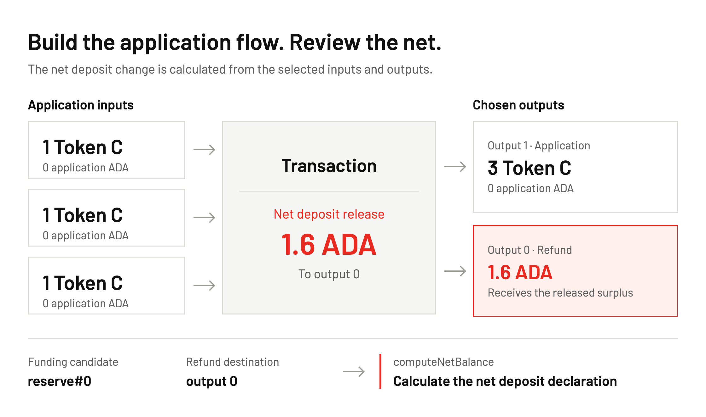
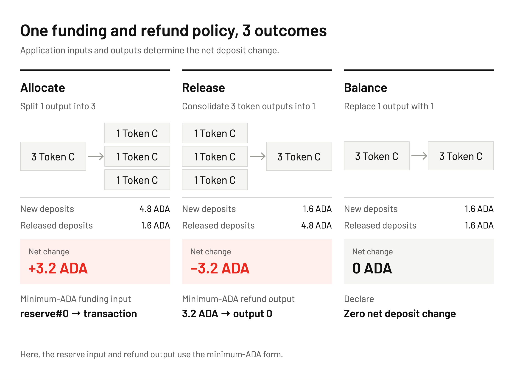
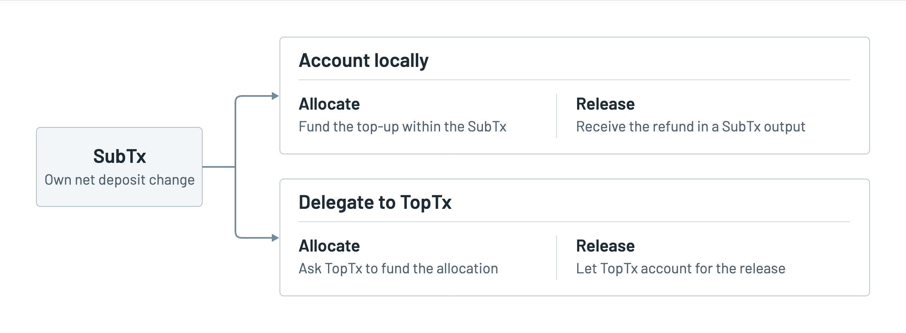
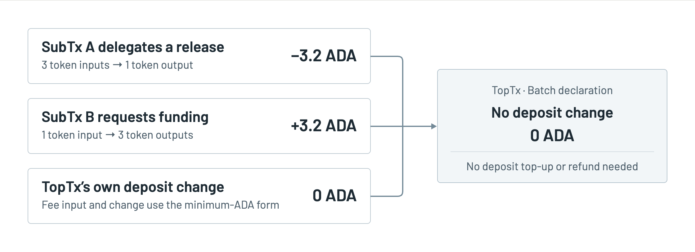
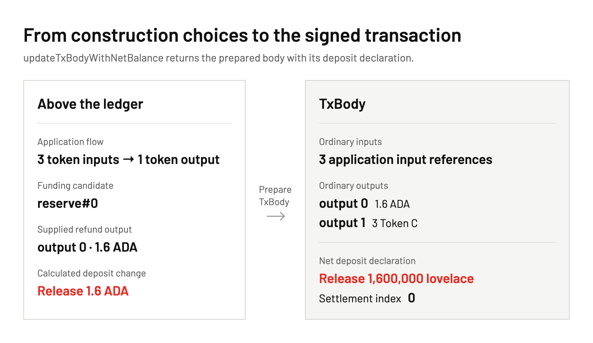
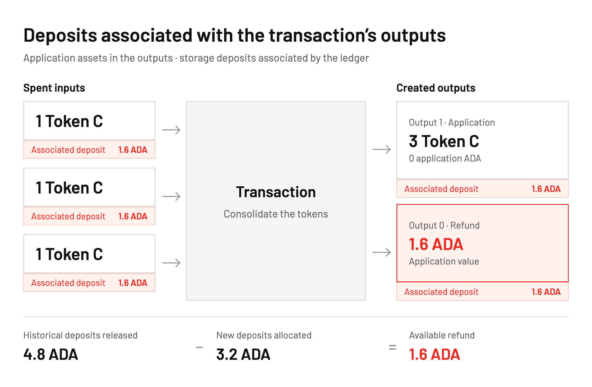
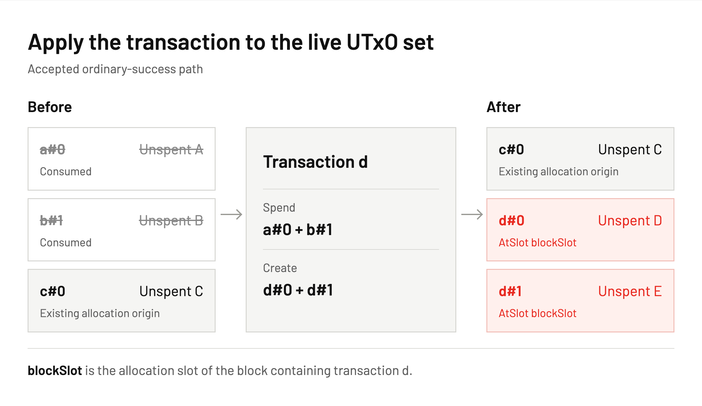

**Table of contents**

- [1. Abstract](#1-abstract)
- [2. Motivation: Why is this CIP necessary?](#2-motivation-why-is-this-cip-necessary)
  - [2.1 When resource funding obscures an application payment](#21-when-resource-funding-obscures-an-application-payment)
  - [2.2 Composition multiplies the funding work](#22-composition-multiplies-the-funding-work)
  - [2.3 Explicit deposits with a choice of output form](#23-explicit-deposits-with-a-choice-of-output-form)
- [3. Specification](#3-specification)
  - [3.1 Transaction-building DSL](#31-transaction-building-dsl)
  - [3.2 SubTx composition and delegation](#32-subtx-composition-and-delegation)
  - [3.3 Ledger interface and TxBody declarations](#33-ledger-interface-and-txbody-declarations)
  - [3.4 Transaction accounting and validation](#34-transaction-accounting-and-validation)
  - [3.5 Output representation and ledger application](#35-output-representation-and-ledger-application)
  - [3.6 Deterministic deposit recovery](#36-deterministic-deposit-recovery)
  - [3.7 Migration and compatibility](#37-migration-and-compatibility)
- [4. Rationale: How does this CIP achieve its goals?](#4-rationale-how-does-this-cip-achieve-its-goals)
  - [4.1 Application value and funding](#41-application-value-and-funding)
  - [4.2 Evaluation against the CPS use cases](#42-evaluation-against-the-cps-use-cases)
  - [4.3 Responses to the CPS questions](#43-responses-to-the-cps-questions)
  - [4.4 Alternatives considered](#44-alternatives-considered)
  - [4.5 Resource protection and implementation costs](#45-resource-protection-and-implementation-costs)
  - [4.6 Author TODOs](#46-author-todos)
- [5. Path to Active](#5-path-to-active)
  - [5.1 Acceptance Criteria](#51-acceptance-criteria)
  - [5.2 Implementation Plan](#52-implementation-plan)
  - [5.3 Reference transaction-construction API](#53-reference-transaction-construction-api)
- [6. References](#6-references)
- [7. Copyright](#7-copyright)

## 1. Abstract

This CIP continues the community work on minUTxO, including discussions at
BuidlerFest in Argentina. We thank the community contributors whose ideas and
discussions made this proposal possible.
[CPS-0037 acknowledgements](../CPS-0037/README.md#acknowledgements) · [@Crypto2099](https://github.com/Crypto2099) · [@lehins](https://github.com/lehins) · [@ch1bo](https://github.com/ch1bo) · [@matteocoppola](https://github.com/matteocoppola) · [@padierfind](https://github.com/padierfind)

*And to everyone who has ever sighed at yet another minUTxO top-up, this one's for
you. We're working to make your life a little easier from here on.*

This proposal introduces deposit-backed TxOuts alongside the current minimum-ADA
TxOuts. A deposit-backed output records application assets, including zero ADA,
while the ledger accounts for its full storage deposit separately. Spending the
output releases its original deposit under the output's spending authority.

The transaction declares the net change between new and released deposits.
SubTxs can account for their contribution locally or delegate it to TopTx,
enabling token-only operations whose fees and deposit funding are coordinated
by the enclosing transaction.

This CIP depends on UTxO Storage Cost Formula for pricing. It introduces allocation
origins and shared formula history at the hard fork, allowing the ledger and
external tools to recover each original deposit across subsequent formula and
parameter changes. [UTxO Storage Cost Formula](../CIP-????-utxo-cost-formula/README.md)

## 2. Motivation: Why is this CIP necessary?

Every unspent output occupies space in the live UTxO set maintained by Cardano
nodes. More outputs increase the number of entries, and larger datums or reference
scripts increase the space occupied by each entry. Requiring ADA to remain
committed while an output is unspent gives users an economic incentive to use
that resource efficiently.

This intended funding cost also appears inside the values applications transfer.
CPS-0037 describes how that coupling creates additional work when constructing
transactions and interpreting their history. This proposal makes resource funding
explicit and gives transaction builders a choice of accounting model.
[CPS-0037](../CPS-0037/README.md)

<a id="21-resource-costs-and-accidental-friction"></a>
<a id="21-application-value-independent-of-resource-funding"></a>
<a id="22-from-ada-payments-to-application-workflows"></a>
<a id="23-explicit-accounting-and-readable-history"></a>

### 2.1 When resource funding obscures an application payment

For an ADA payment above the minimum, the intended payment already satisfies the
rule. A transaction builder can often complete that flow without additional
funding work. The difficulty becomes visible when the application's intended ADA
amount falls below the requirement.

Consider a script output whose address, assets, datum and reference script give
it an illustrative minimum of **32 ADA**.

| Intended application transfer | ADA that must appear in the minimum-ADA output |
| --- | ---: |
| 100 ADA | 100 ADA |
| Tokens with zero ADA | At least 32 ADA |
| Tokens with a 20 ADA payment | At least 32 ADA |

In the last 2 cases, an output containing 32 ADA cannot tell a reader whether the
application intended a payment of zero ADA, 20 ADA or 32 ADA. Applications must
carry that distinction themselves. The ambiguity follows successive outputs and
makes transaction history harder to interpret.

A deposit-backed output records the intended application assets directly. Its
resource requirement is accounted for separately, so the application can express
an exact ADA amount, a token-only transfer, or state containing a datum or
reference script with zero application assets.

<a id="22-transaction-level-netting"></a>
<a id="23-ada-free-subtxs"></a>
<a id="24-transaction-level-netting"></a>
<a id="25-ada-free-subtxs"></a>

### 2.2 Composition multiplies the funding work

A distribution repeats the funding requirement for every recipient output. A
stateful application must fund each successor output, including any increase
caused by larger contents or a changed price. Consolidation can free ADA, while
splitting state can require additional funding. Applications have to coordinate
these movements alongside their business logic.

Nested transactions amplify this work across independently authored SubTxs.
An otherwise token-only operation can need ADA inputs, change outputs and a
refund policy solely to accommodate resource funding. This adds coordination
between the SubTx author and the party assembling TopTx.

The live UTxO set changes when the complete transaction is applied. That boundary
provides a place to account for the combined allocation and release of deposits,
and to assign responsibility for funding the difference.

<a id="24-asset-free-txouts"></a>
<a id="25-a-predictable-deposit-calculation"></a>
<a id="26-asset-free-txouts"></a>
<a id="26-pricing-evolution-and-compatibility"></a>
<a id="27-simple-calculation-and-historical-recovery"></a>

### 2.3 Explicit deposits with a choice of output form

This CIP introduces deposit-backed outputs alongside the current minimum-ADA
outputs. The transaction builder chooses the form of each new output. A
deposit-backed output separates application value from its full storage deposit.
The minimum-ADA form continues to support workflows in which the same ADA serves
both as payment and as resource backing. Their different capital requirements
are illustrated in §3.1.1.

The proposal has 3 construction objectives.

1. Express application inputs and outputs with their intended assets.
2. Account for deposits through an explicit net change at transaction level,
   with funding and refund choices that can be reused across an application.
3. Let a SubTx handle that change locally or delegate it to TopTx, allowing
   TopTx to coordinate deposit funding alongside fees.

The required UTxO Storage Cost Formula supplies a calculation that transaction
tools can reproduce. This CIP adds the accounting and history needed to recover
each original deposit when its output is spent, including after pricing changes.
[UTxO Storage Cost Formula](../CIP-????-utxo-cost-formula/README.md)

<a id="317-scope-and-terminology"></a>

## 3. Specification

The transaction-building DSL combines an application flow with funding and refund
choices. Its helpers prepare the transaction described in §§3.1–3.2. The ledger
interface in §3.3 defines how the resulting choices are represented and signed.
Sections 3.4–3.7 define validation and state transitions.

The proposal extends the Dijkstra model of an enclosing transaction (`TopTx`)
and its sub-transactions (`SubTxs`). A standalone transaction is a TopTx with no
SubTxs. The complete batch consists of TopTx and its SubTx bodies, each counted
once. Activation requires an era transition and compatible node, transaction
construction and script-context interfaces.

Amounts use lovelace, and the pricing rate uses lovelace per byte. Calculations
use exact integer arithmetic. A positive net deposit change allocates ADA, a
negative change releases ADA, and an explicit zero records a balanced deposit
contribution.

<a id="31-moving-minutxo-accounting-from-txouts-to-transactions"></a>
<a id="31-transaction-builder-experience"></a>

### 3.1 Transaction-building DSL

The construction interface lets a transaction builder describe the **application
flow** and supply a **funding and refund policy**. The builder selects the
application inputs, chooses the new outputs and identifies a reserve input for
top-ups and an output for refunds. Helper functions derive the net deposit change
and prepare the transaction body from those choices.

The following example uses an illustrative **1.6 ADA deposit per deposit-backed
output**. The token inputs and outputs carry zero application ADA.



In this example, the application consolidates 3 token inputs into 1 token output.
Its policy names `reserve#0` as a funding candidate and output 0 as the refund
destination. The helper finds a **1.6 ADA net release**. The builder can review
that amount and adjust the application flow before completing the transaction.

The 3 inputs and 2 outputs depicted here all use the deposit-backed form, with
an illustrative deposit of 1.6 ADA each. The calculation includes the deposit
needed for the refund output itself. Fee-funding inputs and change outputs use
the minimum-ADA form and contribute zero external-deposit change. Section 3.4
shows the individual deposit associations behind this construction view.

The construction API and its helpers are described in §5.3. Their results are
expressed through the ledger interface specified from §3.3 onward.

#### 3.1.1 Choosing each output form

Selected inputs retain their recorded forms. For every new output, the
transaction builder chooses the current minimum-ADA form or the deposit-backed
form. Both can appear in the same transaction, and the calculation follows those
choices.

| Property | `MinAdaTxOut` | `DepositBackedTxOut` |
| --- | --- | --- |
| Output value | Full ADA and native assets | Application ADA and native assets |
| Resource funding | ADA inside the output satisfies its minimum | The transaction funds a full external deposit |
| Ordinary spend | Full output value enters the balance | Application value enters the balance and the historical external deposit is released |

For an application payment of **5 ADA** and a resource requirement of **2 ADA**,
the choices commit different amounts.

| | Minimum-ADA output | Deposit-backed output |
| --- | ---: | ---: |
| ADA in the output value | 5 ADA | 5 ADA |
| External deposit | 0 ADA | 2 ADA |
| Total ADA committed for this output | **5 ADA** | **7 ADA** |

The minimum-ADA form lets the payment's ADA satisfy the resource requirement.
The deposit-backed form keeps the application value and full resource deposit
explicitly separate. These examples account for the selected output's funding.

<a id="311-builder-experience-consolidating-token-outputs"></a>
<a id="312-consolidation-and-the-net-declaration"></a>

#### 3.1.2 Computing and reviewing the net

The helper recovers the historical external deposits of the selected inputs and
calculates the requirements for new deposit-backed outputs. Their difference is
the adjustment the complete transaction must fund or receive.

```math
\begin{aligned}
\mathrm{netDepositChange}
  ={}& \mathrm{newExternalDeposits} \\
     & {}- \mathrm{releasedHistoricalDeposits}
\end{aligned}
```



The figure uses an illustrative deposit of 1.6 ADA per application output. Its
reserve input and refund output use the minimum-ADA form and satisfy that form's
minimum, so they contribute zero external-deposit change. Fee-funding inputs and
change outputs use the same form and also contribute zero external-deposit change.

| Computed result | Meaning for transaction construction |
| --- | --- |
| Positive | Use the funding policy to cover the additional deposit requirement |
| Negative | Use the refund policy to receive the released surplus |
| Zero | Record an explicit zero deposit change |

The net makes the resource effect of splitting, consolidating or changing output
contents visible. The transaction builder can compare alternative flows and
choose an acceptable result. A helper repeats the calculation whenever a change
affects the deposits involved.

For the opening example, historical releases total 4.8 ADA and new requirements
total 3.2 ADA, including the deposit-backed refund output. The resulting 1.6 ADA
release is available for that output's application value.

#### 3.1.3 Funding and refund policies

An application can reuse a reserve policy across its workflows. The reference
construction API supports the following choices.

| Policy choice | Helper behavior |
| --- | --- |
| Funding already included | Calculate using the selected ordinary inputs |
| Funding candidate | Add the specified input when the body's attributed allocation requires funding |
| Existing refund output | Select an output already present in the body |
| New refund output | Append the supplied output when a refund is required and its own deposit leaves a positive release |

The helper includes every added input and output in its final calculation.
Adding a funding input may itself release a historical deposit. A new
minimum-ADA refund output uses its own ADA for backing. A new deposit-backed
refund output also requires an external deposit.

`computeNetBalance` calculates the resulting deposit declaration.
`updateTxBodyWithNetBalance` applies the selected input/output additions and
writes the declaration into the body. The helper retains the refund output's
supplied value. The transaction builder sets that value and completes ordinary
asset, change and fee balancing before signing.

The selected reserve input becomes an ordinary spending input. The refund choice
identifies an ordinary output. Section 3.3 specifies how these choices are
represented in the signed transaction, and §3.4 defines their validation.
Individual deposit allocations are recorded when the ledger applies the
transaction.

### 3.2 SubTx composition and delegation

#### 3.2.1 Local accounting or delegation to TopTx

A SubTx author can use the same construction flow and provide a local funding
and refund policy. The additional choice is to **delegate deposit accounting to
TopTx**. The SubTx helper calculates the body's own net change and applies the
chosen policy.



| Own deposit change | Account locally | Delegate to TopTx |
| --- | --- | --- |
| Allocation | Arrange funding through the local policy | Request that TopTx account for the allocation |
| Release | Select an own output with at least the release amount in ADA | Delegate release accounting to TopTx |
| Zero | Prepare an explicit zero declaration | Zero carries no funding or release request |

TopTx already coordinates transaction fees. With this proposal it can also
coordinate deposit top-ups and refunds. A SubTx can therefore express a token
operation with zero application ADA in its inputs and outputs.

Prepare each SubTx before its enclosing TopTx. The SubTx helpers calculate their
own contributions. The TopTx helper then calculates the complete batch change
and its attributed share, using the prepared SubTx declarations. Changing a
SubTx's inputs, outputs or accounting choice requires recalculating the enclosing
transaction. Section 3.4 defines the balance and settlement rules.

#### 3.2.2 Netting across SubTxs

A SubTx consolidating 3 deposit-backed token outputs into 1 releases 3.2 ADA under
the illustrative pricing above. Another SubTx consumes a distinct input and
creates 3 outputs, requiring an additional 3.2 ADA. They delegate their respective
release and allocation to TopTx.



All depicted SubTx inputs and outputs have zero application ADA. Their deposit
changes cancel, so the TopTx helper prepares **explicit zero** for the batch.
TopTx funds fees through minimum-ADA inputs and change outputs, which contribute
zero external-deposit change. Delegation lets the enclosing transaction
coordinate resource funding across the application flows.

<a id="315-an-ada-free-subtx-under-formula-v1"></a>
<a id="323-an-ada-free-subtx-under-formula-v1"></a>

#### 3.2.3 An ADA-free SubTx using the storage cost formula

Use the proposed UTxO Storage Cost Formula with a rate of **4,310 lovelace per
byte**, **57-byte base addresses**, and no datum or reference script on any of the
3 outputs. Alice controls a deposit-backed input containing 2 distinct native
assets and zero application ADA. Its deposit was allocated under these same
pricing rules. Her SubTx sends 1 asset to Bob and the other to Carol in 2
deposit-backed outputs.
[UTxO Storage Cost Formula](../CIP-????-utxo-cost-formula/README.md)

| Deposit operation | Calculation | Lovelace |
| --- | --- | ---: |
| Consume Alice's two-asset output | $`4310 \times (193 + 57 + 74 \times 2)`$ | 1,715,380 released |
| Create Bob's one-asset output | $`4310 \times (193 + 57 + 74)`$ | 1,396,440 allocated |
| Create Carol's one-asset output | $`4310 \times (193 + 57 + 74)`$ | 1,396,440 allocated |
| Net SubTx contribution | $`2{,}792{,}880 - 1{,}715{,}380`$ | 1,077,500 allocated |

Alice chooses delegation. The SubTx helper prepares a request for TopTx to
account for the **1,077,500 lovelace allocation**. Assume TopTx's other inputs
and outputs use the minimum-ADA form and contribute zero external-deposit change.
TopTx's net is that same positive amount, and its available ADA funds the deposit
and fee. The complete transaction also conserves both native assets.

A one-for-one replacement with identical measurements and unchanged pricing has
a zero contribution and requires an explicit zero declaration. When an input
instead uses the minimum-ADA form, its full serialized ADA enters the balance and
its external-deposit release is zero.

<a id="312-txbody-deposit-declarations"></a>

<a id="33-txbody-declarations-and-encoding"></a>

### 3.3 Ledger interface and TxBody declarations

The construction choices above become ordinary spending inputs, ordinary outputs
and a deposit declaration in the signed transaction body. The reserve policy is
an input to the construction API. A selected funding input appears in the body's
ordinary input set. A local refund destination appears as an output index in the
release declaration, and the chosen output already contains its settlement ADA.



The figure continues the release example from §3.1. Its 3 application inputs
provide the released deposits, so the funding candidate is unused. Fee funding
is handled separately as described there.

TopTx declares the complete batch change. Each SubTx declares its own contribution
and accounting choice. Amounts use lovelace. The ledger independently calculates
the required amounts and validates the declarations against the inputs, outputs
and allocation history. The following rules define this interface for every
transaction-construction library.

#### 3.3.1 Declaration meaning and presence

TopTx declares the exact `Δbatch`. Each explicit SubTx declaration gives its exact
own `Δb` and, for a nonzero contribution, its local or delegated accounting choice.
The ledger independently calculates these amounts from the actual inputs,
outputs and history using §3.4.1, then compares them with the declarations.

| Form | TopTx meaning | SubTx meaning |
| --- | --- | --- |
| Absent | No declaration | No declaration or delegation request |
| Explicit zero | Batch net change equals zero | Own net change equals zero |
| Allocation | Positive batch change | Positive own change accounted locally |
| Request funding | Unavailable | Positive own change delegated to TopTx |
| Release | Negative batch change, with a TopTx settlement choice | Negative own change, with an own settlement output or delegation to TopTx |

A declaration is required when the body's ordinary spending inputs reference a
`DepositBackedTxOut` or its ordinary outputs create one. This requirement applies
at a zero rate and when allocation and release cancel exactly. Any explicit SubTx
declaration, including zero, requires an explicit TopTx declaration. A body with no
such operations may omit its declaration or explicitly declare zero, subject to
this parent requirement. Reference-only access creates no declaration requirement.

Amount-bearing forms contain a strictly positive integer in `1..2^64−1`.
Explicit zero has its own representation. The allocation or release form must
agree with the sign of the calculated change.

#### 3.3.2 Haskell representation

The implementation adds the following fields to its body constructors. This
excerpt shows the deposit fields of the otherwise complete transaction bodies.

```haskell
data DijkstraTxBodyRaw l era where
  DijkstraTxBodyRaw ::
    { dtbrNetUTxODepositChange :: !TopTxUTxODepositDeclaration
    } ->
    DijkstraTxBodyRaw TopTx era
  DijkstraSubTxBodyRaw ::
    { dstbrNetUTxODepositChange :: !SubTxUTxODepositDeclaration
    } ->
    DijkstraTxBodyRaw SubTx era
```

The declaration payloads describe zero, allocation or release, together with the
funding or settlement choice. These are the implementation's types, with
deriving clauses omitted.

```haskell
-- TopTx: net change for the complete transaction batch.
data NetUTxODepositChange
  = NoUTxODepositChange
  | AllocateUTxODeposit !StrictlyPositiveCoin
  | ReleaseUTxODeposit !StrictlyPositiveCoin !TopTxReleaseSettlement

data TopTxReleaseSettlement
  = NoTopTxSettlement
  | TopTxSettlementOutput !TxIx

-- SubTx: its own contribution and funding or settlement choice.
data SubTxNetUTxODepositChange
  = SubTxNoUTxODepositChange
  | SubTxAllocateUTxODeposit !StrictlyPositiveCoin
  | SubTxRequestUTxODepositFromTopTx !StrictlyPositiveCoin
  | SubTxReleaseUTxODeposit !StrictlyPositiveCoin !SubTxReleaseTarget

data SubTxReleaseTarget
  = SubTxSettlementOutput !TxIx
  | DelegateToTopTx
```

`TopTxUTxODepositDeclaration` and `SubTxUTxODepositDeclaration` wrap their respective
payloads in `StrictMaybe`. This preserves the distinction between an absent field
and an explicit zero. `NoUTxODepositChange` and `SubTxNoUTxODepositChange` are
present zero declarations. The public `NoUTxODepositDeclaration` pattern in each
module represents absence. The exported patterns provide the public construction
interface. `StrictlyPositiveCoin` is a checked positive lovelace amount, and
`TxIx` is a zero-based output index.

[TopTx declaration types](https://github.com/nhenin/cardano-ledger-specs/blob/1c22597b03e950e14d86e1d5ad86284ee5d7c1f3/eras/dijkstra/impl/src/Cardano/Ledger/Dijkstra/UTxOs/Deposit/TopTx.hs) · [SubTx declaration types](https://github.com/nhenin/cardano-ledger-specs/blob/1c22597b03e950e14d86e1d5ad86284ee5d7c1f3/eras/dijkstra/impl/src/Cardano/Ledger/Dijkstra/UTxOs/Deposit/SubTx.hs)

#### 3.3.3 CBOR encoding

CDDL, the Concise Data Definition Language, describes the serialized data shape.
`?` marks an optional map entry, `/` separates
alternatives, and `[ ... ]` describes an array. Both body maps gain optional key
`28`. The commented entries below are inserted into their existing map schemas.
The Haskell constructors above encode to these tagged arrays.

```cddl
; Added to the transaction_body map
; ? 28 : net_utxo_deposit_change

; Added to the sub_transaction_body map
; ? 28 : sub_tx_net_utxo_deposit_change

positive_coin = 1 .. 18446744073709551615
output_index = uint .size 2

net_utxo_deposit_change =
    [0, amount : positive_coin]
  / [1, amount : positive_coin, settlement : top_tx_release_settlement]
  / [2]

top_tx_release_settlement =
    [0]
  / [1, output_index]

sub_tx_net_utxo_deposit_change =
    [0, amount : positive_coin]
  / [1, amount : positive_coin, target : sub_tx_release_target]
  / [2, amount : positive_coin]
  / [3]

sub_tx_release_target =
    [0, output_index]
  / [1]
```

[Dijkstra CDDL](https://github.com/nhenin/cardano-ledger-specs/blob/1c22597b03e950e14d86e1d5ad86284ee5d7c1f3/eras/dijkstra/impl/cddl/data/dijkstra.cddl) · [Body fields and codecs](https://github.com/nhenin/cardano-ledger-specs/blob/1c22597b03e950e14d86e1d5ad86284ee5d7c1f3/eras/dijkstra/impl/src/Cardano/Ledger/Dijkstra/TxBody.hs)

Decoders preserve absence, explicit zero, operation kind, amount and destination.
They reject unknown tags, incorrect field counts, zero or out-of-range amounts
in amount-bearing forms, and indices outside `0..65535`. Ledger validation also
requires each selected index to exist in the declaring body's own ordinary outputs.

### 3.4 Transaction accounting and validation

The ledger associates an individual deposit with each deposit-backed output.
For the transaction constructed in §3.1, the 3 spent entries release 4.8 ADA and
the 2 created outputs require 3.2 ADA. This includes the refund output's own
deposit. The difference supplies its 1.6 ADA application value.



<a id="313-netting-and-the-transaction-balance"></a>

#### 3.4.1 Netting and the transaction balance

The transaction balance includes serialized output values and a separate term
for the net change in external deposits. Each form contributes as follows.

| Operation | Value included in the ordinary balance | External deposit contribution |
| --- | --- | --- |
| Spend `MinAdaTxOut` | Full serialized value | Zero release |
| Spend `DepositBackedTxOut` | Application value | Release the historical deposit |
| Create `MinAdaTxOut` | Full serialized value, meeting the active minimum | Zero allocation |
| Create `DepositBackedTxOut` | Application value | Allocate the full active requirement |

Let `U` be the live allocation map, `F_active(o)` the active requirement for output
`o`, and `E_H(u)` the external deposit recovered from entry `u` and history `H`.
`E_H` returns zero for minimum-ADA entries. Historical recovery is specified in
§3.6. For each body `b`, calculate its allocations, releases and net change.

```math
\begin{aligned}
A_b &= \sum_{o\in\mathrm{newOutputs}(b)} F_{\mathrm{active}}(o) \\
R_b &= \sum_{i\in\mathrm{spentInputs}(b)} E_H(U[i]) \\
\Delta_b &= A_b-R_b \\
\Delta_{\mathrm{batch}} &= \sum_{b\in\mathrm{batch}}\Delta_b.
\end{aligned}
```

The sum for `A_b` includes only `DepositBackedTxOut` outputs. Min-ADA inputs contribute zero
to `R_b`. Reference inputs and collateral belong outside the ordinary calculation.
TopTx's own outputs exclude its children's outputs.

For an ordinary accepted transaction, add `max(0, -Δbatch)` to the existing
consumed ADA calculation and `max(0, Δbatch)` to the existing produced ADA
calculation. All remaining transaction terms, including fees, mint, withdrawals,
certificates, direct deposits and governance effects, follow their applicable
ledger rules. The complete transaction must balance. The batch total is the single
Store term in this equation.

| New external allocations | Historical external releases | Batch declaration | Deposit effect on available ADA |
| ---: | ---: | --- | --- |
| 5 ADA | 3 ADA | Allocate 2 ADA | Fund 2 ADA from the transaction balance |
| 3 ADA | 5 ADA | Release 2 ADA | Make 2 ADA available to the transaction balance |
| 3 ADA | 3 ADA | Explicit zero | Allocations and releases offset exactly |

These examples assume TopTx accounts for the entire change. Selected settlement
outputs are included in the allocation totals. Each output's form, measurements
and historical or active price determine the result.

For a SubTx `b`, let `L_b = Δ_b` when its contribution is locally accounted and
`L_b = 0` when it delegates allocation or release to TopTx. TopTx's attributed
responsibility is

```math
T = \Delta_{\mathrm{batch}} - \sum_{b\in\mathrm{SubTxs}}L_b.
```

Delegation changes this responsibility while preserving each body's required
amount and the batch total. Individual SubTxs may contribute ADA to the enclosing
transaction or receive funding from it. Conservation is checked for the complete
transaction. Additional balance constraints associated with legacy Plutus mode
are described in §3.7.6.

For a transfer-only batch with fees and no withdrawals, certificates or other
balance terms, either output form uses the following ADA equation. The sums cover
the ordinary inputs and outputs of the complete batch.

```math
\begin{aligned}
\mathrm{inputADA} + \max(0, -\Delta_{\mathrm{batch}})
  ={}& \mathrm{outputADA} + \mathrm{fee} \\
     & {}+ \max(0, \Delta_{\mathrm{batch}})
\end{aligned}
```

`inputADA` and `outputADA` sum the serialized ADA values. Each value is the full ADA field of a minimum-ADA output and the application
ADA field of a deposit-backed output. Native assets follow the applicable
conservation and mint/burn rules. The single batch deposit term moves ADA into
or out of the Store.

[Exact accounting implementation](https://github.com/nhenin/cardano-ledger-specs/blob/1c22597b03e950e14d86e1d5ad86284ee5d7c1f3/eras/dijkstra/impl/src/Cardano/Ledger/Dijkstra/Rules/DepositStore/Accounting.hs)

<a id="314-release-authority-and-settlement"></a>

#### 3.4.2 Release authority and settlement

The authority to consume an output also authorises release of its deposit. The
original funder gains no additional credential or independent recovery right.
For example, if Alice funds an output controlled by Bob, Bob's spending authority
controls its subsequent consumption and release.

A local SubTx release of amount `r` must designate one of that SubTx's own ordinary
outputs. That output must contain at least `r` lovelace in its serialized value.
For a `DepositBackedTxOut` this is application ADA. For a min-ADA output this is its
full ADA, including embedded backing. The external deposit of a settlement output
provides no part of this coin bound.

TopTx's settlement choice follows the batch total and its attributed share `T`.

| Condition | TopTx settlement requirement |
| --- | --- |
| `Δbatch < 0` and `T < 0` | Designate an own ordinary output with at least `-T` lovelace. |
| `Δbatch < 0` and `T >= 0` | Use the release form with no TopTx settlement output. |
| `Δbatch >= 0` | Use allocation or explicit zero, whose forms carry no settlement selector. |

The TopTx coverage amount may exceed the whole-batch release. If a locally
accounted child allocates 3 ADA and TopTx's attributed share releases 5 ADA, the
batch releases 2 ADA while TopTx's selected output must contain at least 5 ADA.

Indices are zero-based within the declaring body's ordinary output sequence.
They cannot select a sibling's output, a parent's output, or a collateral return.
The declared outputs already include their settlement value. Checking a destination
adds no second release to the Store or the transaction's available funds.

These checks constrain the settlement destination and amount. They do not by
themselves establish the source of the selected output's coins or impose
independent SubTx balance. Cross-body funding follows the complete transaction's conservation rules and
any additional script-mode constraints described in §3.7.6.

<a id="316-script-outcomes-and-collateral"></a>

#### 3.4.3 Script outcomes and collateral

Declaration presence, exactness, output validity and settlement checks apply to
both accepted phase-2 outcomes. Ordinary financial conservation applies to the
ordinary-success path. A transaction rejected during validation applies no ledger
effects.

On ordinary success, the ledger applies the ordinary TopTx and SubTx inputs,
outputs and deposit changes and credits the normal transaction fee. On accepted
phase-2 failure, it applies the collateral inputs and collateral return and their
deposit effects. Ordinary effects remain unapplied on that path.

For collateral, define the following quantities.

| Symbol | Quantity |
| --- | --- |
| `C` | Serialized ADA in collateral inputs, using full ADA for min-ADA inputs and application ADA for inputs referencing `DepositBackedTxOut` |
| `Q` | Serialized ADA in the signed collateral return, or zero if absent |
| `dI` | Historical external deposits of consumed collateral inputs |
| `dQ` | Active-price external deposit for a `DepositBackedTxOut` return, or zero for an absent or min-ADA return |

```math
\begin{aligned}
a &= \max(0,d_Q-d_I) \\
s &= \max(0,d_I-d_Q) \\
f_{\mathrm{coin}} &= C-Q-a \\
f_{\min} &= \left\lceil
\frac{\mathrm{txFee}\cdot\mathrm{collateralPercentage}}{100}
\right\rceil.
\end{aligned}
```

When TopTx or any SubTx has redeemers, collateral funding requires
`fcoin >= fmin`. Input coins fund the signed return, any extra deposit requirement
and the minimum collateral fee. Released-deposit surplus is excluded from this
minimum-fee funding calculation and does not enlarge the signed return.

When the optional total-collateral field is present and the redeemer-triggered
comparison applies, it must equal `C − Q`. On accepted phase-2 failure the fee pot
receives `fcoin + s`, and the Store changes by `dQ − dI`. Thus

```math
C+d_I = Q+d_Q+(f_{\mathrm{coin}}+s).
```

The collateral return must preserve the exact native-asset identities and
quantities from collateral inputs. Ordinary mint and outputs cannot supply those
assets on the failure path. Existing input resolution, witness, eligibility,
return validity and input-count rules continue to apply. The ledger derives
collateral deposit effects directly from the collateral inputs and return.

<a id="32-deposit-model"></a>

### 3.5 Output representation and ledger application

<a id="322-output-representation"></a>

#### 3.5.1 The two TxOut forms

The reference implementation makes the per-output choice explicit in `TxOut era`.

```haskell
data TxOut era
  = MinAdaTxOut !(MinAdaTxOut era)
  | DepositBackedTxOut !(DepositBackedTxOut era)
```

The associated types define each era's payload representation.
[Shared output interface](https://github.com/nhenin/cardano-ledger-specs/blob/1c22597b03e950e14d86e1d5ad86284ee5d7c1f3/libs/cardano-ledger-core/src/Cardano/Ledger/TxOut.hs)

Both output forms retain an address and their supported datum and reference-script
fields. The selected form determines how ADA is accounted for.

| Property | `MinAdaTxOut` | `DepositBackedTxOut` |
| --- | --- | --- |
| Admission in the supporting era | Output ADA must cover the active deposit formula | The transaction must fund the full external deposit |
| External deposit | Zero | Full calculated requirement |

A `DepositBackedTxOut` may contain native assets with zero application ADA. The
ledger also accepts zero-ADA outputs carrying a datum, a reference script, or
only an address, subject to the remaining output-validity rules. Every occurrence
has its own allocation, including equal outputs at different indices and outputs
whose calculated deposit is zero.

The full deposit is external even when application ADA already exceeds the
calculated requirement. Adding application ADA leaves the external requirement
unchanged. For a newly proposed min-ADA output, the active formula determines its
minimum ADA, including for a collateral return. Earlier-era validation continues
to use the rules of its own era.

The deposit-backed output's implementation makes the separation explicit. Its fields carry
application assets and spending information. The external deposit amount is
accounted by the Store. This is the implementation's type declaration, with deriving
clauses omitted.

```haskell
data DijkstraDepositBackedTxOut = DijkstraDepositBackedTxOut
  { depositBackedAddress :: !Addr
  , depositBackedApplicationAssets :: !(ApplicationAssets DijkstraEra)
  , depositBackedDatum :: !(Datum DijkstraEra)
  , depositBackedReferenceScript :: !(StrictMaybe (Script DijkstraEra))
  }
```

[Output implementation](https://github.com/nhenin/cardano-ledger-specs/blob/1c22597b03e950e14d86e1d5ad86284ee5d7c1f3/eras/dijkstra/impl/src/Cardano/Ledger/Dijkstra/TxOut.hs)

The corresponding output CDDL extends the existing output choices. `address`,
`value`, `datum_option`, `script_ref` and the legacy productions retain their
meanings in the enclosing Dijkstra schema. The implementation names the `DepositBackedTxOut`
production `store_backed_transaction_output` in its encoding schema.

```cddl
transaction_output =
    alonzo_transaction_output
  / babbage_transaction_output
  / store_backed_transaction_output

store_backed_transaction_output =
  { 0 : address
  , 4 : application_assets
  , ? 2 : datum_option
  , ? 3 : script_ref
  }

application_assets = value
```

A map-form output requires key `0` and exactly one value key. Key `1` selects the
legacy value representation and key `4` selects application assets. Legacy Alonzo
list-form outputs also remain accepted. Transaction output bytes contain neither
the external deposit amount nor the allocation origin.

<a id="321-the-live-utxo-resource"></a>

#### 3.5.2 Unspent entries and allocation origins

The resource is a persistent collection of live outputs indexed by their creating
transaction ID and output index. The reference implementation stores it as a map
of wrapped outputs. These are actual type declarations, with deriving clauses
omitted.

```haskell
newtype IndexedUTxOs era = IndexedUTxOs
  { unIndexedUTxOs :: Map TxIn (Unspent (TxOut era))
  }

data Unspent output = Unspent
  { output :: !output
  , allocatedAt :: !AllocatedAt
  }

data AllocatedAt
  = AtStoreMigration
  | AtSlot !SlotNo
```

`TxIn` identifies the creating transaction and output index. `output` contains the
`TxOut`, which can use the `MinAdaTxOut` or `DepositBackedTxOut` variant. `allocatedAt` belongs to
the surrounding ledger entry, outside the serialized `TxOut`. The wrapper
records the allocation origin. That origin selects a historical formula, which is
applied to the wrapped output to recover its deposit. The Store also maintains
the aggregate external ADA total.


This lookup shows the `DepositBackedTxOut` case. A min-ADA entry contributes zero external
deposit, because its full ADA remains inside its value. Both variants are wrapped
in `Unspent`. The map entries, their output payloads and allocation metadata
occupy node resources.

[Allocation map](https://github.com/nhenin/cardano-ledger-specs/blob/1c22597b03e950e14d86e1d5ad86284ee5d7c1f3/libs/cardano-ledger-core/src/Cardano/Ledger/State/Accounting/UTxOs/IndexedUTxOs.hs) · [Unspent and allocation origin](https://github.com/nhenin/cardano-ledger-specs/blob/1c22597b03e950e14d86e1d5ad86284ee5d7c1f3/libs/cardano-ledger-core/src/Cardano/Ledger/State/Accounting/UTxOs/Unspent.hs)

#### 3.5.3 Applying the transaction

In ordinary successful execution, a transaction removes its spent entries and
adds its newly created outputs. Entries outside the spending inputs remain in place.



After validation selects the execution path, the ledger applies its corresponding
inputs and outputs. The collateral path uses the collateral inputs and return.
Formula activation and migration follow §3.7.

[Store projection](https://github.com/nhenin/cardano-ledger-specs/blob/1c22597b03e950e14d86e1d5ad86284ee5d7c1f3/libs/cardano-ledger-core/src/Cardano/Ledger/State/Accounting/UTxOs/Store/Internals.hs)

On the accepted path, each created output receives the allocation slot of its
containing block. Its `Unspent` entry is inserted under the resulting `TxIn`.
Spending a deposit-backed entry removes its historical external amount from the
Store, and creating a deposit-backed output adds its active-price amount. The
Store total follows the same accepted transition as the allocation map.

The serialized transaction records output values and deposit declarations.
For deposit-backed outputs, the values explicitly identify application assets.
An indexer can follow those asset flows and reconstruct their deposit effects
using allocation origins and formula history. The external allocation exists
for the lifetime of the unspent entry.

### 3.6 Deterministic deposit recovery

<a id="323-dependency-on-utxo-storage-cost-formula"></a>

#### 3.6.1 Dependency on UTxO Storage Cost Formula

This CIP requires [UTxO Storage Cost Formula](../CIP-????-utxo-cost-formula/README.md).
That proposal defines the output measurements, coefficients and exact
calculation. It is the normative source for pricing. This CIP defines how the
result is funded, recorded and released. The formula CIP can be adopted for
minimum-ADA TxOuts without introducing deposit-backed TxOuts.

`F_active(o)` uses the formula version and rate active when the output is
allocated. Its result supplies the minimum or external deposit required by the
output's form, including collateral returns, under §3.5.1. Release of an existing
deposit uses its historical formula under §3.6.2.

The formula's activation must precede or coincide with this CIP's activation.
The numerical examples use the companion proposal with explicitly stated address
sizes and illustrative rates.

<a id="324-allocation-history-and-the-store-invariant"></a>

#### 3.6.2 Formula history and the Store invariant

A deposit-backed output can remain unspent while the pricing rules change.
Repricing it when it is spent would return an amount different from the deposit
originally funded. The ledger therefore records when the output was allocated
and retains the formulas and parameters that applied at each allocation time.

This history begins at the hard fork with the formula and rate selected for
activation. Subsequent formula and parameter changes create new intervals.
Pre-fork outputs receive the permanent migration baseline defined in §3.7.1.

The reference implementation represents the resource and its backing together. Its
`UTxOStore` groups the state required for deposit accounting. Its type
combines the allocation map defined in §3.5.2 with pricing history and the total.

```haskell
data UTxOStore era = UTxOStore
  { depositFormulaHistory :: !DepositFormulaHistory
  , totalDepositAmount :: !DepositAmount
  , allocations :: !(IndexedUTxOs era)
  }
```

[Store](https://github.com/nhenin/cardano-ledger-specs/blob/1c22597b03e950e14d86e1d5ad86284ee5d7c1f3/libs/cardano-ledger-core/src/Cardano/Ledger/State/Accounting/UTxOs/Store/Internals.hs) · [Allocation map](https://github.com/nhenin/cardano-ledger-specs/blob/1c22597b03e950e14d86e1d5ad86284ee5d7c1f3/libs/cardano-ledger-core/src/Cardano/Ledger/State/Accounting/UTxOs/IndexedUTxOs.hs) · [Allocation entry](https://github.com/nhenin/cardano-ledger-specs/blob/1c22597b03e950e14d86e1d5ad86284ee5d7c1f3/libs/cardano-ledger-core/src/Cardano/Ledger/State/Accounting/UTxOs/Unspent.hs)

The logical state consists of an allocation map `U`, a formula history `H`, and a
total `S` of externally held ADA. Each entry in `U` contains the accepted output
and one allocation origin.

- `AtStoreMigration` identifies an imported min-ADA output.
- `AtSlot(s)` identifies an output allocated at ledger slot `s`.

History contains an initial formula and dated activations. A formula includes both
its version and rate. Imported entries always resolve to the initial formula.
Dated entries resolve to the most recent activation at or before their allocation
slot, falling back to the initial formula. Activation intervals include their
starting slot and exclude the following activation's slot.

Let `P_H(u)` be the result of applying that historical formula to entry `u`.

```math
E_H(u) =
\begin{cases}
0 & \text{for a min-ADA output} \\
P_H(u) & \text{for a DepositBackedTxOut}
\end{cases}
```

The ledger must maintain the exact invariant

```math
S = \sum_{u\in U} E_H(u).
```

A valid allocation adds its external deposit once. A valid spend removes its
allocation and releases its historical external deposit once. Reference inputs
leave allocations in place. Rejection preserves the preceding state. The
transaction's existing input and output-reference rules determine which
occurrences may be consumed and created.

The reference implementation reconstructs deposit amounts from output measurements, allocation
origins and shared history. An implementation may use a different internal
representation if it preserves these amounts and the same transitions. Snapshot,
rollback and replay must retain enough information to reproduce them exactly.
History survives an empty allocation map.

#### 3.6.3 Recovering deposits outside the node

External tools need the accepted output referenced by each input, its allocation
origin and the corresponding formula history. Input entries and history must be
obtained from the same ledger snapshot. The formula's original datum and
reference-script payload bytes must remain available wherever their lengths
affect pricing.

The reference implementation recovers external deposits with the following
functions. `AtStoreMigration` selects the permanent migration baseline.
`AtSlot` selects the formula and parameters active at that allocation slot.

```haskell
computeExternalDeposit ::
  EraDepositBackedTxOut era =>
  DepositFormulaHistory ->
  Unspent (TxOut era) ->
  Coin
computeExternalDeposit history (Unspent txOut origin) = case txOut of
  MinAdaTxOut _ -> mempty
  DepositBackedTxOut depositBacked ->
    getDepositTxOut (allocationFormula history origin) depositBacked

allocationFormula ::
  DepositFormulaHistory -> AllocatedAt -> DepositFormula
allocationFormula history origin = case origin of
  AtStoreMigration -> initialFormula history
  AtSlot slot -> formulaAt slot history
```

This pure calculation reproduces the historical external amount from the output
and its allocation context. New outputs are priced with the active formula.
The two results supply the release and allocation terms in §3.4.1.
[Historical deposit recovery](https://github.com/nhenin/cardano-ledger-specs/blob/1c22597b03e950e14d86e1d5ad86284ee5d7c1f3/libs/cardano-ledger-core/src/Cardano/Ledger/State/Accounting/UTxOs/Unspent.hs)

<a id="33-lifecycle-and-compatibility"></a>

### 3.7 Migration and compatibility

<a id="331-parameter-changes-and-migration"></a>

#### 3.7.1 Activation and the migration baseline

At the hard fork, translate existing UTxO references and their semantic address, value,
datum and reference script into min-ADA entries marked `AtStoreMigration`. Initialise
history with the formula and rate selected for this activation. The initial
external Store total is zero. Imported entries use this permanent baseline for
their derived backing view, capped by each output's ADA. The complete original
value is available when an imported output is spent.

A transaction may spend both output forms and create either form after activation.
New outputs, including replacements of min-ADA outputs, satisfy the active rules.
This transition changes state representation and requires downstream interfaces to
handle the new form.

#### 3.7.2 Legacy outputs below the new minimum

For wallet and inspection queries, the proposal also defines a min-ADA backing
view. If `C(u)` is the output's ADA, its embedded reserve is
`min(C(u), P_H(u))`, and the corresponding application-ADA view is the remainder.
Its entire serialized ADA still enters spending and conservation. This reserve
view creates zero external release credit. The cap concerns existing entries,
while admission of a newly created min-ADA output requires the full active minimum.

Consider an imported minimum-ADA output containing **2 ADA and 100 tokens**.
Suppose the migration baseline assigns it a **3 ADA** requirement. Its inspection
view reports a reserve of `min(2, 3) = 2 ADA`, leaving zero application ADA and
100 tokens. Native assets are unaffected by this derived view.

If it is spent to create a deposit-backed output carrying those 100 tokens with
zero application ADA and requiring a 3 ADA deposit, the accounting is as follows.
Assume all other inputs and outputs use the minimum-ADA form, and fund fees
separately.

| Quantity | Amount |
| --- | ---: |
| ADA consumed from the imported output's serialized value | 2 ADA |
| External deposit released by that input | 0 ADA |
| External deposit allocated for the new output | 3 ADA |
| Net deposit declaration | **Allocate 3 ADA** |
| Additional ADA needed to complete this funding | **1 ADA** |

The transaction consumes the original 2 ADA once through ordinary value balance.
The declaration accounts for the full 3 ADA added to the external Store. This
lets ordinary funding and explicit deposit netting handle an under-covered
minimum-ADA input together.

The migration marker always uses its initial baseline. Later formula changes
price new outputs and preserve this imported entry's derived reserve. A newly
created minimum-ADA successor must satisfy the full active requirement.

#### 3.7.3 Formula and parameter changes

A rate change becomes part of history at the first slot of the epoch in which it
is effective, including when the first transaction arrives later. New allocations
use the active formula and rate. Existing allocations retain their origins and
historical deposits, and the cached Store total is preserved by activation alone.

Activations append a later interval. They must preserve the prices of all existing
allocations. The ledger rejects formula-version downgrades and permits rates
to increase or decrease within a version. Reapplying the current formula is a
no-op.

Consider 2 deposit-backed outputs, each with a 57-byte base address, 1 native
asset, and no datum or reference script. The companion formula assigns each
$`193 + 57 + 74 = 324`$ pricing units. The slots below illustrate the ordering,
with slot 200 standing for the first slot of the epoch that activates the new rate.

| Ledger event | Active price per byte | External deposit accounting |
| --- | ---: | --- |
| Slot 100 — create output A | 4,310 lovelace | Allocate $`324 \times 4{,}310 = 1{,}396{,}440`$ lovelace |
| Slot 200 — activate a new rate | 5,000 lovelace | Existing allocations retain their historical amounts |
| Slot 250 — create output B | 5,000 lovelace | Allocate $`324 \times 5{,}000 = 1{,}620{,}000`$ lovelace |
| Slot 300 — spend A and B | 5,000 lovelace | Release $`1{,}396{,}440 + 1{,}620{,}000 = 3{,}016{,}440`$ lovelace |

A's allocation origin selects the interval before slot 200. B's selects the
interval starting at slot 200. Outputs created by the spending transaction use
the active rate of 5,000. A formula-version change uses the same interval lookup,
with the historical version and its parameters retained together.
[Formula history and allocation recovery](https://github.com/nhenin/cardano-ledger-specs/blob/1c22597b03e950e14d86e1d5ad86284ee5d7c1f3/docs/dijkstra-deposit-store-rules.md)

<a id="332-stake-voting-and-monetary-conservation"></a>

#### 3.7.4 Stake, voting and monetary conservation

The ledger applies existing staking eligibility and delegation rules to the
full ADA of min-ADA outputs and to the application ADA of `DepositBackedTxOut` outputs.
External deposits add no stake or voting weight. Store ADA remains part of total
ADA conservation and is counted once, alongside output ADA and the existing fees,
deposits, rewards, treasury, reserves and donation pots.

For example, an eligible min-ADA output containing 10 ADA contributes 10 ADA. An
eligible `DepositBackedTxOut` containing 8 application ADA with a 2 ADA external
deposit contributes 8 ADA. [Distribution rules](https://github.com/nhenin/cardano-ledger-specs/blob/1c22597b03e950e14d86e1d5ad86284ee5d7c1f3/docs/dijkstra-deposit-store-rules.md#derived-distributions)

<a id="333-encoding-validation-and-versioning"></a>

#### 3.7.5 Encoding validation and persistence

The transaction encodings in §3.3.3 and §3.5.1 activate in the supporting era.
Snapshots, rollback and replay must preserve the accepted output payloads,
allocation origins, formula history and external Store total. Historical
calculation uses the retained bytes required by each formula version.

The reference implementation uses MemPack for some Store entries. Interoperable
persistence must specify those entries' encoding as well as the outer snapshot
structure.

#### 3.7.6 Script contexts and legacy Plutus mode

The reference implementation preserves a TopTx self-balance check when legacy
Plutus mode applies. That check uses TopTx's own value flows and its attributed
deposit share from §3.4.1. A composed transaction must satisfy the balance checks
required by its script mode as well as complete-batch conservation.
[Legacy-mode balance check](https://github.com/nhenin/cardano-ledger-specs/blob/1c22597b03e950e14d86e1d5ad86284ee5d7c1f3/eras/dijkstra/impl/src/Cardano/Ledger/Dijkstra/Rules/Utxo.hs#L333-L351)

> **TODO — Plutus compatibility:** Specify the output and deposit information
> exposed to each supported script version, including validators that depend on
> exact ADA amounts. Complete the deposit-backed output translation paths and
> verify mixed-output transactions under each supported mode. See §4.6.1.

## 4. Rationale: How does this CIP achieve its goals?

### 4.1 Application value and funding

The two output forms offer different accounting and capital trade-offs. For a
payment of `C` application ADA and requirement `F`, a deposit-backed output commits
`C + F`. A minimum-ADA output commits at least `max(C, F)`, allowing the same ADA
to satisfy both purposes. Builders can choose the form appropriate to each output.

The full external deposit makes application value explicit, including token-only
and asset-free outputs. The existing value representation supports applications
that rely on ADA inside their outputs.

Netting follows the transaction's atomic update of the live UTxO set. The ledger
can settle one aggregate funding change while preserving an individual allocation
and spending authority for each output. Delegation extends that funding
coordination to independently authored SubTxs. The complete balance still includes
fees, change and all other applicable ledger effects.

### 4.2 Evaluation against the CPS use cases

| CPS use case | Effect of the proposal | Remaining burden or trade-off |
| --- | --- | --- |
| Frozen wallet | Released backing can fund replacement deposits. TopTx can sponsor a SubTx's fee and additional deposit funding. | An equally priced replacement frees no spare ADA for the fee. A sponsor or another ADA source is still needed. |
| Payment below minUTxO | A `DepositBackedTxOut` can contain an exact small ADA payment or tokens with zero application ADA. | The full external deposit and transaction fees require funding. |
| Funding recipient-controlled ADA | Funding may be consolidated or delegated to TopTx. The deposit is held outside the application's value. | Release authority still follows the output. The original funder gains no separate claim. |
| Non-staking application state | Application value is represented independently of backing. | Deposits remain locked and excluded from stake and voting. Moving otherwise eligible backing to an external deposit also removes that eligibility. |
| Construction and change balancing | The required formula CIP avoids an ADA-amount/encoded-size fixed point. This CIP's netting gives one batch Store transfer. | Builders handle input selection, final payload measurements, fees, declarations, formula history and balancing. |
| High fan-out distribution | The batch funds the net sum, with optional sponsorship. | Each new output still incurs its full requirement. More outputs can require more capital. |
| Successor-output top-up | The old historical deposit is available toward the new active-price requirement. | Any shortfall needs funding. A decrease releases value through the spending transaction's settlement rules. |

A quantitative comparison uses representative transactions and wallet workflows.
It must count application ADA, external deposits and fees without double counting
ADA that serves both roles in a min-ADA output. [CPS evaluation requirements](../CPS-0037/README.md#evaluation-requirements)

### 4.3 Responses to the CPS questions

1. **Parameter changes and beneficiaries.** Existing deposits retain their original
   amount. A successor pays the current requirement. The transaction funds an
   increase and disposes of a release under its spending and settlement rules.
   Historical funding creates no independent entitlement.
2. **Existing validators.** **TODO:** Specify the script-context projection for
   each supported Plutus version and its effect on validators that check exact
   ADA amounts. See [the author TODO](#461-plutus-compatibility).
3. **Uneconomic cleanup.** Spending releases the historical backing. The proposal
   adds no expiry or extra cleanup reward. An output can remain indefinitely when
   consumption costs exceed the value its controller can recover.
4. **Deposit organisation.** The ledger maintains an individual allocation per
   output and an exact aggregate total. Transaction-level funding can be shared,
   while output spending authority remains individual. The resource costs are
   described in §4.5.
5. **Exact allocation and encoding boundaries.** The required formula CIP calculates
   the full requirement independently of application ADA and the outer output encoding.
   Its exact amount enters the Store invariant. The proposal allows no
   unallocated Store surplus. Embedded min-ADA is consumed once through value.

### 4.4 Alternatives considered

| Alternative | Reason for evaluating it | Trade-off motivating the proposal |
| --- | --- | --- |
| Adopt UTxO Storage Cost Formula alone | Simplify the minimum calculation while retaining minimum-ADA TxOuts | This CIP builds on that calculation to add deposit-backed values and explicit netting. |
| Application/deposit split inside each output | Make the two roles explicit within the transferred output | A size formula over that same encoded split can create a fixed-point allocation problem. Deposit representation and pricing must be evaluated together. |
| External deposit for only the shortfall `max(0, requirement − applicationADA)` | Preserve overlap between intended ADA and backing, as an alternative representation | Application ADA affects the external amount and requires its own lifecycle and compatibility analysis. The proposal uses a full external deposit for the new form. |
| Funder-controlled account obligation | Give the funder a continuing claim while state occupies capacity | Account ownership, authorisation, shared obligations and independently spendable outputs require additional rules. |
| Redistribute backing across outputs | Relax each output's minimum while retaining ADA in output values | Allocation and recovery rights still need definition, and backing continues to participate in the transferred values. |

The full external deposit separates the backing requirement from application ADA.
This gives each new output an exact, individual allocation while
allowing transactions to net their funding. The capital and implementation costs
of this choice are described below.

### 4.5 Resource protection and implementation costs

The Store invariant ensures that the recorded external obligations have exactly
matching ADA backing. Economic protection additionally depends on the rate and
coefficients specified by [UTxO Storage Cost Formula](../CIP-????-utxo-cost-formula/README.md).
Calibration belongs to that proposal. Integrating deposit-backed outputs must also
account for the resources introduced here: allocation metadata, indexes and
historical-price lookup and storage. A passing accounting test does not establish
that the selected pricing covers those costs.

The protocol can represent a zero rate. Zero-priced outputs still require
allocation records and explicit declarations where applicable. Such a rate must
be assessed against the intended economic protection.

Each live output retains an allocation origin, while common formula versions
and parameters are recorded once per history interval. Recovering an amount
requires both the corresponding formula implementation and its input measurements.
Implementers must assess state size, lookups, snapshot costs and retention of
obsolete formula intervals. Any history compaction must preserve every live
allocation's exact historical amount.

Conservation includes the Store once. Ordinary and collateral effects must use the
selected execution path, and all consumers of ledger state must agree on the two
output forms. Release authority, price changes and migration are therefore part
of the validation and compatibility contract.

### 4.6 Author TODOs

> **TODO — Editorial:** Resolve the items below, incorporate the resulting rules
> and rationale into the appropriate sections, and remove this author checklist
> before publication.

#### 4.6.1 Plutus compatibility

> **TODO:** Specify the context projection for each supported Plutus version,
> including application value, backing, transaction-level deposit information and
> validators that check exact ADA amounts. Resolve the `DepositBackedTxOut` translation
> paths. Use the V4 integration fixture as supporting evidence, without treating
> it as a contract for other versions.
>
> Sources: [Ledger context work](https://github.com/nhenin/cardano-ledger-specs/blob/1c22597b03e950e14d86e1d5ad86284ee5d7c1f3/docs/dijkstra-deposit-store-rules.md#ds-plutus-compatibility) · [V4 integration fixture](https://github.com/willjgould/cardano-minutxo-integration/commit/d2300267436d4cc6a4cb2dbc7898b9f98787192b)

#### 4.6.2 Local release guarantees

> **TODO:** Decide whether the destination-and-amount checks need an additional
> guarantee about the source or permitted use of released ADA. Define how the
> signed body expresses that guarantee while allowing intentional cross-body
> funding. Cover the case where a SubTx consumes 10 application ADA and releases
> 2 ADA: either 12 ADA goes to its own output, or 10 ADA goes there and 2 ADA is
> intentionally contributed to TopTx fees. Update §3.4.2 with the resulting rule.
>
> Source: [Settlement analysis](https://github.com/nhenin/cardano-ledger-specs/blob/1c22597b03e950e14d86e1d5ad86284ee5d7c1f3/docs/dijkstra-deposit-store-rules.md#ds-tx-settlement-refinement)

#### 4.6.3 Pricing and activation

> **TODO:** Record the assigned number of the required UTxO Storage Cost Formula CIP and
> coordinate the two proposals' activation versions. Confirm that its calibration
> covers the allocation metadata and storage introduced here. Select the initial
> history baseline if the formula has evolved before the deposit fork. The
> prototype uses one initial formula for imported entries and the first new
> allocations. A separate migration pricing policy would require its own rule.
>
> **TODO — Formula integration:** Update the pinned prototype's fixed 250-byte
> allowance to use the companion proposal's 193-byte allowance plus measured
> address bytes. Add the address measurement to the shared formula inputs and
> verify both output forms and historical recovery with those measurements.
>
> **TODO:** Define the transaction-construction workflow at a pricing boundary.
> Cover a transaction prepared and signed under one formula or rate but submitted
> after another becomes active. Specify query context, validity intervals and
> any required rebuilding or re-signing, including independently signed SubTxs.
> Validation uses the formula active for new allocations at ledger application.

#### 4.6.4 Declarations

> **TODO:** Confirm the use of explicit numeric net declarations and document the
> reason for retaining them. Any alternative in which the ledger computes the
> amount must still represent the signed funding and settlement choices.

#### 4.6.5 Stake and voting

> **TODO:** Confirm the external-deposit exclusion, document its implications for
> capital efficiency and migration, and record verification of the distributions
> through ordinary execution, collateral and snapshot boundaries.

#### 4.6.6 Integration and validation

> **TODO:** Incorporate evidence for wallet/indexer handling, private-network flows
> and rollback/replay. Check that persisted-history validation enforces the same
> contract as formula activation, including version-downgrade rejection. Cover
> shared-collateral cases and document the interoperable snapshot format. Specify
> the common query representation for allocation origins and formula history so
> independent implementations can reproduce the recovery calculation in §3.6.3.
>
> Source: [Verification record](https://github.com/nhenin/cardano-ledger-specs/blob/1c22597b03e950e14d86e1d5ad86284ee5d7c1f3/docs/dijkstra-deposit-store-verification.md)

## 5. Path to Active

### 5.1 Acceptance Criteria

- [x] Publish the motivating problem statement as CPS-0037 and link it from the CIP.
- [ ] Complete author and domain review of the rules, alternatives, local settlement
      guarantee, Plutus projections, transaction encoding and activation policy.
- [ ] Adopt the required [UTxO Storage Cost Formula](../CIP-????-utxo-cost-formula/README.md)
      before or with this proposal, including its resource-pricing validation.
- [ ] Establish the conservation, exact-backing and historical-release properties
      in the formal specification and assess the additional allocation and history
      costs against the pricing supplied by the formula CIP.
- [ ] Demonstrate interoperable encoding, validation, migration, snapshots and
      rollback/replay against independent expectations.
- [ ] Complete the dedicated stake/voting and collateral verification,
      with results tied to the final implementation revision.
- [ ] Demonstrate native-token transfers, small ADA payments, continuing-script
      transitions and sponsored SubTxs across the wallet, builder and node stack
      on a private network, including accepted script failure and transactions
      constructed across formula or parameter activation boundaries.
- [ ] Document the operational impact on node implementations, cardano-api,
      wallets, hardware wallets, indexers and explorers.
- [ ] Deploy compatible node and downstream implementations and activate the
      proposal through the agreed protocol transition.

### 5.2 Implementation Plan

The Haskell Ledger implementation in PR #3 provides executable rules for output
forms, declarations, net accounting, authority, settlement, collateral,
historical deposits and state transitions. Its transaction-construction API
provides funding and settlement strategies and body-update helpers. Implementation
references and excerpts in this CIP use revision
`1c22597b03e950e14d86e1d5ad86284ee5d7c1f3`, including the `MinAdaTxOut` and
`DepositBackedTxOut` names. Excerpts omit surrounding code where indicated.
The prototype uses the earlier fixed-base pricing formula. Its adaptation to
the companion proposal's address-size term is recorded in §4.6.3.
[Ledger implementation](https://github.com/nhenin/cardano-ledger-specs/pull/3)

Deployment requires support across the Ledger, node, cardano-api, transaction
builders, wallets and indexers. Integrated validation must cover native-token
transfers, small ADA payments, continuing-script transitions and sponsored SubTxs,
including accepted script failure, parameter changes, snapshots and rollback.
Results must identify the implementation revision and protocol parameters used.

Activation follows the acceptance criteria above and the supporting era's
protocol transition, with UTxO Storage Cost Formula active no later than this proposal.
Nodes and downstream tools must agree on the output forms,
deposit declarations, state representation and script-context contract before
activation.

### 5.3 Reference transaction-construction API

<a id="38-reference-transaction-construction-api"></a>
<a id="381-funding-and-settlement-strategies"></a>
<a id="382-preparing-transaction-bodies"></a>
<a id="383-constructing-declarations"></a>

The reference API implements the flow in §3.1. Its strategy names identify the
transaction builder's funding and refund choices.

| Choice | Reference API |
| --- | --- |
| Use funding already included in the body | `TopUpAlreadyIncluded` |
| Offer an ordinary input for additional funding | `TopUpFromInput TxIn` |
| Select a TopTx refund output | `TopTxRefundToExistingOutput TxIx` or `TopTxRefundToNewOutput TxOut` |
| Select a SubTx refund output | `SubTxRefundToExistingOutput TxIx` or `SubTxRefundToNewOutput TxOut` |
| Delegate a SubTx's allocation or release | `DelegateDepositToTopTx` |

The update functions take input entries and formula history from the same ledger
snapshot, apply the strategy, and return a body with its declaration. These
signatures are from the reference implementation.

```haskell
updateTxBodyWithNetBalance ::
  DepositFormulaHistory ->
  IndexedUTxOs DijkstraEra ->
  UTxODepositStrategy (TopTxDepositSettlement DijkstraEra) ->
  TxBody TopTx DijkstraEra ->
  Either NetBalanceError (TxBody TopTx DijkstraEra)

updateSubTxBodyWithNetBalance ::
  DepositFormulaHistory ->
  IndexedUTxOs DijkstraEra ->
  UTxODepositStrategy (SubTxDepositSettlement DijkstraEra) ->
  TxBody SubTx DijkstraEra ->
  Either NetBalanceError (TxBody SubTx DijkstraEra)
```

`computeNetBalance` and `computeSubTxNetBalance` take the corresponding inputs and
return the declaration payload. Both calculation and update helpers include any
input or output additions selected by the strategy. Update helpers also apply
those additions to the body.

Prepare each SubTx before TopTx. The TopTx helper combines its own calculated
contribution with the prepared SubTx declarations. Ledger validation independently
recalculates every contribution from the actual inputs, outputs and history.

The helpers retain the ADA values supplied for refund outputs. Their own deposits
enter the calculation. Adding a TopTx refund output must leave both the batch and
TopTx's attributed share in release. Adding a SubTx refund output must leave that
SubTx's own contribution in release. Rebalancing a body that already contains the
refund uses the existing-output strategy.

The transaction builder funds the selected output to satisfy §3.4.2 and completes
change and fee balancing. Subsequent changes to the body can require another
calculation.
[Builder API](https://github.com/nhenin/cardano-ledger-specs/blob/1c22597b03e950e14d86e1d5ad86284ee5d7c1f3/libs/cardano-ledger-api/src/Cardano/Ledger/Api/Tx/Body/DepositBalance.hs) · [Strategy types and behavior](https://github.com/nhenin/cardano-ledger-specs/blob/1c22597b03e950e14d86e1d5ad86284ee5d7c1f3/libs/cardano-ledger-api/src/Cardano/Ledger/Api/Tx/Body/DepositBalance/Strategy.hs)

## 6. References

- [CIP-0001 and the CIP process](https://cips.cardano.org/cip/CIP-0001)
- [CPS-0037 and its cited prior work](https://github.com/cardano-foundation/CIPs/tree/master/CPS-0037)
- [UTxO Storage Cost Formula — required companion CIP](../CIP-????-utxo-cost-formula/README.md)
- [DepositStore business specification at the referenced revision](https://github.com/nhenin/cardano-ledger-specs/blob/1c22597b03e950e14d86e1d5ad86284ee5d7c1f3/docs/dijkstra-deposit-store-rules.md)
- [Verification record at the same baseline](https://github.com/nhenin/cardano-ledger-specs/blob/1c22597b03e950e14d86e1d5ad86284ee5d7c1f3/docs/dijkstra-deposit-store-verification.md)
- [Formula implementation](https://github.com/nhenin/cardano-ledger-specs/blob/1c22597b03e950e14d86e1d5ad86284ee5d7c1f3/eras/dijkstra/impl/src/Cardano/Ledger/Dijkstra/UTxOs/Deposit/Formula.hs)
- [Transaction accounting implementation](https://github.com/nhenin/cardano-ledger-specs/blob/1c22597b03e950e14d86e1d5ad86284ee5d7c1f3/eras/dijkstra/impl/src/Cardano/Ledger/Dijkstra/Rules/DepositStore/Accounting.hs)
- [Dijkstra transaction CDDL](https://github.com/nhenin/cardano-ledger-specs/blob/1c22597b03e950e14d86e1d5ad86284ee5d7c1f3/eras/dijkstra/impl/cddl/data/dijkstra.cddl)

## 7. Copyright

This CIP is licensed under
[CC-BY-4.0](https://creativecommons.org/licenses/by/4.0/legalcode).
