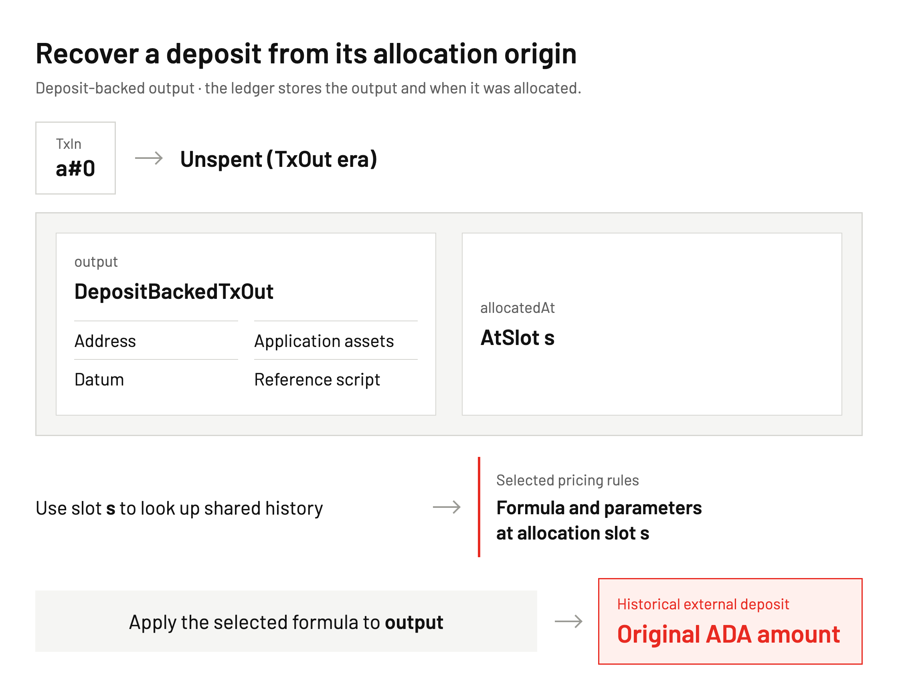

**Table of contents**

- [1. Abstract](#1-abstract)
- [2. Motivation: Why is this CIP necessary?](#2-motivation-why-is-this-cip-necessary)
  - [2.1 Preliminaries — the live UTxO set and its economic deterrent](#21-preliminaries--the-live-utxo-set-and-its-economic-deterrent)
  - [2.2 From straightforward payments to hidden application intent](#22-from-straightforward-payments-to-hidden-application-intent)
    - [2.2.1 An ADA payment already covers the minimum](#221-an-ada-payment-already-covers-the-minimum)
    - [2.2.2 A token-only transfer introduces ADA funding](#222-a-token-only-transfer-introduces-ada-funding)
    - [2.2.3 The recorded value obscures the intended payment](#223-the-recorded-value-obscures-the-intended-payment)
  - [2.3 Composition multiplies the funding work](#23-composition-multiplies-the-funding-work)
  - [2.4 Explicit deposits with a choice of output form](#24-explicit-deposits-with-a-choice-of-output-form)
- [3. Specification](#3-specification)
  - [3.1 Application value and resource backing](#31-application-value-and-resource-backing)
    - [3.1.1 The banknote analogy](#311-the-banknote-analogy)
    - [3.1.2 Minimum-ADA vs deposit-backed outputs](#312-minimum-ada-vs-deposit-backed-outputs)
    - [3.1.3 From individual deposits to transaction netting](#313-from-individual-deposits-to-transaction-netting)
  - [3.2 Transaction-building experience](#32-transaction-building-experience)
    - [3.2.1 Build the application. Review the net.](#321-build-the-application-review-the-net)
    - [3.2.2 Describing the application flow](#322-describing-the-application-flow)
    - [3.2.3 Choosing funding and refund policies](#323-choosing-funding-and-refund-policies)
    - [3.2.4 Computing and reviewing the net](#324-computing-and-reviewing-the-net)
    - [3.2.5 Composing SubTxs and delegating to TopTx](#325-composing-subtxs-and-delegating-to-toptx)
      - [3.2.5.1 Building a token-only SubTx](#3251-building-a-token-only-subtx)
      - [3.2.5.2 Netting across SubTxs](#3252-netting-across-subtxs)
    - [3.2.6 Mixing minimum-ADA and deposit-backed outputs](#326-mixing-minimum-ada-and-deposit-backed-outputs)
      - [3.2.6.1 Choosing the form of each payment](#3261-choosing-the-form-of-each-payment)
      - [3.2.6.2 Spending an input below the minimum](#3262-spending-an-input-below-the-minimum)
  - [3.3 Ledger](#33-ledger)
    - [3.3.1 Signed transaction interface](#331-signed-transaction-interface)
      - [3.3.1.1 TxBody deposit declarations and encoding](#3311-txbody-deposit-declarations-and-encoding)
      - [3.3.1.2 TxOut forms and encoding](#3312-txout-forms-and-encoding)
    - [3.3.2 Validation rules](#332-validation-rules)
      - [3.3.2.1 Declaration presence and exactness](#3321-declaration-presence-and-exactness)
      - [3.3.2.2 Netting and the transaction balance](#3322-netting-and-the-transaction-balance)
      - [3.3.2.3 Release authority and settlement](#3323-release-authority-and-settlement)
      - [3.3.2.4 Script outcomes and collateral](#3324-script-outcomes-and-collateral)
    - [3.3.3 Ledger state and transaction application](#333-ledger-state-and-transaction-application)
      - [3.3.3.1 Unspent entries and allocation origins](#3331-unspent-entries-and-allocation-origins)
      - [3.3.3.2 UTxOStore and deposit accounting](#3332-utxostore-and-deposit-accounting)
      - [3.3.3.3 Applying transactions and maintaining the Store invariant](#3333-applying-transactions-and-maintaining-the-store-invariant)
      - [3.3.3.4 Persistence, rollback and replay](#3334-persistence-rollback-and-replay)
    - [3.3.4 Historical deposits and pricing changes](#334-historical-deposits-and-pricing-changes)
      - [3.3.4.1 Storage cost formula and allocation history](#3341-storage-cost-formula-and-allocation-history)
      - [3.3.4.2 Formula and parameter changes](#3342-formula-and-parameter-changes)
      - [3.3.4.3 Recovering deposits outside the node](#3343-recovering-deposits-outside-the-node)
  - [3.4 Activation and compatibility](#34-activation-and-compatibility)
    - [3.4.1 Activation and the migration baseline](#341-activation-and-the-migration-baseline)
    - [3.4.2 Legacy outputs below the new minimum](#342-legacy-outputs-below-the-new-minimum)
    - [3.4.3 Script contexts and existing contracts](#343-script-contexts-and-existing-contracts)
    - [3.4.4 Stake, voting and monetary conservation](#344-stake-voting-and-monetary-conservation)
- [4. Rationale: How does this CIP achieve its goals?](#4-rationale-how-does-this-cip-achieve-its-goals)
  - [4.1 Application value and funding](#41-application-value-and-funding)
  - [4.2 Evaluation against the CPS use cases](#42-evaluation-against-the-cps-use-cases)
  - [4.3 Responses to the CPS questions](#43-responses-to-the-cps-questions)
  - [4.4 Alternatives considered](#44-alternatives-considered)
  - [4.5 Resource protection and implementation costs](#45-resource-protection-and-implementation-costs)
  - [4.6 Author TODOs](#46-author-todos)
    - [4.6.1 Plutus compatibility](#461-plutus-compatibility)
    - [4.6.2 Local release guarantees](#462-local-release-guarantees)
    - [4.6.3 Pricing and activation](#463-pricing-and-activation)
    - [4.6.4 Declarations](#464-declarations)
    - [4.6.5 Stake and voting](#465-stake-and-voting)
    - [4.6.6 Integration and validation](#466-integration-and-validation)
- [5. Path to Active](#5-path-to-active)
  - [5.1 Acceptance Criteria](#51-acceptance-criteria)
  - [5.2 Implementation Plan](#52-implementation-plan)
  - [5.3 Reference transaction-construction API](#53-reference-transaction-construction-api)
- [6. References](#6-references)
- [7. Copyright](#7-copyright)

## 1. Abstract

This CIP continues the community work on minUTxO, including discussions at
BuidlerFest in Argentina. We thank the community contributors whose ideas and
discussions made this proposal possible.
[CPS-0037 acknowledgements](../CPS-0037/README.md#acknowledgements) · [@Crypto2099](https://github.com/Crypto2099) · [@lehins](https://github.com/lehins) · [@ch1bo](https://github.com/ch1bo) · [@matteocoppola](https://github.com/matteocoppola) · [@padierfind](https://github.com/padierfind)

*And to everyone who has ever sighed at yet another minUTxO top-up, this one's for
you. We're working to make your life a little easier from here on.*

This proposal introduces deposit-backed TxOuts alongside the current minimum-ADA
TxOuts. A deposit-backed output records application assets, including zero ADA,
while the ledger accounts for its full storage deposit separately. Spending the
output releases its original deposit under the output's spending authority.

The proposed declaration counts the storage reserve on both sides of a
transaction. Both minimum-ADA and deposit-backed outputs contribute. The ledger
also tracks how much ADA moves into or out of its external deposit store.
SubTxs can account for their contribution locally or delegate it to TopTx,
enabling token-only operations whose fees and deposit funding are coordinated
by the enclosing transaction.

This CIP depends on UTxO Storage Cost Formula for pricing. It introduces allocation
origins and shared formula history at the hard fork, allowing the ledger and
external tools to recover each original deposit across subsequent formula and
parameter changes. [UTxO Storage Cost Formula](../CIP-????-utxo-cost-formula/README.md)

## 2. Motivation: Why is this CIP necessary?

CPS-0037 collects the community's experience with minimum ADA. This proposal
addresses the **funding and accounting work** that arises when the ADA backing
ledger state becomes part of the **application's transfers**.
[CPS-0037](../CPS-0037/README.md)

### 2.1 Preliminaries — the live UTxO set and its economic deterrent

Each node maintains the **live UTxO set**, a map from input references to unspent
outputs. In ordinary successful execution, a transaction removes the outputs it
spends and adds those it creates. The resource grows through **more entries** or
**more bytes per entry**, including larger **inline datums** and **reference
scripts**. [Inline datums](https://cips.cardano.org/cip/CIP-0032) · [Reference scripts](https://cips.cardano.org/cip/CIP-0033)

The **minimum-ADA requirement** makes every new output carry enough ADA for its
resource footprint. Keeping more or larger outputs live therefore requires more
**ADA to remain committed**. Spending an output makes its ADA available to the
transaction, subject to the requirements of the outputs it creates.
[CPS-0037 — the current rule](../CPS-0037/README.md#the-current-minutxo-rule)


That commitment is the **economic deterrent** this proposal preserves. It is the
**necessary resource friction**. Mixing that funding into application payments
also creates **accidental friction**, as the following examples show.
[CPS-0037 — necessary and accidental friction](../CPS-0037/README.md#necessary-resource-friction-and-accidental-implementation-friction)

<a id="21-resource-costs-and-accidental-friction"></a>
<a id="21-application-value-independent-of-resource-funding"></a>
<a id="22-from-ada-payments-to-application-workflows"></a>
<a id="23-explicit-accounting-and-readable-history"></a>
<a id="21-when-resource-funding-obscures-an-application-payment"></a>

### 2.2 From straightforward payments to hidden application intent

The same rule affects these **3 application flows** differently. The examples use
illustrative minima for outputs with different contents.


#### 2.2.1 An ADA payment already covers the minimum

An application sends **100 ADA** to a script output with a large datum and a
reference script. Its minimum is approximately **52 ADA**. The payment already
covers the requirement, so this output needs **no additional funding**. The
intended payment can be recorded directly in `Value`.

#### 2.2.2 A token-only transfer introduces ADA funding

The intended payment is **1 token and zero ADA**. With a **1.6 ADA minimum**, the
output must also carry that ADA. Sending tokens to **3 recipients** through
3 such outputs requires **4.8 ADA** alongside the tokens. The application now
has **ADA funding** to manage, and each recipient's spending conditions control
that ADA. [CPS-0037 — token transfers and funding control](../CPS-0037/README.md#use-case-fund-for-someone-else)

#### 2.2.3 The recorded value obscures the intended payment

An application sends **1,000 tokens and 20 ADA** to a script output with a
**32 ADA minimum**. A **12 ADA top-up** brings its recorded `Value` to
**1,000 tokens and 32 ADA**.

A **token-only transfer** could produce the same `Value`, with all 32 ADA supplied
for resource backing. `Value` alone cannot recover the intended **0 ADA or 20 ADA
payment**. Applications must preserve that **application context** through a
datum, metadata or their own records, and consult it when interpreting subsequent
transfers and transaction history. [CPS-0037 — application value and resource backing](../CPS-0037/README.md#applicative-value-and-operational-backing)

<a id="22-transaction-level-netting"></a>
<a id="23-ada-free-subtxs"></a>
<a id="24-transaction-level-netting"></a>
<a id="25-ada-free-subtxs"></a>
<a id="22-composition-multiplies-the-funding-work"></a>

### 2.3 Composition multiplies the funding work

Applications must repeat this accounting across **recipient outputs** and
**successive state updates**. If an output holds 32 ADA and its successor needs
40 ADA after a pricing change, that successor has an **8 ADA funding
shortfall**. Consolidating outputs can instead free ADA for other uses.
Each step combines the application's asset movements with **top-ups and refunds**.
[CPS-0037 — successor-output funding](../CPS-0037/README.md#use-case-continuing-output)

**Nested transactions** amplify that work across independently authored
**SubTxs** assembled into a **TopTx**. Token-only operations can require ADA
funding and refund decisions across the batch, while their intended payment
amounts still need separate bookkeeping. Transaction-level accounting provides a
place to coordinate those resource-funding movements.
[Nested transactions](https://cips.cardano.org/cip/CIP-0118)

<a id="24-asset-free-txouts"></a>
<a id="25-a-predictable-deposit-calculation"></a>
<a id="26-asset-free-txouts"></a>
<a id="26-pricing-evolution-and-compatibility"></a>
<a id="27-simple-calculation-and-historical-recovery"></a>
<a id="23-explicit-deposits-with-a-choice-of-output-form"></a>

### 2.4 Explicit deposits with a choice of output form

The goal is to preserve the **economic deterrent** while making **application
amounts explicit** and resource funding easier to coordinate. **Deposit-backed
outputs** account separately for application assets and their full storage
deposit. The current **minimum-ADA form** remains available for workflows in
which the same ADA serves both as payment and as resource backing.

The proposal gives transaction builders 3 capabilities.

1. Express application inputs and outputs with their **intended assets**.
2. Account for deposits through a **net change at transaction level**, with
   reusable funding and refund policies.
3. Let a SubTx handle its change locally or **delegate to TopTx**, which can
   coordinate deposit funding alongside fees.

The **UTxO Storage Cost Formula** proposal supplies the calculation. This CIP
adds the accounting and history needed to recover each **original deposit** when
its output is spent, including after pricing changes.
[UTxO Storage Cost Formula](../CIP-????-utxo-cost-formula/README.md)

<a id="317-scope-and-terminology"></a>

## 3. Specification

The specification introduces the distinction between **application value and
resource backing**, then follows the **transaction-building workflow** from
application inputs and outputs to net deposit accounting and SubTx delegation.

The **Ledger** section defines the signed transaction interface, validation,
state transitions and historical deposit recovery across pricing changes.
**Activation and compatibility** covers migration and the interaction with
existing outputs and contracts.

> **Ledger prototype**
>
> The Cardano ledger prototype implements external deposits, SubTx delegation
> and historical deposit recovery. Its signed net currently counts external
> deposits only. This proposal extends that calculation to the embedded reserves
> of minimum-ADA outputs. [Prototype integration TODO](#464-declarations)
>
> Throughout this document, implementation references and Haskell excerpts connect
> the specification to the prototype's types, transaction-construction API and
> validation rules.
>
> [Implementation PR](https://github.com/nhenin/cardano-ledger-specs/pull/3) · [Referenced source revision](https://github.com/nhenin/cardano-ledger-specs/tree/1c22597b03e950e14d86e1d5ad86284ee5d7c1f3)

### 3.1 Application value and resource backing

Two amounts are involved when an application creates an output. The application
chooses the value it intends to transfer. The storage cost formula determines
the ADA backing required for the output to occupy the live UTxO set. This proposal
introduces a deposit-backed output that accounts for each amount separately.

#### 3.1.1 The banknote analogy

A **20-euro banknote** gives its holder 20 euros of spending power. Producing the
note also requires paper, ink and printing. Its face value expresses what it can
buy. Its production cost expresses the resources needed to create the physical
object used for that payment.

A deposit-backed output gives application value and resource backing similarly
distinct roles. The output records the assets the application transfers. Its
associated ADA deposit backs the resources it occupies in the live UTxO set.


In the example, the application transfers **1,000 tokens and 20 ADA**. An
illustrative **32 ADA deposit** gives **52 ADA committed for this output**,
alongside the tokens. The deposit is held while the output is unspent. Spending
the output releases that deposit through the transaction balance.

<a id="311-choosing-each-output-form"></a>

<a id="312-minimum-ada-and-deposit-backed-outputs"></a>

#### 3.1.2 Minimum-ADA vs deposit-backed outputs

The transaction builder chooses the form of each new output. In a **minimum-ADA
output**, the ADA in `Value` also satisfies the resource requirement. In a
**deposit-backed output**, `Value` records the application assets and the full
storage deposit is accounted for outside the `TxOut`.

Consider the intended transfer of **1,000 tokens and 20 ADA**, with an illustrative
resource requirement of **32 ADA**. A minimum-ADA output must carry 32 ADA,
including a **12 ADA top-up**. Its `Value` would be identical for a **token-only
transfer**, where all 32 ADA were supplied to meet the minimum. Reading `Value`
alone cannot distinguish those application payments.

A deposit-backed output records the **20 ADA payment** alongside the tokens and
accounts for the **32 ADA deposit** separately, giving **52 ADA committed** for
this output.


For the token-only transfer, the deposit-backed output instead records **1,000
tokens and zero ADA** in `Value`, with the same **32 ADA external deposit**. The
intended application ADA amount is explicit in each case.

When the payment already covers the minimum, the minimum-ADA form lets the same
ADA serve both purposes. A **5 ADA payment** with a **2 ADA resource requirement**
commits **5 ADA** in that form. A deposit-backed output records the 5 ADA payment
and a separate 2 ADA deposit, committing **7 ADA**.


**Deposit-backed outputs make the distinction explicit when resource funding
would otherwise obscure the application's intended ADA amount.** This supports
token-only transfers, exact ADA payments below the minimum, and application state
with zero application assets. Minimum-ADA outputs remain available for workflows
that use the same ADA as payment and resource backing. The choice is made for
each output, and both forms can appear in one transaction.

When a minimum-ADA output is spent, its full value enters the transaction balance.
Spending a deposit-backed output contributes its application value and releases
its historical external deposit into that balance.

#### 3.1.3 From individual deposits to transaction netting

The choice of representation also affects how many objects carry the value.
**20 coins of 1 euro** can be exchanged for **1 banknote of 20 euros**. The holder
has 20 euros to spend in either case. Similarly, a transaction builder can group
assets into fewer outputs or distribute them across several outputs. These
choices change the resources occupied in the live UTxO set and the deposits
required.

Each spent output releases its original storage reserve. Each new output needs
a reserve at the current price. The reserve may be embedded in a minimum-ADA
output or held externally for a deposit-backed one. Across both forms,
**input reserves can fund output reserves**. Their difference is the amount of
backing the transaction allocates or releases.

The transaction builder can therefore design the **application flow** and review
its resource-funding effect as **one net amount**. The following section shows how
this works in practice, with a **funding input** for top-ups, a **refund output**
for released ADA, and a calculation that prepares the net declaration for review.

<a id="31-moving-minutxo-accounting-from-txouts-to-transactions"></a>
<a id="31-transaction-builder-experience"></a>
<a id="31-transaction-building-dsl"></a>

<a id="32-transaction-building-dsl"></a>

### 3.2 Transaction-building experience

#### 3.2.1 Build the application. Review the net.

Transaction builders describe the **application flow**, choose **funding and
refund policies**, and review the **net deposit change**. The construction API
uses the selected inputs and outputs, these policy choices and the ledger context
to prepare the deposit declaration. This workflow supports standalone
transactions and TopTx/SubTx batches.


This workflow runs in transaction-construction software. The ledger validates its
**signed result** and records individual deposit allocations when applying it.

<a id="321-describing-the-application-flow"></a>

#### 3.2.2 Describing the application flow

An application wants to consolidate **3 units of token C in a single output**.
The transaction builder selects 3 deposit-backed inputs, each with 1 token and
zero ADA in its `Value`. The inputs retain their recorded form. For each new
output, the builder chooses between the **minimum-ADA** and **deposit-backed**
forms. Here, the builder chooses a deposit-backed output for the application
transfer so that **output 1** carries all 3 tokens and zero ADA.


The builder designates **output 0** for the refund and also chooses the
deposit-backed form for it. Assume each of the 3 spent outputs releases a
**1.6 ADA** deposit and each of the 2 new outputs requires the same amount.
Of the 4.8 ADA released, 3.2 ADA backs the new outputs, including the refund
output itself. The remaining **1.6 ADA** goes into output 0 as spendable value.
The funding candidate `reserve#0` stays unspent. Assume the minimum-ADA input
for fees and the change output have equal embedded reserves. Their contributions
cancel in the net and are omitted from the breakdown below.

> **Viewing individual deposits.** The application view can hide the per-output
> deposits and show just the net release. When the ledger applies this transaction,
> it releases the spent inputs’ deposits and allocates a separate deposit to each
> new deposit-backed output. When a later transaction spends one of those outputs,
> its deposit appears on the input side of that transaction’s breakdown.

<details>
<summary>Show the deposit breakdown for this transaction</summary>

| Entry | Deposit released | Deposit allocated |
| --- | ---: | ---: |
| 3 spent token inputs | 1.6 ADA each | — |
| Output 1 · Token consolidation | — | 1.6 ADA |
| Output 0 · Refund | — | 1.6 ADA |
| **Total** | **4.8 ADA** | **3.2 ADA** |

</details>

<a id="313-funding-and-refund-policies"></a>

<a id="323-funding-and-refund-policies"></a>

<a id="322-choosing-funding-and-refund-policies"></a>

#### 3.2.3 Choosing funding and refund policies

The builder chooses **where a top-up comes from** and **where a refund goes**.
An application can reuse these choices across transfers. In the consolidation
above, the policy offers `reserve#0` for funding and names output 0 for refunds.
The transaction releases **1.6 ADA**, so output 0 receives it and the reserve
stays unspent.


For a **top-up**, the builder can use funds already in the transaction or name
a reserve input to add when the body has an allocation to fund. If selected, the
reserve becomes an ordinary spending input. Any historical deposit it releases
counts towards the final net.

For a **refund**, the builder can select an existing output by index or supply a
new output. A new deposit-backed output needs its own deposit. If that would
consume the entire release, the builder must choose another refund destination.
A minimum-ADA refund output uses the ADA in its own value for backing.

The builder can **preview the declaration** before applying the policy to the
transaction body. For the consolidation above, the pseudocode gives the following results.

```text
policy = { funding: candidate("reserve#0"), refund: existingOutput(0) }

previewDepositChange(draft, policy, ledgerContext)
    → Release(1.6 ADA, output 0)

applyDepositPolicy(draft, policy, ledgerContext)
    → draft with deposit declaration Release(1.6 ADA, output 0)
```

The preview accounts for any input or output the policy would add. Applying the
policy to the same draft and ledger context includes those additions and writes
the same declaration. Here, output 0 is already in the draft and the reserve
stays unspent. The builder sets the refund output’s value and balances assets,
change and fees before signing.

For a Haskell implementation, see the [reference transaction-construction API](#53-reference-transaction-construction-api).

<a id="311-builder-experience-consolidating-token-outputs"></a>
<a id="312-consolidation-and-the-net-declaration"></a>
<a id="312-computing-and-reviewing-the-net"></a>

<a id="322-computing-and-reviewing-the-net"></a>

<a id="323-computing-and-reviewing-the-net"></a>

#### 3.2.4 Computing and reviewing the net

With the inputs, outputs and reserve policy chosen, the builder can see **how
much ADA this transaction needs to commit or can recover**. For a standalone
transaction, price **every new output** under the active rules and recover the
**original reserve of every spent input**. For a minimum-ADA input the reserve
is capped at the ADA it contains. Include any funding input, change output or
refund output selected by the policy.

```math
\text{Net reserve change} = \text{Reserves on new outputs} - \text{Reserves on spent inputs}
```

The sign determines the declaration. **Release** returns the surplus when the
net is negative. **Allocate** identifies the additional backing when the net is positive.
Equal amounts give **No deposit change**, an explicit zero.

Consolidating or splitting outputs can change the net. So can changing the
contents of a single output. Consider 3 drafts that spend **the same inputs**
and create **the same number of outputs**. Each spends a script output with a
historical deposit of **3.2 ADA** and creates one deposit-backed successor with
the same address and application assets. Each also includes the same minimum-ADA
reserve input and a minimum-ADA change output at index 0, which can receive a
refund. Assume the reserve on the change output equals the embedded reserve on
the funding input, so their contributions cancel.

Assume the pricing rules stay fixed at an illustrative **4,000 lovelace per
byte**. The comparison varies the encoded sizes of the successor’s **inline
datum** and **reference script**. A difference of 400 bytes changes the required
deposit by **1.6 ADA**.


The builder can use this preview to compare valid representations of the same
application state, then review the declaration for the chosen draft before signing.

<a id="32-subtx-composition-and-delegation"></a>
<a id="33-subtx-composition-and-delegation"></a>
<a id="321-local-accounting-or-delegation-to-toptx"></a>
<a id="331-local-accounting-or-delegation-to-toptx"></a>

<a id="324-subtx-accounting-and-delegation-to-toptx"></a>

<a id="324-composing-subtxs-and-delegating-to-toptx"></a>

#### 3.2.5 Composing SubTxs and delegating to TopTx

In a nested transaction, the enclosing **TopTx** brings together **SubTxs** that
can have different authors. Each author calculates the net deposit change for
their SubTx’s inputs and outputs, just as they would for a standalone transaction.
They also choose **who funds a shortfall or receives a surplus**.

- **Handle it locally.** For **Allocate**, the author funds the shortfall within
  the SubTx, selecting a reserve input if needed. For **Release**, they choose one of the
  SubTx’s ordinary outputs to receive the refund. Its value must include at
  least the refund amount. Any external deposit on that output is accounted for
  separately.
- **Delegate to TopTx.** The SubTx still declares its own amount. For **Allocate**,
  it requests funding from TopTx. For **Release**, it lets TopTx account for the
  surplus alongside the other contributions. The author can build the SubTx
  without a deposit funding input or refund destination of its own.


If a SubTx releases and reallocates equal deposits, it declares **No deposit
change**. There is no top-up or refund to delegate.

<a id="315-an-ada-free-subtx-under-formula-v1"></a>
<a id="323-an-ada-free-subtx-under-formula-v1"></a>
<a id="323-an-ada-free-subtx-using-the-storage-cost-formula"></a>
<a id="333-an-ada-free-subtx-using-the-storage-cost-formula"></a>

<a id="326-an-ada-free-subtx-example"></a>

<a id="3242-an-ada-free-subtx-example"></a>

<a id="3252-an-ada-free-subtx-example"></a>

##### 3.2.5.1 Building a token-only SubTx

Alice holds tokens B and C in a single deposit-backed output. She sends **B to
Bob** and **C to Carol**. Each recipient’s deposit-backed output holds one token
and **zero ADA** in its `Value`.


Spending Alice’s input releases its deposit, which covers part of the deposits
on the 2 new outputs. Alice’s SubTx declares **Allocate** and asks TopTx to
fund the remaining **1.0775 ADA**. The operator supplies the top-up from its
reserve and pays the batch fee. Alice can build her transfer using just the
input that holds her tokens.

<details>
<summary>How the deposit shortfall is calculated</summary>

Assume 57-byte base addresses, no datum or reference script, and the same
pricing rules for all 3 outputs. At 4,310 lovelace per byte, Alice’s two-asset
output releases **1.71538 ADA**. Bob’s and Carol’s one-asset outputs each
require **1.39644 ADA**. [UTxO Storage Cost Formula](../CIP-%3F%3F%3F%3F-utxo-cost-formula/README.md)

```math
2 \times 1.39644 - 1.71538 = 1.0775\ \text{ADA}
```

In this example, Alice supplies the only SubTx. The operator uses a minimum-ADA
reserve input and a minimum-ADA change output with equal embedded reserves.
Its own reserve change is zero. The TopTx declaration equals Alice’s contribution, and the
batch funds the allocation once.

</details>

<a id="322-netting-across-subtxs"></a>
<a id="332-netting-across-subtxs"></a>

<a id="325-netting-across-subtxs"></a>

<a id="3241-netting-across-subtxs"></a>

<a id="3251-netting-across-subtxs"></a>

##### 3.2.5.2 Netting across SubTxs

The TopTx builder reviews **two amounts**. The **batch net** adds the net from
TopTx’s own inputs and outputs to every SubTx’s net, counting each body once.
This is the amount TopTx declares. **TopTx’s share** adds its own net to the
contributions the SubTx authors delegated. The local funding and refund choices
stay with the SubTxs that made them.

Consider 2 SubTxs spending distinct token inputs. Assume every token output in
this example, whether spent or created, carries zero application ADA and has an
external deposit of **1.6 ADA**. SubTx A consolidates 3 token inputs into 1
output and delegates **Release 3.2 ADA**.
SubTx B spends 1 token input, creates 3 outputs and delegates **Allocate
3.2 ADA**. TopTx’s fee-funding input and change output carry equal embedded
reserves, so its own reserve change is zero.


A’s release covers B’s allocation. **TopTx declares No deposit change**, and no
deposit top-up or refund output is needed. The token operations still have their
own declarations, and the operator still funds the fee.

Now suppose A chooses **local release** and puts the 3.2 ADA refund in its own
token output. With the same deposit costs, the batch net is still zero. This
time the TopTx builder must arrange **3.2 ADA for B** because A has directed
its refund to its own output. This is why the builder prepares each SubTx’s
declaration first and reviews the enclosing transaction again whenever a child’s
inputs, outputs or delegation choice changes.

#### 3.2.6 Mixing minimum-ADA and deposit-backed outputs

At the hard fork, all existing UTxOs have the minimum-ADA form. When spending
them, a builder can introduce deposit backing **one output at a time**. Reserves
from all spent inputs can fund any new output. The builder reviews a single
[transaction net](#324-computing-and-reviewing-the-net) across both forms.

<a id="3261-one-input-two-output-forms"></a>

##### 3.2.6.1 Choosing the form of each payment

Keep a **minimum-ADA output** when a contract expects the backing ADA in its
value. Choose a **deposit-backed output** when the recipient should see exactly
the assets the application intends to send. Both choices can appear in the same
transaction.


Splitting the payment creates another output to back. Its embedded minimum
counts towards the net even when the external deposit for the token stays the same.


##### 3.2.6.2 Spending an input below the minimum

A pre-fork output can hold less ADA than the minimum calculated at migration.
In that case **all the ADA it holds counts as reserve**. The builder
can pool it with reserves from other inputs and fund any remaining shortfall.
This works for either form of successor. [Migration rule](#342-legacy-outputs-below-the-new-minimum)


<a id="33-ledger-interface-and-validation"></a>

### 3.3 Ledger

The transaction body records each output’s form and the declared change in
**UTxO backing**. To check that declaration, the ledger counts both embedded
minimum ADA and external deposits. To conserve ADA, it also keeps track of
**where the backing is held**. Only external deposits enter or leave the Store.
The pinned prototype implements the external accounting and historical lookup.
Its signed declaration currently counts external deposits alone.

#### 3.3.1 Signed transaction interface

<a id="312-txbody-deposit-declarations"></a>
<a id="33-txbody-declarations-and-encoding"></a>
<a id="33-ledger-interface-and-txbody-declarations"></a>
<a id="34-ledger-interface-and-txbody-declarations"></a>

<a id="332-txbody-deposit-declarations-and-encoding"></a>

##### 3.3.1.1 TxBody deposit declarations and encoding

The application flow and funding choices become ordinary spending inputs, outputs
and a deposit declaration in the signed transaction body. The reserve policy is
an input to the construction API. A selected funding input appears in the body's
ordinary input set. A local refund destination appears as an output index in the
release declaration, and the chosen output already contains its settlement ADA.


The figure continues the token-consolidation example. Its 3 application inputs
provide the released deposits, so the funding candidate is unused. Fee funding
is handled separately as described there.

In a batch using the DSL, TopTx declares the complete signed change in backing.
Each participating SubTx declares its own contribution and accounting choice.
The ledger can reproduce each amount from the spending inputs, new outputs and
allocation history.

Amounts use lovelace, and the pricing rate uses lovelace per byte. Calculations
use exact integer arithmetic. A positive declaration means the outputs require
more backing than the inputs supplied. A negative declaration records a release
of backing, and an explicit zero records equal amounts. Activation requires an era transition and compatible node,
transaction-construction and script-context interfaces.

<a id="332-haskell-representation"></a>
<a id="342-haskell-representation"></a>

**Haskell representation**

The pinned prototype adds the following fields to its body constructors. This
excerpt shows the deposit fields of the otherwise complete transaction bodies.

```haskell
data DijkstraTxBodyRaw l era where
  DijkstraTxBodyRaw ::
    { dtbrNetUTxODepositChange :: !TopTxUTxODepositDeclaration
    } ->
    DijkstraTxBodyRaw TopTx era
  DijkstraSubTxBodyRaw ::
    { dstbrNetUTxODepositChange :: !SubTxUTxODepositDeclaration
    } ->
    DijkstraTxBodyRaw SubTx era
```

The prototype’s payloads express zero, allocation or release and the SubTx
funding or settlement choice. Under the proposed semantics, the amount covers
backing in both output forms. The excerpts omit deriving clauses.

```haskell
-- TopTx: net change for the complete transaction batch.
data NetUTxODepositChange
  = NoUTxODepositChange
  | AllocateUTxODeposit !StrictlyPositiveCoin
  | ReleaseUTxODeposit !StrictlyPositiveCoin !TopTxReleaseSettlement

data TopTxReleaseSettlement
  = NoTopTxSettlement
  | TopTxSettlementOutput !TxIx

-- SubTx: its own contribution and funding or settlement choice.
data SubTxNetUTxODepositChange
  = SubTxNoUTxODepositChange
  | SubTxAllocateUTxODeposit !StrictlyPositiveCoin
  | SubTxRequestUTxODepositFromTopTx !StrictlyPositiveCoin
  | SubTxReleaseUTxODeposit !StrictlyPositiveCoin !SubTxReleaseTarget

data SubTxReleaseTarget
  = SubTxSettlementOutput !TxIx
  | DelegateToTopTx
```

`TopTxUTxODepositDeclaration` and `SubTxUTxODepositDeclaration` wrap their respective
payloads in `StrictMaybe`. This preserves the distinction between an absent field
and an explicit zero. `NoUTxODepositChange` and `SubTxNoUTxODepositChange` are
present zero declarations. The public `NoUTxODepositDeclaration` pattern in each
module represents absence. The exported patterns provide the public construction
interface. `StrictlyPositiveCoin` is a checked positive lovelace amount, and
`TxIx` is a zero-based output index.

[TopTx declaration types](https://github.com/nhenin/cardano-ledger-specs/blob/1c22597b03e950e14d86e1d5ad86284ee5d7c1f3/eras/dijkstra/impl/src/Cardano/Ledger/Dijkstra/UTxOs/Deposit/TopTx.hs) · [SubTx declaration types](https://github.com/nhenin/cardano-ledger-specs/blob/1c22597b03e950e14d86e1d5ad86284ee5d7c1f3/eras/dijkstra/impl/src/Cardano/Ledger/Dijkstra/UTxOs/Deposit/SubTx.hs)

<a id="333-cbor-encoding"></a>
<a id="343-cbor-encoding"></a>

**CBOR encoding**

CDDL, the Concise Data Definition Language, describes the serialized data shape.
`?` marks an optional map entry, `/` separates
alternatives, and `[ ... ]` describes an array. Both body maps gain optional key
`28`. The commented entries below are inserted into their existing map schemas.
The Haskell constructors above encode to these tagged arrays.

```cddl
; Added to the transaction_body map
; ? 28 : net_utxo_deposit_change

; Added to the sub_transaction_body map
; ? 28 : sub_tx_net_utxo_deposit_change

positive_coin = 1 .. 18446744073709551615
output_index = uint .size 2

net_utxo_deposit_change =
    [0, amount : positive_coin]
  / [1, amount : positive_coin, settlement : top_tx_release_settlement]
  / [2]

top_tx_release_settlement =
    [0]
  / [1, output_index]

sub_tx_net_utxo_deposit_change =
    [0, amount : positive_coin]
  / [1, amount : positive_coin, target : sub_tx_release_target]
  / [2, amount : positive_coin]
  / [3]

sub_tx_release_target =
    [0, output_index]
  / [1]
```

[Dijkstra CDDL](https://github.com/nhenin/cardano-ledger-specs/blob/1c22597b03e950e14d86e1d5ad86284ee5d7c1f3/eras/dijkstra/impl/cddl/data/dijkstra.cddl) · [Body fields and codecs](https://github.com/nhenin/cardano-ledger-specs/blob/1c22597b03e950e14d86e1d5ad86284ee5d7c1f3/eras/dijkstra/impl/src/Cardano/Ledger/Dijkstra/TxBody.hs)

Decoders preserve absence, explicit zero, operation kind, amount and destination.
They reject unknown tags, incorrect field counts, zero or out-of-range amounts
in amount-bearing forms, and indices outside `0..65535`.

<a id="322-output-representation"></a>
<a id="351-the-two-txout-forms"></a>
<a id="361-the-two-txout-forms"></a>

<a id="331-txout-forms-and-encoding"></a>

##### 3.3.1.2 TxOut forms and encoding

The reference implementation makes the per-output choice explicit in `TxOut era`.

```haskell
data TxOut era
  = MinAdaTxOut !(MinAdaTxOut era)
  | DepositBackedTxOut !(DepositBackedTxOut era)
```

The associated types define each era's payload representation.
[Shared output interface](https://github.com/nhenin/cardano-ledger-specs/blob/1c22597b03e950e14d86e1d5ad86284ee5d7c1f3/libs/cardano-ledger-core/src/Cardano/Ledger/TxOut.hs)

Both output forms retain an address and their supported datum and reference-script
fields. The selected form determines how ADA is accounted for.

| Property | `MinAdaTxOut` | `DepositBackedTxOut` |
| --- | --- | --- |
| Admission in the supporting era | Output ADA must cover the active deposit formula | The transaction must fund the full external deposit |
| External deposit | Zero | Full calculated requirement |

A `DepositBackedTxOut` may contain native assets with zero application ADA. The
ledger also accepts zero-ADA outputs carrying a datum, a reference script, or
only an address, subject to the remaining output-validity rules. Every occurrence
has its own allocation, including equal outputs at different indices and outputs
whose calculated deposit is zero.

The full deposit is external even when application ADA already exceeds the
calculated requirement. Adding application ADA leaves the external requirement
unchanged. For a newly proposed min-ADA output, the active formula determines its
minimum ADA, including for a collateral return. Earlier-era validation continues
to use the rules of its own era.

The deposit-backed output's implementation makes the separation explicit. Its fields carry
application assets and spending information. The external deposit amount is
accounted by the Store. This is the implementation's type declaration, with deriving
clauses omitted.

```haskell
data DijkstraDepositBackedTxOut = DijkstraDepositBackedTxOut
  { depositBackedAddress :: !Addr
  , depositBackedApplicationAssets :: !(ApplicationAssets DijkstraEra)
  , depositBackedDatum :: !(Datum DijkstraEra)
  , depositBackedReferenceScript :: !(StrictMaybe (Script DijkstraEra))
  }
```

[Output implementation](https://github.com/nhenin/cardano-ledger-specs/blob/1c22597b03e950e14d86e1d5ad86284ee5d7c1f3/eras/dijkstra/impl/src/Cardano/Ledger/Dijkstra/TxOut.hs)

The corresponding output CDDL extends the existing output choices. `address`,
`value`, `datum_option`, `script_ref` and the legacy productions retain their
meanings in the enclosing Dijkstra schema. The implementation names the `DepositBackedTxOut`
production `store_backed_transaction_output` in its encoding schema.

```cddl
transaction_output =
    alonzo_transaction_output
  / babbage_transaction_output
  / store_backed_transaction_output

store_backed_transaction_output =
  { 0 : address
  , 4 : application_assets
  , ? 2 : datum_option
  , ? 3 : script_ref
  }

application_assets = value
```

A map-form output requires key `0` and exactly one value key. Key `1` selects the
legacy value representation and key `4` selects application assets. Legacy Alonzo
list-form outputs also remain accepted. Transaction output bytes contain neither
the external deposit amount nor the allocation origin.

#### 3.3.2 Validation rules

<a id="331-declaration-meaning-and-presence"></a>
<a id="341-declaration-meaning-and-presence"></a>

##### 3.3.2.1 Declaration presence and exactness

In a transaction using the proposed declarations, `Δbatch` is the complete
batch’s signed change in backing, and `Δb` is a body’s own contribution.
TopTx declares the exact `Δbatch`. Each explicit SubTx declaration
records the exact `Δb` and, for a nonzero contribution, its local or delegated
accounting choice.
The ledger independently calculates these amounts from the actual inputs,
outputs and history, then compares them with the declarations.

| Form | TopTx meaning | SubTx meaning |
| --- | --- | --- |
| Absent | No declaration | No declaration or delegation request |
| Explicit zero | Batch net change equals zero | Own net change equals zero |
| Allocation | Positive batch change | Positive own change accounted locally |
| Request funding | Unavailable | Positive own change delegated to TopTx |
| Release | Negative batch change, with a TopTx settlement choice | Negative own change, with an own settlement output or delegation to TopTx |

The pinned prototype requires a declaration when a body spends or creates a
deposit-backed output, including at a zero price or when deposits cancel.
Any explicit SubTx declaration requires an explicit TopTx declaration. A
standalone transaction using only minimum-ADA outputs can omit the field.
Reference inputs are read without releasing their backing.

> **TODO — Declaration presence.** Preserve the validity of existing minimum-ADA
> transactions that omit key `28`. Specify when a minimum-ADA-only body opts into
> the new declaration and how its contribution is represented if an enclosing
> batch or a sibling already uses it. Absence alone does not imply a zero change
> in embedded backing.

Amount-bearing forms contain a strictly positive integer in `1..2^64−1`.
Explicit zero has its own representation. The allocation or release form must
agree with the sign of the calculated change.

Ledger validation requires each selected index to exist in the declaring body's
own ordinary outputs.

<a id="34-transaction-accounting-and-validation"></a>
<a id="35-transaction-accounting-and-validation"></a>
<a id="313-netting-and-the-transaction-balance"></a>
<a id="341-netting-and-the-transaction-balance"></a>
<a id="351-netting-and-the-transaction-balance"></a>

<a id="333-netting-and-the-transaction-balance"></a>

##### 3.3.2.2 Netting and the transaction balance

The ledger associates an individual deposit with each deposit-backed output.
In the token-consolidation example, the 3 spent entries release 4.8 ADA and
the 2 created outputs require 3.2 ADA. This includes the refund output's own
deposit. The difference supplies its 1.6 ADA application value.


**What the transaction signs.** Each spent input gives up the backing it held.
Each new output needs backing at the active price. The ledger uses the output
form to identify where that ADA is accounted for.

| Output form | Backing counted on spend | Backing counted on creation | ADA held in the Store |
| --- | --- | --- | --- |
| Minimum-ADA | Historical requirement, capped at the ADA in the input | Full active minimum, covered by the output’s ADA | Zero |
| Deposit-backed | Original external deposit | Full active deposit | The entire deposit |

For body `b`, let `B(u)` be the historical backing in the table for spent
entry `u`, and `F(o)` the active requirement for a new output `o`. Count only
that body's own ordinary spending inputs and newly created outputs, including
any funding input or settlement output. Each SubTx contributes once to the batch.

```math
\begin{aligned}
\Delta_b &= \sum_{o\in\mathrm{outputs}(b)} F(o)
          - \sum_{u\in\mathrm{spent}(b)} B(u) \\
\Delta_{\mathrm{batch}} &= \sum_{b\in\mathrm{batch}} \Delta_b .
\end{aligned}
```

**What enters or leaves the Store.** Compute the same difference over
**deposit-backed outputs only**, across the whole batch.

```math
\Delta_{\mathrm{store}}
= \sum_{o\in\mathrm{newBackedOutputs}} F(o)
- \sum_{u\in\mathrm{spentBackedInputs}} B(u).
```

Ordinary value conservation already counts the full serialized ADA in each
minimum-ADA input and output. It therefore uses `Δstore` as its only additional
deposit term. For a transfer with fees and no other ADA flows the equation is

```math
\mathrm{inputADA} = \mathrm{outputADA} + \mathrm{fee} + \Delta_{\mathrm{store}} .
```

A positive `Δstore` funds new external deposits. A negative `Δstore` returns
ADA to the transaction balance. Withdrawals, certificates, governance and
other balance terms follow their existing rules, as do native assets. For an
entirely deposit-backed flow, `Δbatch` and `Δstore` coincide. With mixed
outputs they can differ even in sign.

For example, spend a minimum-ADA input holding 4 ADA, all of it backing, and
create a deposit-backed output with 1 application ADA and a 3 ADA deposit.
With fees separately funded and no other backing change, the declaration is
**Release 1 ADA**. The Store receives **3 ADA**. The input funds both the
deposit and the 1 ADA in the new output.

**Who handles the change.** A SubTx can handle its signed reserve change locally
or delegate it to TopTx. Let `L_b = Δ_b` for a local contribution and `L_b = 0`
for a delegated contribution. TopTx’s share of the signed change is

```math
T = \Delta_{\mathrm{batch}} - \sum_{b\in\mathrm{SubTxs}} L_b .
```

Assigning responsibility does not move funds by itself. The ledger still checks
conservation once for the full batch using its external Store movement. In the
pinned prototype the same external-only amount supplies both the declaration
and the Store term. Implementing the proposed rule requires checking the signed
reserve change and deriving the external movement separately. [Prototype declaration check](https://github.com/nhenin/cardano-ledger-specs/blob/1c22597b03e950e14d86e1d5ad86284ee5d7c1f3/eras/dijkstra/impl/src/Cardano/Ledger/Dijkstra/Rules/DepositStore/Accounting.hs#L109-L143) · [Prototype value conservation](https://github.com/nhenin/cardano-ledger-specs/blob/1c22597b03e950e14d86e1d5ad86284ee5d7c1f3/eras/dijkstra/impl/src/Cardano/Ledger/Dijkstra/UTxO.hs#L92-L144)

<a id="314-release-authority-and-settlement"></a>
<a id="342-release-authority-and-settlement"></a>
<a id="352-release-authority-and-settlement"></a>

<a id="334-release-authority-and-settlement"></a>

##### 3.3.2.3 Release authority and settlement

The authority to consume an output also authorises release of its deposit. The
original funder gains no additional credential or independent recovery right.
For example, if Alice funds an output controlled by Bob, Bob's spending authority
controls its subsequent consumption and release.

The following settlement checks describe the **pinned prototype**, whose
declarations and Store transfers both use the external deposit net.

A local SubTx release of amount `r` must designate one of that SubTx's own ordinary
outputs. That output must contain at least `r` lovelace in its serialized value.
For a `DepositBackedTxOut` this is application ADA. For a min-ADA output this is its
full ADA, including embedded backing. The external deposit of a settlement output
provides no part of this coin bound.

For the following prototype checks, `Δbatch` and `T` are computed from external
deposits alone. TopTx’s settlement choice follows that batch total and its
attributed share.

| Condition | TopTx settlement requirement |
| --- | --- |
| `Δbatch < 0` and `T < 0` | Designate an own ordinary output with at least `-T` lovelace. |
| `Δbatch < 0` and `T >= 0` | Use the release form with no TopTx settlement output. |
| `Δbatch >= 0` | Use allocation or explicit zero, whose forms carry no settlement selector. |

The TopTx coverage amount may exceed the whole-batch release. If a locally
accounted child allocates 3 ADA and TopTx's attributed share releases 5 ADA, the
batch releases 2 ADA while TopTx's selected output must contain at least 5 ADA.

Indices are zero-based within the declaring body's ordinary output sequence.
They cannot select a sibling's output, a parent's output, or a collateral return.
The declared outputs already include their settlement value. Checking a destination
adds no second release to the Store or the transaction's available funds.

These checks establish a destination and a lower bound on its serialized ADA.
The prototype checks value conservation across the whole transaction and
applies an additional TopTx self-balance check in legacy Plutus mode.

> **TODO — Mixed-form settlement.** Define the amount that a designated output
> must cover when the signed release, the delegated share and the external ADA
> movement differ. A release can come entirely from ADA embedded in spent
> outputs while the Store receives funds. Conversely, a signed allocation or
> zero can accompany a withdrawal from the Store. The prototype’s allocation
> and zero constructors carry no refund index.

<a id="316-script-outcomes-and-collateral"></a>
<a id="343-script-outcomes-and-collateral"></a>
<a id="353-script-outcomes-and-collateral"></a>

<a id="335-script-outcomes-and-collateral"></a>

##### 3.3.2.4 Script outcomes and collateral

In the pinned prototype, declaration presence, exactness, output validity and
settlement checks apply to both accepted phase-2 outcomes. Ordinary financial
conservation applies to the ordinary-success path. A transaction rejected
during validation applies no ledger effects.

For collateral, define the following quantities.

| Symbol | Quantity |
| --- | --- |
| `C` | Serialized ADA in collateral inputs, using full ADA for min-ADA inputs and application ADA for inputs referencing `DepositBackedTxOut` |
| `Q` | Serialized ADA in the signed collateral return, or zero if absent |
| `dI` | Historical external deposits of consumed collateral inputs |
| `dQ` | Active-price external deposit for a `DepositBackedTxOut` return, or zero for an absent or min-ADA return |

```math
\begin{aligned}
a &= \max(0,d_Q-d_I) \\
s &= \max(0,d_I-d_Q) \\
f_{\mathrm{coin}} &= C-Q-a \\
f_{\min} &= \left\lceil
\frac{\mathrm{txFee}\cdot\mathrm{collateralPercentage}}{100}
\right\rceil.
\end{aligned}
```

When TopTx or any SubTx has redeemers, collateral funding requires
`fcoin >= fmin`. Input coins fund the signed return, any extra deposit requirement
and the minimum collateral fee. Released-deposit surplus is excluded from this
minimum-fee funding calculation and does not enlarge the signed return.

When the optional total-collateral field is present and the redeemer-triggered
comparison applies, it must equal `C − Q`. On accepted phase-2 failure the fee pot
receives `fcoin + s`, and the Store changes by `dQ − dI`. Thus

```math
C+d_I = Q+d_Q+(f_{\mathrm{coin}}+s).
```

The collateral return must preserve the exact native-asset identities and
quantities from collateral inputs. Ordinary mint and outputs cannot supply those
assets on the failure path. Existing input resolution, witness, eligibility,
return validity and input-count rules continue to apply. The collateral Store
movement comes from the collateral inputs and return. The ordinary signed
reserve change supplies no funds to this path.

> **TODO — Phase-2 failure.** Verify mixed-form declarations and their
> settlement checks on accepted failure while preserving the separate
> collateral accounting above.

<a id="32-deposit-model"></a>
<a id="35-output-representation-and-ledger-application"></a>
<a id="36-output-representation-and-ledger-application"></a>
<a id="36-deterministic-deposit-recovery"></a>
<a id="37-deterministic-deposit-recovery"></a>

<a id="34-ledger-state-and-deposit-lifecycle"></a>

#### 3.3.3 Ledger state and transaction application

The ledger records live outputs with their allocation origins and maintains the
external deposit total. Historical pricing recovers the amount originally
allocated to each deposit-backed output throughout its lifetime.

<a id="321-the-live-utxo-resource"></a>
<a id="352-unspent-entries-and-allocation-origins"></a>
<a id="362-unspent-entries-and-allocation-origins"></a>

<a id="341-unspent-entries-and-allocation-origins"></a>

##### 3.3.3.1 Unspent entries and allocation origins

The resource is a persistent collection of live outputs indexed by their creating
transaction ID and output index. The reference implementation stores it as a map
of wrapped outputs. These are actual type declarations, with deriving clauses
omitted.

```haskell
newtype IndexedUTxOs era = IndexedUTxOs
  { unIndexedUTxOs :: Map TxIn (Unspent (TxOut era))
  }

data Unspent output = Unspent
  { output :: !output
  , allocatedAt :: !AllocatedAt
  }

data AllocatedAt
  = AtStoreMigration
  | AtSlot !SlotNo
```

`TxIn` identifies the creating transaction and output index. `output` contains the
`TxOut`, which can use the `MinAdaTxOut` or `DepositBackedTxOut` variant. `allocatedAt` belongs to
the surrounding ledger entry, outside the serialized `TxOut`. The wrapper
records the allocation origin. That origin selects a historical formula, which is
applied to the wrapped output to recover its deposit. The Store also maintains
the aggregate external ADA total.



This lookup shows the `DepositBackedTxOut` case. For a minimum-ADA entry, the
same allocation context gives the historical requirement. Its embedded backing
is capped by the ADA in the entry. It contributes zero to the external Store
total. Both variants are wrapped in `Unspent`.

[Allocation map](https://github.com/nhenin/cardano-ledger-specs/blob/1c22597b03e950e14d86e1d5ad86284ee5d7c1f3/libs/cardano-ledger-core/src/Cardano/Ledger/State/Accounting/UTxOs/IndexedUTxOs.hs) · [Unspent and allocation origin](https://github.com/nhenin/cardano-ledger-specs/blob/1c22597b03e950e14d86e1d5ad86284ee5d7c1f3/libs/cardano-ledger-core/src/Cardano/Ledger/State/Accounting/UTxOs/Unspent.hs)

<a id="324-allocation-history-and-the-store-invariant"></a>
<a id="362-formula-history-and-the-store-invariant"></a>
<a id="372-formula-history-and-the-store-invariant"></a>

##### 3.3.3.2 UTxOStore and deposit accounting

The reference implementation represents the resource and its backing together. Its
`UTxOStore` groups the state required for deposit accounting. Its type
combines the allocation map with pricing history and the total.

```haskell
data UTxOStore era = UTxOStore
  { depositFormulaHistory :: !DepositFormulaHistory
  , totalDepositAmount :: !DepositAmount
  , allocations :: !(IndexedUTxOs era)
  }
```

[Store](https://github.com/nhenin/cardano-ledger-specs/blob/1c22597b03e950e14d86e1d5ad86284ee5d7c1f3/libs/cardano-ledger-core/src/Cardano/Ledger/State/Accounting/UTxOs/Store/Internals.hs) · [Allocation map](https://github.com/nhenin/cardano-ledger-specs/blob/1c22597b03e950e14d86e1d5ad86284ee5d7c1f3/libs/cardano-ledger-core/src/Cardano/Ledger/State/Accounting/UTxOs/IndexedUTxOs.hs) · [Allocation entry](https://github.com/nhenin/cardano-ledger-specs/blob/1c22597b03e950e14d86e1d5ad86284ee5d7c1f3/libs/cardano-ledger-core/src/Cardano/Ledger/State/Accounting/UTxOs/Unspent.hs)

The logical state consists of an allocation map `U`, a formula history `H`, and a
total `S` of externally held ADA. Each entry in `U` contains the accepted output
and one allocation origin.

- `AtStoreMigration` identifies an imported min-ADA output.
- `AtSlot(s)` identifies an output allocated at ledger slot `s`.

Let `P_H(u)` be the amount obtained by applying to entry `u` the formula and
parameters selected from history `H` by its allocation origin.

```math
E_H(u) =
\begin{cases}
0 & \text{for a min-ADA output} \\
P_H(u) & \text{for a DepositBackedTxOut}
\end{cases}
```

<a id="353-applying-the-transaction"></a>
<a id="363-applying-the-transaction"></a>

<a id="343-applying-transactions-and-maintaining-the-store-invariant"></a>

##### 3.3.3.3 Applying transactions and maintaining the Store invariant

The ledger must maintain the exact invariant

```math
S = \sum_{u\in U} E_H(u).
```

A valid allocation adds its external deposit once. A valid spend removes its
allocation and releases its historical external deposit once. Reference inputs
leave allocations in place. Rejection preserves the preceding state. The
transaction's existing input and output-reference rules determine which
occurrences may be consumed and created.

On ordinary success, the ledger updates the Store by the external change
`Δstore` calculated from the applied TopTx and SubTx entries, and credits
the normal transaction fee. On accepted
phase-2 failure, it applies the collateral inputs and collateral return and their
deposit effects. Ordinary effects remain unapplied on that path.

In ordinary successful execution, a transaction removes its spent entries and
adds its newly created outputs. Entries outside the spending inputs remain in place.


After validation selects the execution path, the ledger applies its corresponding
inputs and outputs. The collateral path uses the collateral inputs and return.

[Store projection](https://github.com/nhenin/cardano-ledger-specs/blob/1c22597b03e950e14d86e1d5ad86284ee5d7c1f3/libs/cardano-ledger-core/src/Cardano/Ledger/State/Accounting/UTxOs/Store/Internals.hs)

On the accepted path, each created output receives the allocation slot of its
containing block. Its `Unspent` entry is inserted under the resulting `TxIn`.
Spending a deposit-backed entry removes its historical external amount from the
Store, and creating a deposit-backed output adds its active-price amount. The
Store total follows the same accepted transition as the allocation map.

The serialized transaction records output values and deposit declarations.
For deposit-backed outputs, the values explicitly identify application assets.
An indexer can follow those asset flows and reconstruct their deposit effects
using allocation origins and formula history. The external allocation exists
for the lifetime of the unspent entry.

<a id="333-encoding-validation-and-versioning"></a>
<a id="375-encoding-validation-and-persistence"></a>
<a id="385-encoding-validation-and-persistence"></a>

<a id="346-persistence-rollback-and-replay"></a>

##### 3.3.3.4 Persistence, rollback and replay

Snapshots, rollback and replay must preserve the accepted output payloads,
allocation origins, formula history and external Store total. Historical
calculation uses the retained bytes required by each formula version.

The reference implementation uses MemPack for some Store entries. Interoperable
persistence must specify those entries' encoding as well as the outer snapshot
structure.

#### 3.3.4 Historical deposits and pricing changes

A deposit-backed output can remain unspent while the pricing rules change.
Repricing it when it is spent would return an amount different from the deposit
originally funded. The ledger therefore records when the output was allocated
and retains the formulas and parameters that applied at each allocation time.

This history begins at the hard fork with the formula and rate selected for
activation. Subsequent formula and parameter changes create new intervals.
Pre-fork outputs receive a permanent migration baseline.

<a id="342-storage-cost-formula-and-allocation-history"></a>

##### 3.3.4.1 Storage cost formula and allocation history

<a id="323-dependency-on-utxo-storage-cost-formula"></a>
<a id="361-dependency-on-utxo-storage-cost-formula"></a>
<a id="371-dependency-on-utxo-storage-cost-formula"></a>

This CIP requires [UTxO Storage Cost Formula](../CIP-????-utxo-cost-formula/README.md).
That proposal defines the output measurements, coefficients and exact
calculation. It is the normative source for pricing. This CIP defines how the
result is funded, recorded and released. The formula CIP can be adopted for
minimum-ADA TxOuts without introducing deposit-backed TxOuts.

`F_active(o)` uses the formula version and rate active when the output is
allocated. Its result supplies the minimum or external deposit required by the
output's form, including collateral returns. Release of an existing deposit uses
the formula and parameters that applied when it was allocated.

The formula's activation must precede or coincide with this CIP's activation.
The numerical examples use the companion proposal with explicitly stated address
sizes and illustrative rates.

History contains an initial formula and dated activations. A formula includes both
its version and rate. Imported entries always resolve to the initial formula.
Dated entries resolve to the most recent activation at or before their allocation
slot, falling back to the initial formula. Activation intervals include their
starting slot and exclude the following activation's slot.

The reference implementation reconstructs deposit amounts from output measurements, allocation
origins and shared history. An implementation may use a different internal
representation if it preserves these amounts and the same transitions. Snapshot,
rollback and replay must retain enough information to reproduce them exactly.
History survives an empty allocation map.

<a id="373-formula-and-parameter-changes"></a>
<a id="383-formula-and-parameter-changes"></a>

<a id="344-formula-and-parameter-changes"></a>

##### 3.3.4.2 Formula and parameter changes

A rate change becomes part of history at the first slot of the epoch in which it
is effective, including when the first transaction arrives later. New allocations
use the active formula and rate. Existing allocations retain their origins and
historical deposits, and the cached Store total is preserved by activation alone.

Activations append a later interval. They must preserve the prices of all existing
allocations. The ledger rejects formula-version downgrades and permits rates
to increase or decrease within a version. Reapplying the current formula is a
no-op.

Consider 2 deposit-backed outputs, each with a 57-byte base address, 1 native
asset, and no datum or reference script. The companion formula assigns each
$`193 + 57 + 74 = 324`$ pricing units. The slots below illustrate the ordering,
with slot 200 standing for the first slot of the epoch that activates the new rate.

| Ledger event | Active price per byte | External deposit accounting |
| --- | ---: | --- |
| Slot 100 — create output A | 4,310 lovelace | Allocate $`324 \times 4{,}310 = 1{,}396{,}440`$ lovelace |
| Slot 200 — activate a new rate | 5,000 lovelace | Existing allocations retain their historical amounts |
| Slot 250 — create output B | 5,000 lovelace | Allocate $`324 \times 5{,}000 = 1{,}620{,}000`$ lovelace |
| Slot 300 — spend A and B | 5,000 lovelace | Release $`1{,}396{,}440 + 1{,}620{,}000 = 3{,}016{,}440`$ lovelace |

A's allocation origin selects the interval before slot 200. B's selects the
interval starting at slot 200. Outputs created by the spending transaction use
the active rate of 5,000. A formula-version change uses the same interval lookup,
with the historical version and its parameters retained together.
[Formula history and allocation recovery](https://github.com/nhenin/cardano-ledger-specs/blob/1c22597b03e950e14d86e1d5ad86284ee5d7c1f3/docs/dijkstra-deposit-store-rules.md)

<a id="363-recovering-deposits-outside-the-node"></a>
<a id="373-recovering-deposits-outside-the-node"></a>

<a id="345-recovering-deposits-outside-the-node"></a>

##### 3.3.4.3 Recovering deposits outside the node

External tools need the accepted output referenced by each input, its allocation
origin and the corresponding formula history. Input entries and history must be
obtained from the same ledger snapshot. The formula's original datum and
reference-script payload bytes must remain available wherever their lengths
affect pricing.

The reference implementation recovers external deposits with the following
functions. `AtStoreMigration` selects the permanent migration baseline.
`AtSlot` selects the formula and parameters active at that allocation slot.

```haskell
computeExternalDeposit ::
  EraDepositBackedTxOut era =>
  DepositFormulaHistory ->
  Unspent (TxOut era) ->
  Coin
computeExternalDeposit history (Unspent txOut origin) = case txOut of
  MinAdaTxOut _ -> mempty
  DepositBackedTxOut depositBacked ->
    getDepositTxOut (allocationFormula history origin) depositBacked

allocationFormula ::
  DepositFormulaHistory -> AllocatedAt -> DepositFormula
allocationFormula history origin = case origin of
  AtStoreMigration -> initialFormula history
  AtSlot slot -> formulaAt slot history
```

This function gives the external amount for the Store and ordinary balance.
To reproduce the **signed** change, a builder also needs the minimum-ADA
inputs’ historical backing. The prototype already exposes a separate
`computeDeposit` function that caps each such requirement at the ADA present
in the entry. New outputs use the active formula. [External deposit recovery](https://github.com/nhenin/cardano-ledger-specs/blob/1c22597b03e950e14d86e1d5ad86284ee5d7c1f3/libs/cardano-ledger-core/src/Cardano/Ledger/State/Accounting/UTxOs/Unspent.hs#L76-L89) · [Historical backing for either form](https://github.com/nhenin/cardano-ledger-specs/blob/1c22597b03e950e14d86e1d5ad86284ee5d7c1f3/eras/dijkstra/impl/src/Cardano/Ledger/Dijkstra/UTxOs/Unspent.hs#L20-L35)

<a id="33-lifecycle-and-compatibility"></a>
<a id="37-migration-and-compatibility"></a>
<a id="38-migration-and-compatibility"></a>

<a id="35-activation-and-compatibility"></a>

### 3.4 Activation and compatibility

<a id="331-parameter-changes-and-migration"></a>
<a id="371-activation-and-the-migration-baseline"></a>
<a id="381-activation-and-the-migration-baseline"></a>

<a id="351-activation-and-the-migration-baseline"></a>

#### 3.4.1 Activation and the migration baseline

The extended transaction-body and output encodings activate in the supporting era.

At the hard fork, translate existing UTxO references and their semantic address, value,
datum and reference script into min-ADA entries marked `AtStoreMigration`. Initialise
history with the formula and rate selected for this activation. The initial
external Store total is zero. Imported entries use this permanent baseline
to determine the embedded backing credited on spend under the proposed
declaration, capped by each output’s ADA. The complete original value remains
available to the ordinary balance when an imported output is spent.

A transaction may spend both output forms and create either form after activation.
New outputs, including replacements of min-ADA outputs, satisfy the active rules.
This transition changes state representation and requires downstream interfaces to
handle the new form.

<a id="372-legacy-outputs-below-the-new-minimum"></a>
<a id="382-legacy-outputs-below-the-new-minimum"></a>

<a id="352-legacy-outputs-below-the-new-minimum"></a>

#### 3.4.2 Legacy outputs below the new minimum

An imported output can hold less ADA than its migration-baseline requirement.
The reserve credited when spending it is `min(C(u), P_H(u))`, where `C(u)` is
the ADA actually present and `P_H(u)` is that historical requirement. Its
application-ADA view is the remainder. New minimum-ADA outputs must meet their
full active minimum.

Consider an imported minimum-ADA output containing **2 ADA and 100 tokens**.
Suppose the migration baseline assigns it a **3 ADA** requirement. Its inspection
view reports a reserve of `min(2, 3) = 2 ADA`, leaving zero application ADA and
100 tokens. Native assets are unaffected by this derived view.

Spend it to create a deposit-backed output carrying the 100 tokens, with zero
application ADA and a 3 ADA external deposit. Assume the funding and change for
the difference and fees have zero net backing effect.

| Quantity | Amount |
| --- | ---: |
| Embedded backing released by the imported input | 2 ADA |
| Backing required by the new output | 3 ADA |
| Proposed declaration | **Allocate 1 ADA** |
| Change in the external Store | **+3 ADA** |
| Additional ADA needed, before fees | **1 ADA** |

The original 2 ADA reaches the ordinary balance through the input’s serialized
value. With 1 additional ADA it funds the full 3 ADA deposit. The pinned
prototype signs **Allocate 3 ADA** for these same entries because its declaration
uses the external Store movement.

The migration marker always uses its initial baseline. Later formula changes
price new outputs and preserve this imported entry's derived reserve. A newly
created minimum-ADA successor must satisfy the full active requirement.

<a id="376-script-contexts-and-legacy-plutus-mode"></a>
<a id="386-script-contexts-and-legacy-plutus-mode"></a>

<a id="353-script-contexts-and-existing-contracts"></a>

#### 3.4.3 Script contexts and existing contracts

The pinned prototype preserves a TopTx self-balance check when legacy Plutus
mode applies. It combines TopTx’s own serialized value flows with its attributed
share of **external** deposits. The proposed signed reserve share can include
ADA already present in those flows.
[Legacy-mode balance check](https://github.com/nhenin/cardano-ledger-specs/blob/1c22597b03e950e14d86e1d5ad86284ee5d7c1f3/eras/dijkstra/impl/src/Cardano/Ledger/Dijkstra/Rules/Utxo.hs#L333-L351)

> **TODO — Plutus compatibility.** Specify how the legacy TopTx self-balance
> check handles delegated mixed-form changes without counting embedded ADA
> twice. Define what each script version sees, complete the deposit-backed output
> translation paths, and verify contracts that depend on exact output ADA.

<a id="332-stake-voting-and-monetary-conservation"></a>
<a id="374-stake-voting-and-monetary-conservation"></a>
<a id="384-stake-voting-and-monetary-conservation"></a>

<a id="354-stake-voting-and-monetary-conservation"></a>

#### 3.4.4 Stake, voting and monetary conservation

The ledger applies existing staking eligibility and delegation rules to the
full ADA of min-ADA outputs and to the application ADA of `DepositBackedTxOut` outputs.
External deposits add no stake or voting weight. Store ADA remains part of total
ADA conservation and is counted once, alongside output ADA and the existing fees,
deposits, rewards, treasury, reserves and donation pots.

For example, an eligible min-ADA output containing 10 ADA contributes 10 ADA. An
eligible `DepositBackedTxOut` containing 8 application ADA with a 2 ADA external
deposit contributes 8 ADA. [Distribution rules](https://github.com/nhenin/cardano-ledger-specs/blob/1c22597b03e950e14d86e1d5ad86284ee5d7c1f3/docs/dijkstra-deposit-store-rules.md#derived-distributions)

## 4. Rationale: How does this CIP achieve its goals?

### 4.1 Application value and funding

The two output forms offer different accounting and capital trade-offs. For a
payment of `C` application ADA and requirement `F`, a deposit-backed output commits
`C + F`. A minimum-ADA output commits at least `max(C, F)`, allowing the same ADA
to satisfy both purposes. Builders can choose the form appropriate to each output.

The full external deposit makes application value explicit, including token-only
and asset-free outputs. The existing value representation supports applications
that rely on ADA inside their outputs.

Netting follows the transaction's atomic update of the live UTxO set. The ledger
can settle one aggregate funding change while preserving an individual allocation
and spending authority for each output. Delegation extends that funding
coordination to independently authored SubTxs. The complete balance still includes
fees, change and all other applicable ledger effects.

### 4.2 Evaluation against the CPS use cases

| CPS use case | Effect of the proposal | Remaining burden or trade-off |
| --- | --- | --- |
| Frozen wallet | Released backing can fund replacement deposits. TopTx can sponsor a SubTx's fee and additional deposit funding. | An equally priced replacement frees no spare ADA for the fee. A sponsor or another ADA source is still needed. |
| Payment below minUTxO | A `DepositBackedTxOut` can contain an exact small ADA payment or tokens with zero application ADA. | The full external deposit and transaction fees require funding. |
| Funding recipient-controlled ADA | Funding may be consolidated or delegated to TopTx. The deposit is held outside the application's value. | Release authority still follows the output. The original funder gains no separate claim. |
| Non-staking application state | Application value is represented independently of backing. | Deposits remain locked and excluded from stake and voting. Moving otherwise eligible backing to an external deposit also removes that eligibility. |
| Construction and change balancing | The formula CIP removes the dependency on the output’s ADA amount. The builder reviews one net change in backing for the batch. | Funding inputs and change outputs can affect that net. Builders also balance fees and the ADA moving into or out of the external Store. |
| High fan-out distribution | The batch funds the net sum, with optional sponsorship. | Each new output still incurs its full requirement. More outputs can require more capital. |
| Successor-output top-up | The old historical deposit is available toward the new active-price requirement. | Any shortfall needs funding. A decrease releases value through the spending transaction's settlement rules. |

A quantitative comparison uses representative transactions and wallet workflows.
It must count application ADA, external deposits and fees without double counting
ADA that serves both roles in a min-ADA output. [CPS evaluation requirements](../CPS-0037/README.md#evaluation-requirements)

### 4.3 Responses to the CPS questions

1. **Parameter changes and beneficiaries.** Existing deposits retain their original
   amount. A successor pays the current requirement. The transaction funds an
   increase and disposes of a release under its spending and settlement rules.
   Historical funding creates no independent entitlement.
2. **Existing validators.** **TODO:** Specify the script-context projection for
   each supported Plutus version and its effect on validators that check exact
   ADA amounts. See [the author TODO](#461-plutus-compatibility).
3. **Uneconomic cleanup.** Spending releases the historical backing. The proposal
   adds no expiry or extra cleanup reward. An output can remain indefinitely when
   consumption costs exceed the value its controller can recover.
4. **Deposit organisation.** The ledger maintains an individual allocation per
   output and an exact aggregate total. Transaction-level funding can be shared,
   while output spending authority remains individual.
5. **Exact allocation and encoding boundaries.** The required formula CIP calculates
   the full requirement independently of application ADA and the outer output encoding.
   The Store holds the exact sum of the external deposits. A minimum-ADA
   output’s embedded backing counts toward the signed change in backing and
   enters ordinary ADA conservation once, through its value.

### 4.4 Alternatives considered

| Alternative | Reason for evaluating it | Trade-off motivating the proposal |
| --- | --- | --- |
| Adopt UTxO Storage Cost Formula alone | Simplify the minimum calculation while retaining minimum-ADA TxOuts | This CIP builds on that calculation to add deposit-backed values and explicit netting. |
| Application/deposit split inside each output | Make the two roles explicit within the transferred output | A size formula over that same encoded split can create a fixed-point allocation problem. Deposit representation and pricing must be evaluated together. |
| External deposit for only the shortfall `max(0, requirement − applicationADA)` | Preserve overlap between intended ADA and backing, as an alternative representation | Application ADA affects the external amount and requires its own lifecycle and compatibility analysis. The proposal uses a full external deposit for the new form. |
| Funder-controlled account obligation | Give the funder a continuing claim while state occupies capacity | Account ownership, authorisation, shared obligations and independently spendable outputs require additional rules. |
| Redistribute backing across outputs | Relax each output's minimum while retaining ADA in output values | Allocation and recovery rights still need definition, and backing continues to participate in the transferred values. |

The full external deposit separates the backing requirement from application ADA.
This gives each new output an exact, individual allocation while
allowing transactions to net their funding. The capital and implementation costs
of this choice are described below.

### 4.5 Resource protection and implementation costs

The Store invariant ensures that the recorded external obligations have exactly
matching ADA backing. Economic protection additionally depends on the rate and
coefficients specified by [UTxO Storage Cost Formula](../CIP-????-utxo-cost-formula/README.md).
Calibration belongs to that proposal. Integrating deposit-backed outputs must also
account for the resources introduced here: allocation metadata, indexes and
historical-price lookup and storage. A passing accounting test does not establish
that the selected pricing covers those costs.

The protocol can represent a zero rate. Zero-priced outputs still require
allocation records and explicit declarations where applicable. Such a rate must
be assessed against the intended economic protection.

Each live output retains an allocation origin, while common formula versions
and parameters are recorded once per history interval. Recovering an amount
requires both the corresponding formula implementation and its input measurements.
Implementers must assess state size, lookups, snapshot costs and retention of
obsolete formula intervals. Any history compaction must preserve every live
allocation's exact historical amount.

Conservation includes the Store once. Ordinary and collateral effects must use the
selected execution path, and all consumers of ledger state must agree on the two
output forms. Release authority, price changes and migration are therefore part
of the validation and compatibility contract.

### 4.6 Author TODOs

> **TODO — Editorial:** Resolve the items below, incorporate the resulting rules
> and rationale into the appropriate sections, and remove this author checklist
> before publication.

#### 4.6.1 Plutus compatibility

> **TODO:** Specify the context projection for each supported Plutus version,
> including application value, backing, transaction-level deposit information and
> validators that check exact ADA amounts. Resolve the `DepositBackedTxOut` translation
> paths. Use the V4 integration fixture as supporting evidence, without treating
> it as a contract for other versions.
>
> Sources: [Ledger context work](https://github.com/nhenin/cardano-ledger-specs/blob/1c22597b03e950e14d86e1d5ad86284ee5d7c1f3/docs/dijkstra-deposit-store-rules.md#ds-plutus-compatibility) · [V4 integration fixture](https://github.com/willjgould/cardano-minutxo-integration/commit/d2300267436d4cc6a4cb2dbc7898b9f98787192b)

#### 4.6.2 Local release guarantees

> **TODO:** Decide whether the destination-and-amount checks need an additional
> guarantee about the source or permitted use of released ADA. Define how the
> signed body expresses that guarantee while allowing intentional cross-body
> funding. Cover the case where a SubTx consumes 10 application ADA and releases
> 2 ADA: either 12 ADA goes to its own output, or 10 ADA goes there and 2 ADA is
> intentionally contributed to TopTx fees. Incorporate the decision into the
> release authority and settlement rules.
>
> Source: [Settlement analysis](https://github.com/nhenin/cardano-ledger-specs/blob/1c22597b03e950e14d86e1d5ad86284ee5d7c1f3/docs/dijkstra-deposit-store-rules.md#ds-tx-settlement-refinement)

#### 4.6.3 Pricing and activation

> **TODO:** Record the assigned number of the required UTxO Storage Cost Formula CIP and
> coordinate the two proposals' activation versions. Confirm that its calibration
> covers the allocation metadata and storage introduced here. Select the initial
> history baseline if the formula has evolved before the deposit fork. The
> prototype uses one initial formula for imported entries and the first new
> allocations. A separate migration pricing policy would require its own rule.
>
> **TODO — Formula integration:** Update the pinned prototype's fixed 250-byte
> allowance to use the companion proposal's 193-byte allowance plus measured
> address bytes. Add the address measurement to the shared formula inputs and
> verify both output forms and historical recovery with those measurements.
>
> **TODO:** Define the transaction-construction workflow at a pricing boundary.
> Cover a transaction prepared and signed under one formula or rate but submitted
> after another becomes active. Specify query context, validity intervals and
> any required rebuilding or re-signing, including independently signed SubTxs.
> Validation uses the formula active for new allocations at ledger application.

#### 4.6.4 Declarations

> **TODO:** Confirm the use of explicit numeric net declarations and document the
> reason for retaining them. Any alternative in which the ledger computes the
> amount must still represent the signed funding and settlement choices.

- [ ] Update the prototype’s builder API and ledger validation to count both
      output forms in the signed net. Credit each ordinary input’s historical
      backing, capped at its actual ADA for a minimum-ADA input, and count each
      new output’s active requirement. The Store records external deposits only.
      Replacing 1.6 ADA of embedded backing with a 2 ADA external deposit signs
      **Allocate 0.4 ADA** and adds **2 ADA** to the Store when other backing cancels.
      [Prototype task and regression cases](../backlog/issues/prototype/PROTO-02-ledger-integration.md#signed-backing-change-for-mixed-output-forms)

#### 4.6.5 Stake and voting

> **TODO:** Confirm the external-deposit exclusion, document its implications for
> capital efficiency and migration, and record verification of the distributions
> through ordinary execution, collateral and snapshot boundaries.

#### 4.6.6 Integration and validation

> **TODO:** Incorporate evidence for wallet/indexer handling, private-network flows
> and rollback/replay. Check that persisted-history validation enforces the same
> contract as formula activation, including version-downgrade rejection. Cover
> shared-collateral cases and document the interoperable snapshot format. Specify
> the common query representation for allocation origins and formula history so
> independent implementations can reproduce the historical deposit calculation.
>
> Source: [Verification record](https://github.com/nhenin/cardano-ledger-specs/blob/1c22597b03e950e14d86e1d5ad86284ee5d7c1f3/docs/dijkstra-deposit-store-verification.md)

## 5. Path to Active

### 5.1 Acceptance Criteria

- [x] Publish the motivating problem statement as CPS-0037 and link it from the CIP.
- [ ] Complete author and domain review of the rules, alternatives, local settlement
      guarantee, Plutus projections, transaction encoding and activation policy.
- [ ] Adopt the required [UTxO Storage Cost Formula](../CIP-????-utxo-cost-formula/README.md)
      before or with this proposal, including its resource-pricing validation.
- [ ] Establish the conservation, exact-backing and historical-release properties
      in the formal specification and assess the additional allocation and history
      costs against the pricing supplied by the formula CIP.
- [ ] Demonstrate interoperable encoding, validation, migration, snapshots and
      rollback/replay against independent expectations.
- [ ] Complete the dedicated stake/voting and collateral verification,
      with results tied to the final implementation revision.
- [ ] Demonstrate native-token transfers, small ADA payments, continuing-script
      transitions and sponsored SubTxs across the wallet, builder and node stack
      on a private network, including accepted script failure and transactions
      constructed across formula or parameter activation boundaries.
- [ ] Document the operational impact on node implementations, cardano-api,
      wallets, hardware wallets, indexers and explorers.
- [ ] Deploy compatible node and downstream implementations and activate the
      proposal through the agreed protocol transition.

### 5.2 Implementation Plan

The Haskell Ledger implementation in PR #3 provides executable rules for output
forms, declarations, external deposit accounting, authority, settlement, collateral,
historical deposits and state transitions. Its transaction-construction API
provides funding and settlement strategies and transaction-body update functions.
Implementation references and excerpts in this CIP use revision
`1c22597b03e950e14d86e1d5ad86284ee5d7c1f3`, including the `MinAdaTxOut` and
`DepositBackedTxOut` names. Excerpts omit surrounding code where indicated.
The prototype uses the earlier fixed-base pricing formula and signs the net
change in external deposits. The proposed signed net also counts embedded
minimum-ADA backing. The integration tasks cover that change and the companion
formula’s address-size term.
[Ledger implementation](https://github.com/nhenin/cardano-ledger-specs/pull/3)

Deployment requires support across the Ledger, node, cardano-api, transaction
builders, wallets and indexers. Integrated validation must cover native-token
transfers, small ADA payments, continuing-script transitions and sponsored SubTxs,
including accepted script failure, parameter changes, snapshots and rollback.
Results must identify the implementation revision and protocol parameters used.

Activation follows the acceptance criteria above and the supporting era's
protocol transition, with UTxO Storage Cost Formula active no later than this proposal.
Nodes and downstream tools must agree on the output forms,
deposit declarations, state representation and script-context contract before
activation.

### 5.3 Reference transaction-construction API

<a id="38-reference-transaction-construction-api"></a>
<a id="381-funding-and-settlement-strategies"></a>
<a id="382-preparing-transaction-bodies"></a>
<a id="383-constructing-declarations"></a>

The reference API provides strategies for the transaction builder's funding
and refund choices. At the pinned revision, its net-balance functions calculate
the change in external deposits. The proposed calculation accounts for embedded
backing as well. [Prototype task](../backlog/issues/prototype/PROTO-02-ledger-integration.md#signed-backing-change-for-mixed-output-forms)

| Choice | Reference API |
| --- | --- |
| Use funding already included in the body | `TopUpAlreadyIncluded` |
| Offer an ordinary input for additional funding | `TopUpFromInput TxIn` |
| Select a TopTx refund output | `TopTxRefundToExistingOutput TxIx` or `TopTxRefundToNewOutput TxOut` |
| Select a SubTx refund output | `SubTxRefundToExistingOutput TxIx` or `SubTxRefundToNewOutput TxOut` |
| Delegate a SubTx's allocation or release | `DelegateDepositToTopTx` |

The update functions take input entries and formula history from the same ledger
snapshot, apply the strategy, and return a body with its declaration. These
signatures are from the reference implementation.

```haskell
updateTxBodyWithNetBalance ::
  DepositFormulaHistory ->
  IndexedUTxOs DijkstraEra ->
  UTxODepositStrategy (TopTxDepositSettlement DijkstraEra) ->
  TxBody TopTx DijkstraEra ->
  Either NetBalanceError (TxBody TopTx DijkstraEra)

updateSubTxBodyWithNetBalance ::
  DepositFormulaHistory ->
  IndexedUTxOs DijkstraEra ->
  UTxODepositStrategy (SubTxDepositSettlement DijkstraEra) ->
  TxBody SubTx DijkstraEra ->
  Either NetBalanceError (TxBody SubTx DijkstraEra)
```

[`computeNetBalance`](https://github.com/nhenin/cardano-ledger-specs/blob/1c22597b03e950e14d86e1d5ad86284ee5d7c1f3/libs/cardano-ledger-api/src/Cardano/Ledger/Api/Tx/Body/DepositBalance.hs#L38-L66) and `computeSubTxNetBalance` take the corresponding inputs and
return the declaration payload. Their calculations include any input or output
additions selected by the strategy. [`updateTxBodyWithNetBalance`](https://github.com/nhenin/cardano-ledger-specs/blob/1c22597b03e950e14d86e1d5ad86284ee5d7c1f3/libs/cardano-ledger-api/src/Cardano/Ledger/Api/Tx/Body/DepositBalance.hs#L68-L78) and
`updateSubTxBodyWithNetBalance` also apply those additions and write the declaration
into the returned body.

Prepare each SubTx before TopTx. `computeNetBalance` combines TopTx's calculated
contribution with the prepared SubTx declarations. Ledger validation independently
recalculates every contribution from the actual inputs, outputs and history.

Refund outputs are inserted with the ADA values supplied by the transaction
builder. In this implementation, a deposit-backed refund output’s own external
deposit enters the calculation. Adding a TopTx refund output
must leave both the batch and TopTx's attributed share in release. Adding a SubTx refund output must leave that
SubTx's own contribution in release. Rebalancing a body that already contains the
refund uses the existing-output strategy.

The transaction builder sets the selected output's serialized ADA to cover the
body's local release amount and completes change and fee balancing. For TopTx, that amount
is its attributed release. For a SubTx, it is its own release. Subsequent changes
to the body can require another calculation.
[Builder API](https://github.com/nhenin/cardano-ledger-specs/blob/1c22597b03e950e14d86e1d5ad86284ee5d7c1f3/libs/cardano-ledger-api/src/Cardano/Ledger/Api/Tx/Body/DepositBalance.hs) · [Strategy types and behavior](https://github.com/nhenin/cardano-ledger-specs/blob/1c22597b03e950e14d86e1d5ad86284ee5d7c1f3/libs/cardano-ledger-api/src/Cardano/Ledger/Api/Tx/Body/DepositBalance/Strategy.hs)

## 6. References

- [CIP-0001 and the CIP process](https://cips.cardano.org/cip/CIP-0001)
- [CPS-0037 and its cited prior work](https://github.com/cardano-foundation/CIPs/tree/master/CPS-0037)
- [UTxO Storage Cost Formula — required companion CIP](../CIP-????-utxo-cost-formula/README.md)
- [DepositStore business specification at the referenced revision](https://github.com/nhenin/cardano-ledger-specs/blob/1c22597b03e950e14d86e1d5ad86284ee5d7c1f3/docs/dijkstra-deposit-store-rules.md)
- [Verification record at the same baseline](https://github.com/nhenin/cardano-ledger-specs/blob/1c22597b03e950e14d86e1d5ad86284ee5d7c1f3/docs/dijkstra-deposit-store-verification.md)
- [Formula implementation](https://github.com/nhenin/cardano-ledger-specs/blob/1c22597b03e950e14d86e1d5ad86284ee5d7c1f3/eras/dijkstra/impl/src/Cardano/Ledger/Dijkstra/UTxOs/Deposit/Formula.hs)
- [Transaction accounting implementation](https://github.com/nhenin/cardano-ledger-specs/blob/1c22597b03e950e14d86e1d5ad86284ee5d7c1f3/eras/dijkstra/impl/src/Cardano/Ledger/Dijkstra/Rules/DepositStore/Accounting.hs)
- [Dijkstra transaction CDDL](https://github.com/nhenin/cardano-ledger-specs/blob/1c22597b03e950e14d86e1d5ad86284ee5d7c1f3/eras/dijkstra/impl/cddl/data/dijkstra.cddl)

## 7. Copyright

This CIP is licensed under
[CC-BY-4.0](https://creativecommons.org/licenses/by/4.0/legalcode).
